# 第0章 · 课程导读

 

> **本章目标**：建立流计算思维，理解 Flink 在大数据技术版图中的位置，**用比喻和图先把核心术语混个脸熟**，确认前置知识达标，并制定学习计划。

---

## 1. 一个例子看懂：为什么需要流计算？

想象你是某电商平台的工程师，双11 当晚，老板要求：

| 需求 | 技术挑战 |
|:---|:---|
| 大屏每 **1 分钟**刷新一次全国 GMV | 数据要"边到边算"，不能等 |
| 用户下单后 **10 秒内**识别欺诈交易并拦截 | 计算延迟必须秒级 |
| 某工厂设备温度异常，**立即**告警 | 事件发生的那一刻就要处理 |

传统方案是**批处理**：数据先落盘（HDFS/数据库），每小时跑一次离线任务。结果就是——**报表永远是过去式，欺诈分子早已提现跑路**。

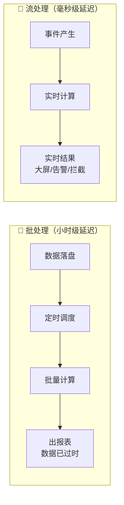

**流计算的核心思想**：把数据看作一条永不停止的"河流"，事件到达的瞬间就处理。Flink 正是这个领域的事实标准。

## 2. Flink 是什么？

[Apache Flink](https://flink.apache.org) 是一个**分布式流批一体计算引擎**。三个关键词：

| 关键词 | 含义 | 通俗解释 |
|:---|:---|:---|
| **分布式** | 作业跑在多台机器上 | 一台机器算不动，一百台一起算 |
| **流批一体** | 同一套 API 同时支持流与批 | 像水龙头：一直开着是"流"，接一桶水是"批" |
| **状态计算** | 计算过程可以"记住"历史 | 统计每个用户累计消费额，需要记住之前的结果 |

### 2.1 有界流 vs 无界流

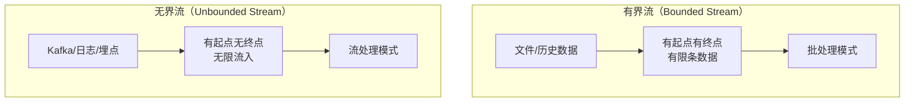

**同一个 Flink 作业**，读文件就是批处理，读 Kafka 就是流处理——这就是"流批一体"，也是 Flink 对 Spark（先有批后补流）的架构级优势。

### 2.2 Flink 集群长什么样

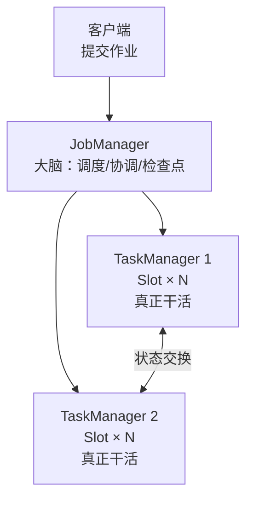

| 角色 | 职责 | 类比 |
|:---|:---|:---|
| **JobManager** | 作业调度、Checkpoint 协调、故障恢复 | 包工头：不搬砖，只派活、验收、记账 |
| **TaskManager** | 执行算子逻辑，管理 Slot 槽位 | 工人：真正搬砖干活 |
| **Slot** | TaskManager 的资源配额单位（默认可容纳同一作业的多条算子链） | 工位：一个工位可以同时安排几道工序的工人（⚠️ Slot ≠ 线程，详见第3章） |

> 本课程第1章会用 Docker 一键拉起这个集群，不用手动安装任何东西。

## 3. 核心术语图解：先混个脸熟

学习 Flink 的第一道门槛不是代码，而是**名词**。面试官、官方文档、Web UI 里到处都是 Event Time、Watermark、Checkpoint……如果你脑子里没有对应的"画面"，读什么都像天书。

这一节把这些术语**一网打尽**——每个术语给三样东西：**一句话定义、一个生活比喻、一张图**。现在只需要建立直觉，深入原理是后续章节的事。

### 3.0 术语全景表（可当速查手册）

| 术语 | 一句话定义 | 生活比喻 | 深入章节 |
|:---|:---|:---|:---|
| **DataStream** | Flink 中流动的数据抽象 | 传送带上的货物流 | [第3章](ch03.md) |
| **Source / Sink** | 数据的入口 / 出口 | 河流的源头 / 入海口 | [第3章](ch03.md) · [第10章](ch10.md) |
| **算子（Operator）** | 一个数据处理步骤 | 工厂流水线上的一个工位 | [第3章](ch03.md) |
| **并行度（Parallelism）** | 一个算子同时开几路 | 超市开几个收银窗口 | [第3章](ch03.md) |
| **SubTask** | 算子的一个并行实例 | 某个窗口的那位收银员 | [第3章](ch03.md) |
| **算子链（Operator Chain）** | 多个算子合并到一个线程执行 | 一个工人包干多道工序 | [第3章](ch03.md) |
| **事件时间 / 处理时间** | 业务发生的时间 / 机器收到的时间 | 快递的下单时间 / 签收时间 | [第4章](ch04.md) |
| **Watermark（水印）** | "这之前的数据都到齐了"的承诺 | 考试收卷的哨声 | [第4章](ch04.md) |
| **窗口（Window）** | 把无限流切成有限的段再统计 | 水渠上的分段闸门 | [第5章](ch05.md) |
| **状态（State）** | 算子记住的历史中间结果 | 收银员的记事本 | [第6章](ch06.md) |
| **状态后端（StateBackend）** | 状态存储在哪里 | 记事本放抽屉还是放仓库 | [第6章](ch06.md) |
| **Checkpoint（检查点）** | 全作业定期自动快照 | 全员定时定格合影 | [第7章](ch07.md) |
| **Savepoint（保存点）** | 手动触发的快照，用于升级迁移 | 手动摆拍的大合照 | [第7章](ch07.md) |
| **Exactly-Once** | 故障恢复后不多算、不漏算 | 转账不能重复扣款 | [第7章](ch07.md) |
| **反压（Backpressure）** | 下游慢了，上游自动减速 | 早高峰地铁限流 | [第14章](ch14.md) |

下面逐个展开。建议顺序阅读，因为后面的术语会用到前面的。

### 3.1 Source → 算子 → Sink：数据流的工厂流水线

**定义**：Flink 作业就是一条流水线——数据从 **Source**（源）流入，经过若干 **Transformation**（算子）加工，最终从 **Sink**（汇）流出。数据在流水线上流动的抽象就叫 **DataStream**。

**比喻**：想象一条生鱼片加工流水线——原料（活鱼）从进货口进来（Source），依次经过去鳞、切片、摆盘三道工序（算子），最后装车发货（Sink）。传送带上流的鱼（DataStream）就是数据本身。

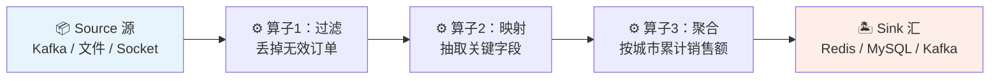

**关键认知**：Flink 作业代码的本质，就是声明这条流水线有哪几道工序。比如：

```java
// 伪代码：先看懂"流水线"结构，具体 API 从第3章开始学
env.addSource(...)                       // Source：进货口
   .filter(order -> order.isValid())     // 算子：挑出有效订单
   .keyBy(order -> order.getCity())      // 算子：按城市分组
   .window(...)                          // 算子：按分钟切段
   .aggregate(...)                       // 算子：算销售额
   .sinkTo(...)                          // Sink：发货口
```

?> **深入**：Source 的种类与容错 → [第3章](ch03.md)；Kafka/JDBC/Redis 连接器实战 → [第10章](ch10.md)。

### 3.2 并行度与 SubTask：流水线开几条

**定义**：一个算子可以同时开多路并行执行，开的路数叫**并行度（Parallelism）**；其中的一路（算子的一个实例）叫 **SubTask（子任务）**。

**比喻**：超市结账区只有一个"结账"工序，但可以同时开 3 个收银窗口（并行度=3），每个窗口一位收银员（SubTask），顾客被分流到不同窗口。窗口开得越多，整体吞吐越高——但受限于超市面积（集群资源）。

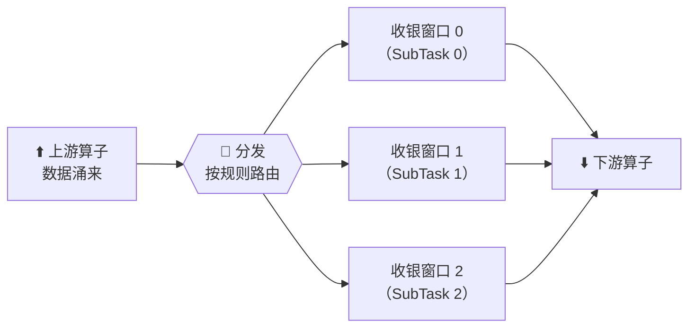

**为什么重要**：并行度是 Flink 调优的第一个旋钮。并行度太低 → 数据处理不过来；太高 → 浪费资源甚至适得其反。**同一个作业里不同算子可以有不同并行度**（比如读 Kafka 3 个分区用并行度 3，汇总结果写库用并行度 1）。

?> **深入**：并行度设置的 4 个层级与优先级 → [第3章 3.5 节](ch03.md)；数据怎么路由到各个 SubTask（8 种物理分区策略）→ [第3章 3.3 节](ch03.md)。

### 3.3 事件时间 vs 处理时间：下单时间与签收时间

这是 Flink **最重要也最反直觉**的一对概念，请务必看完。

**定义**：

- **事件时间（Event Time）**：事件在业务上真实发生的时刻（数据自带的字段，如订单的"下单时间"）；
- **处理时间（Processing Time）**：Flink 机器**收到**这条数据的时刻（看机器的钟）。

**比喻**：快递包裹上贴的**发货时间**是事件时间，你家门口的**签收时间**是处理时间。双十一爆仓时，10 号发货的包裹可能 11 号才到、9 号发货的反而 12 号才到——**到达顺序 ≠ 发生顺序**。而业务方关心的是"哪天卖出去的"（事件时间），不是"哪天送到的"（处理时间）。

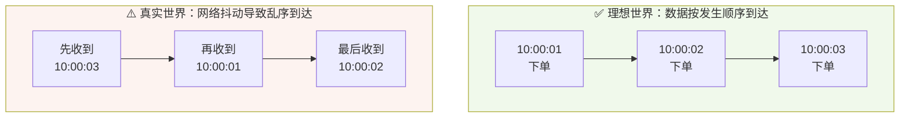

**为什么重要**：如果按处理时间统计"10:00～10:01 的订单量"，一条 10:00:05 下单、10:01:30 才到的数据会被错误地算进下一分钟——**结果对不上账**。按事件时间算才准，但乱序问题必须解决——于是有了下一个术语：Watermark。

?> **深入**：三种时间语义详解 → [第4章 4.1 节](ch04.md)。

### 3.4 Watermark 水印：考试收卷的哨声

**定义**：Watermark 是一个特殊的时间戳，含义是"**事件时间早于它的数据，（基本）都到齐了**"。它是 Flink 解决乱序问题的核心机制。

**比喻**：考试收卷。学生交卷有先有后（数据乱序到达），但老师不会无限期等——**哨声一响（Watermark 推进到 T），就默认 T 之前交的卷都齐了，开始批改**（触发窗口计算）。至于哨响之后才交的卷（迟到数据），另有补交机制单独处理。

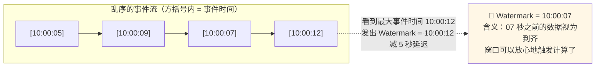

上图的"减 5 秒"就是**允许乱序的等待时长**——等得越久，结果越准，但实时性越差。这是一个业务权衡，没有标准答案：财报可以等 10 秒，欺诈拦截可能只等 1 秒。

?> **深入**：Watermark 生成与传播原理、交互式实验 → [第4章 4.3～4.5 节](ch04.md)；迟到数据的两级兜底 → [第4章 4.6 节](ch04.md)。

### 3.5 窗口 Window：把无限的流切成有限的段

**定义**：无界流永远算不完，**窗口**就是把流按时间切成一段一段，每段攒够一批、触发一次计算、输出一次结果。

**比喻**：一条水渠没法"统计整条渠的水量"（永远在流），于是每隔 100 米修一道闸门，**分段计量**。滚动窗口 = 闸门首尾相接不重叠；滑动窗口 = 闸门每 30 秒挪 100 米（同一段水会被计多次）；会话窗口 = 水来了计时、断流超时就合上一段。

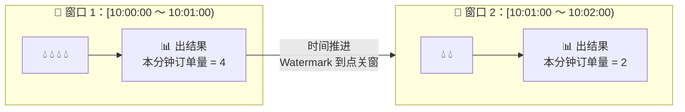

**什么时候触发计算**？就是上一节的 Watermark 推过窗口结束时刻的那一刻——**Watermark 和窗口是一对搭档**：窗口负责"切"，Watermark 负责"喊停"。

?> **深入**：滚动/滑动/会话/全局四种窗口选型 → [第5章 5.2 节](ch05.md)。

### 3.6 状态 State：算子的记事本

**定义**：**状态**是算子在内存（或磁盘）中记住的中间结果。所有"累计、去重、识别连续行为"类计算都离不开它。

**比喻**：超市收银员脑子里记着"这位顾客今天买了 3 件商品、满 100 减 20 还差 40 元"——这个"记忆"就是状态。没有记事本，每来一件新商品，你都算不出"今天累计多少钱"。

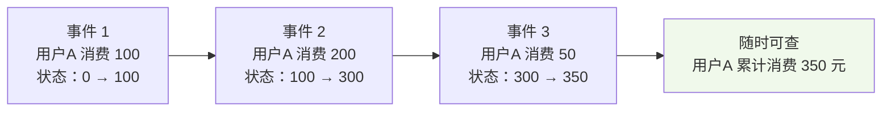

**两个关键细节**（现在留个印象即可）：

1. 状态是**按 key 隔离**的——用户A 和用户B 的记事本互不干扰，这正是 `keyBy()` 的意义；
2. 状态存在哪里由**状态后端（StateBackend）**决定——量小放内存（HashMapStateBackend，抽屉），量大放磁盘 RocksDB（EmbeddedRocksDBStateBackend，仓库）。

?> **深入**：Keyed State 五种类型、状态 TTL、状态后端选型 → [第6章](ch06.md)。

### 3.7 Checkpoint 与 Savepoint：给作业拍快照

**定义**：**Checkpoint** 是 Flink 定期自动给全作业拍的状态快照（所有算子的状态 + 数据流位置），故障后从最近一次快照恢复，不丢数据。**Savepoint** 是手动触发的快照，用于升级代码、调整并行度、迁移集群。

**比喻**：Checkpoint = 班级春游时老师**每半小时清点人数拍一张合影**（自动、定期，走丢了从合影时刻找回）；Savepoint = 毕业时**全班专门摆拍一张大合照**（手动、庄重，用于"换教室"这种大动作）。

快照怎么做到"同一时刻"冻结所有算子？靠 **Barrier（屏障）**——JobManager 定期向数据流里插入一个特殊标记，像一颗随水漂流的"染色弹"：

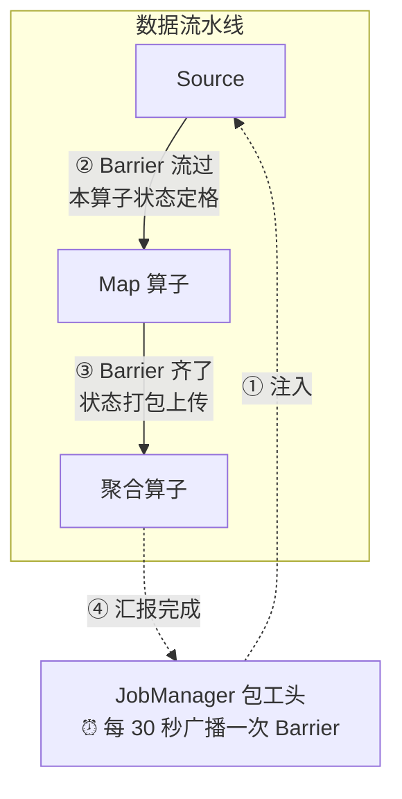

**为什么重要**：没有 Checkpoint，一个 TaskManager 宕机 = 作业从零开始、状态全丢、数据重复计算。有了它，Flink 才敢号称"7×24 小时不停机"。

?> **深入**：Barrier 对齐、非对齐快照、生产配置模板 → [第7章 7.2～7.3 节](ch07.md)；Savepoint 的完整工作流 → [第7章 7.4 节](ch07.md)。

### 3.8 Exactly-Once：不多算、不漏算

**定义**：**精确一次（Exactly-Once）语义**指：即使发生故障、作业恢复，最终效果也如同每条数据**恰好被处理一次**——不多、不少。

**比喻**：银行转账。系统崩了重启后，宁可这笔转账暂时没执行（可以重试），**绝不能重复扣两次款**。"至少一次"（At-Least-Once）像"宁可重复扣款不能漏扣"，"至多一次"（At-Most-Once）像"宁可漏扣不能重复"——只有 Exactly-Once 两头都保证。

| 语义 | 故障后效果 | 比喻 | 典型场景 |
|:---|:---|:---|:---|
| At-Most-Once | 可能丢数据 | 漏扣款 | 日志、监控（丢了无所谓）|
| At-Least-Once | 可能重复 | 重复扣款 | UV 统计可去重容忍 |
| **Exactly-Once** | 不丢不重 | 恰好扣一次 | **转账、计费、风控** |

**注意**：Exactly-Once 不是免费的——它依赖 Checkpoint + Source 可重放（如 Kafka）+ Sink 事务支持，三者缺一不可（[第7章 7.5 节](ch07.md)会讲"三个前提"）。

### 3.9 反压 Backpressure：天然减速带

**定义**：当下游算子处理不过来时，压力会像水流倒灌一样**沿流水线向上游传导**，让上游自动减速——这个机制叫**反压**。

**比喻**：早高峰的地铁站。站台上人满为患（下游算子的缓冲区堆满），工作人员在入口拉起铁马限流放人（下游向上游传导压力），站外乘客排队放缓（上游 Source 自动降速）。**反压不是故障，而是 Flink 的自我保护**——它让系统"变慢"而不是"崩溃丢数据"。

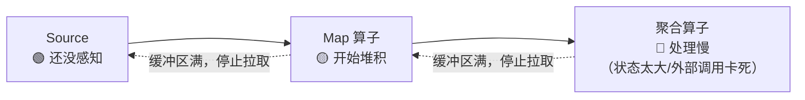

**但要看医生**：短期反压是正常的流量高峰；**长期反压**说明作业有病——通常是数据倾斜、外部服务慢、或者并行度配小了。Web UI 顶部有专门的 Backpressure 标签页可以定位"堵在哪一环"。

?> **深入**：反压定位与治理 SOP → [第14章 14.2 节](ch14.md)。

### 3.10 术语之间的关系：一张全景图

把这一节的术语串成一条真实的作业，它们的关系如下——**这张图值得反复回看**：

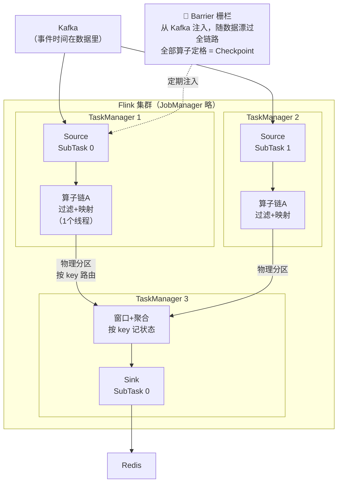

对照全景表读一遍这条链路：

1. 数据从 **Kafka（Source）** 流入，每条数据自带**事件时间**；
2. 过滤 + 映射被合并成**算子链**，在同一个线程里跑（省去线程间传输）；
3. **物理分区**决定数据流向哪个 SubTask（按 key 哈希等）；
4. **Watermark** 随数据一起流动，推过窗口终点时触发**窗口**计算；
5. 窗口聚合依赖**状态**（每个 key 一本记事本）；
6. 结果写入 **Redis（Sink）**；**Barrier** 周期性流过全链路，形成 **Checkpoint**，保障 **Exactly-Once**；
7. 任何一环变慢，**反压**自动向上传导。

> 至此，Flink 的核心黑话你已全部见过。**不求完全记住，只求再次见到时有画面感**。后面每章开篇都会回收这些概念。

## 4. Flink 在大数据版图中的位置

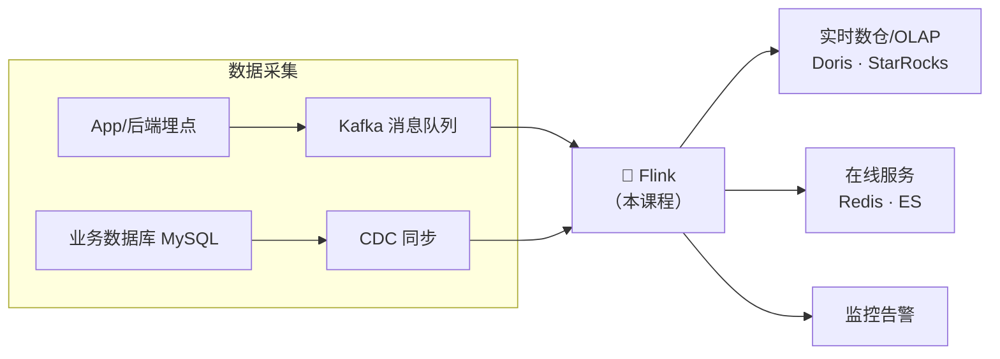

国内主流实时链路：**埋点/日志 → Kafka → Flink → OLAP（Doris/StarRocks）/ Redis / ES**。Flink 是这条链路的"CPU"。

### 为什么不是 Spark Streaming？

| 维度 | Flink | Spark Streaming |
|:---|:---|:---|
| 处理模型 | 逐条事件（真流式） | 微批次（Micro-Batch） |
| 时间语义 | 事件时间原生支持 | 事件时间支持较晚 |
| 状态 | 原生状态 + RocksDB | 借助 RDD 容错 |
| 延迟 | 毫秒级 | 秒级 |
| 生态定位 | 实时计算事实标准 | 离线计算为主，流处理为辅 |

?> **一句话**：离线用 Spark/Hive，实时用 Flink——这是当前工业界的共识分工。

## 5. 前置知识自查清单

开始前请逐项确认，达不到的先花半天补齐（都有免费资源）：

| # | 技能 | 要求程度 | 自测方法 | 不达标怎么办 |
|:-:|:---|:---|:---|:---|
| 1 | Java 基础 | 集合、泛型、Lambda、异常 | 能看懂 `list.stream().filter(x -> x > 0).collect(toList())` | B站任意 Java8 新特性视频 |
| 2 | Maven | 会 `mvn compile`、看懂 pom | 知道 `<dependency>` 的作用 | Maven 官方 5 分钟教程 |
| 3 | SQL | `GROUP BY`、`JOIN` | 能手写"每个城市的订单总额" | 牛客 SQL 快速过一遍 |
| 4 | Linux 命令 | `cd`/`tail`/`grep` | 能在终端自由行动 | 无需专门学，用到再查 |
| 5 | Docker | 会 `docker compose up` | 装好 Docker Desktop 即可 | 本课程第1章手把手教 |

!> **不需要**的：Hadoop/Spark 经验、Kafka 运维经验、Scala 语言。课程涉及时会即时讲解。

## 6. 课程地图与学习节奏


**三条学习建议（重要）：**

1. **核心篇（3～7章）是地基，慢就是快**。时间/窗口/状态是 Flink 面试与生产问题的 90% 来源——恰好就是本章第 3 节那批术语，每个示例都亲手运行并改参数观察行为；
2. **不要跳过练习题**。每章的"动手练习"都是模拟真实工作需求设计的；
3. **实战篇选一个深做**。第11/12/13章对应数据/风控/物联网三个方向，面试时"深挖一个项目"远胜"浅尝三个"。

## 7. 本课程约定

| 约定 | 说明 |
|:---|:---|
| 版本 | Flink **1.20.1** / Java **11** / Kafka 3.7（KRaft）|
| 代码位置 | `code/src/main/java/com/flinkcourse/chXX/` |
| 运行方式 | 优先 IDE 直接运行 main（零依赖场景），需要外部组件时明确标注 |
| 图表 | 全部 Mermaid 绘制，源码在文档中可直接修改 |

---

## 本章小结

- 流计算解决"数据一产生就要算"的场景，延迟毫秒级；
- Flink = 分布式 + 流批一体 + 状态计算，是实时计算事实标准；
- 集群三角色：**JobManager**（包工头）→ **TaskManager**（工人）→ **Slot**（工位）；
- 核心术语的直觉画面：
  - 数据走 **Source → 算子 → Sink** 的流水线，并行度决定开几条线；
  - **事件时间**看业务发生时刻，**Watermark** 宣布"之前的数据到齐了"；
  - **窗口**把无限流切段，**状态**是算子的记事本；
  - **Checkpoint**（自动合影）/ **Savepoint**（手动摆拍）保障故障恢复，成就是 **Exactly-Once**；
  - **反压**是下游变慢向上游传导的自动减速，是保护不是故障；
- 前置知识：Java Lambda、Maven、基础 SQL，**不需要大数据经验**。

## ✍️ 动手练习

1. 思考题：列出你所在业务（或熟悉的产品）中 3 个"必须实时、批处理做不到"的场景；
2. 思考题：**有界流**和**无界流**各举两个数据源例子；
3. 费曼检验：**不看文档**，用自己的话向同事（或对着空气）解释 Watermark 和 Checkpoint——卡壳的地方就是你需要重读 3.4 / 3.7 节的地方；
4. 预习动作：确认本机已安装 JDK 11 与 Docker，为第1章做准备。

---

<div class="chapter-nav">

[⬅️ 返回主页](/)
[➡️ 第1章 · 环境搭建](ch01.md)

</div>
