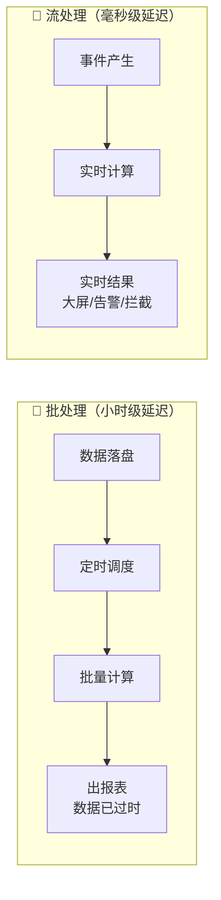
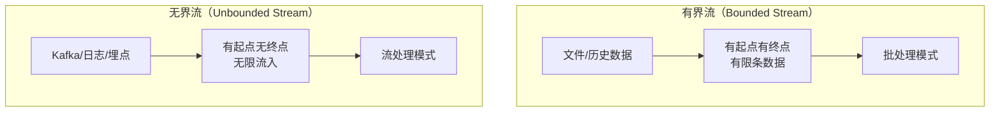
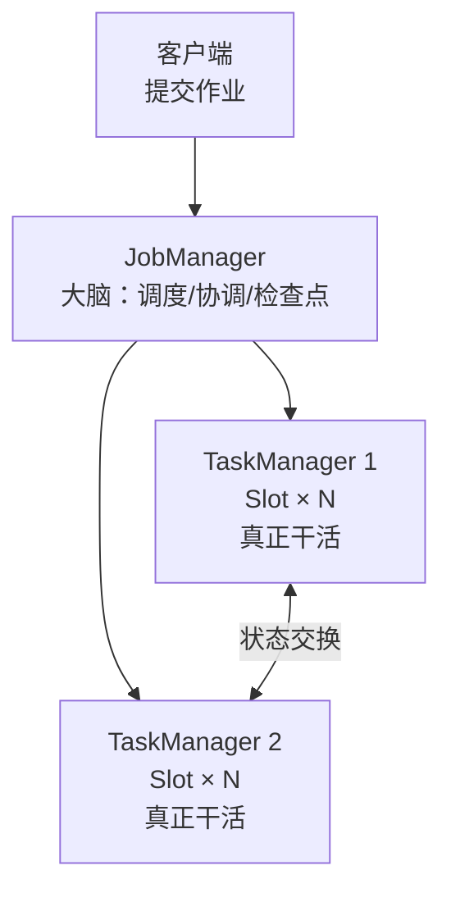
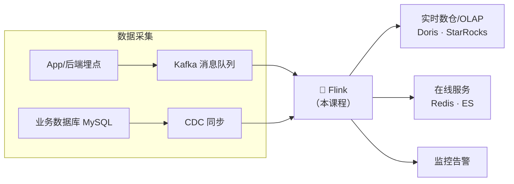

# 第0章 · 课程导读

 

> **本章目标**：建立流计算思维，理解 Flink 在大数据技术版图中的位置，确认自己的前置知识是否达标，并制定学习计划。

---

## 1. 一个例子看懂：为什么需要流计算？

想象你是某电商平台的工程师，双11 当晚，老板要求：

| 需求 | 技术挑战 |
|:---|:---|
| 大屏每 **1 分钟**刷新一次全国 GMV | 数据要"边到边算"，不能等 |
| 用户下单后 **10 秒内**识别欺诈交易并拦截 | 计算延迟必须秒级 |
| 某工厂设备温度异常，**立即**告警 | 事件发生的那一刻就要处理 |

传统方案是**批处理**：数据先落盘（HDFS/数据库），每小时跑一次离线任务。结果就是——**报表永远是过去式，欺诈分子早已提现跑路**。

**流计算的核心思想**：把数据看作一条永不停止的"河流"，事件到达的瞬间就处理。Flink 正是这个领域的事实标准。

## 2. Flink 是什么？

[Apache Flink](https://flink.apache.org) 是一个**分布式流批一体计算引擎**。三个关键词：

| 关键词 | 含义 | 通俗解释 |
|:---|:---|:---|
| **分布式** | 作业跑在多台机器上 | 一台机器算不动，一百台一起算 |
| **流批一体** | 同一套 API 同时支持流与批 | 像水龙头：一直开着是"流"，接一桶水是"批" |
| **状态计算** | 计算过程可以"记住"历史 | 统计每个用户累计消费额，需要记住之前的结果 |

### 2.1 有界流 vs 无界流

**同一个 Flink 作业**，读文件就是批处理，读 Kafka 就是流处理——这就是"流批一体"，也是 Flink 对 Spark（先有批后补流）的架构级优势。

### 2.2 Flink 集群长什么样

| 角色 | 职责 | 类比 |
|:---|:---|:---|
| **JobManager** | 作业调度、Checkpoint 协调、故障恢复 | 包工头 |
| **TaskManager** | 执行算子逻辑，管理 Slot 槽位 | 工人 |
| **Slot** | TaskManager 中的资源单位（一个作业的算子链跑在 Slot 里） | 工位 |

> 本课程第1章会用 Docker 一键拉起这个集群，不用手动安装任何东西。

## 3. Flink 在大数据版图中的位置

国内主流实时链路：**埋点/日志 → Kafka → Flink → OLAP（Doris/StarRocks）/ Redis / ES**。Flink 是这条链路的"CPU"。

### 为什么不是 Spark Streaming？

| 维度 | Flink | Spark Streaming |
|:---|:---|:---|
| 处理模型 | 逐条事件（真流式） | 微批次（Micro-Batch） |
| 时间语义 | 事件时间原生支持 | 事件时间支持较晚 |
| 状态 | 原生状态 + RocksDB | 借助 RDD 容错 |
| 延迟 | 毫秒级 | 秒级 |
| 生态定位 | 实时计算事实标准 | 离线计算为主，流处理为辅 |

?> **一句话**：离线用 Spark/Hive，实时用 Flink——这是当前工业界的共识分工。

## 4. 前置知识自查清单

开始前请逐项确认，达不到的先花半天补齐（都有免费资源）：

| # | 技能 | 要求程度 | 自测方法 | 不达标怎么办 |
|:-:|:---|:---|:---|:---|
| 1 | Java 基础 | 集合、泛型、Lambda、异常 | 能看懂 `list.stream().filter(x -> x > 0).collect(toList())` | B站任意 Java8 新特性视频 |
| 2 | Maven | 会 `mvn compile`、看懂 pom | 知道 `<dependency>` 的作用 | Maven 官方 5 分钟教程 |
| 3 | SQL | `GROUP BY`、`JOIN` | 能手写"每个城市的订单总额" | 牛客 SQL 快速过一遍 |
| 4 | Linux 命令 | `cd`/`tail`/`grep` | 能在终端自由行动 | 无需专门学，用到再查 |
| 5 | Docker | 会 `docker compose up` | 装好 Docker Desktop 即可 | 本课程第1章手把手教 |

!> **不需要**的：Hadoop/Spark 经验、Kafka 运维经验、Scala 语言。课程涉及时会即时讲解。

## 5. 课程地图与学习节奏

**三条学习建议（重要）：**

1. **核心篇（3~7章）是地基，慢就是快**。时间/窗口/状态是 Flink 面试与生产问题的 90% 来源，每个示例都亲手运行并改参数观察行为；
2. **不要跳过练习题**。每章的"动手练习"都是模拟真实工作需求设计的；
3. **实战篇选一个深做**。第11/12/13章对应数据/风控/物联网三个方向，面试时"深挖一个项目"远胜"浅尝三个"。

## 6. 本课程约定

| 约定 | 说明 |
|:---|:---|
| 版本 | Flink **1.20.1** / Java **11** / Kafka 3.7（KRaft）|
| 代码位置 | `code/src/main/java/com/flinkcourse/chXX/` |
| 运行方式 | 优先 IDE 直接运行 main（零依赖场景），需要外部组件时明确标注 |
| 图表 | 全部 Mermaid 绘制，源码在文档中可直接修改 |

---

## 本章小结

- 流计算解决"数据一产生就要算"的场景，延迟毫秒级；
- Flink = 分布式 + 流批一体 + 状态计算，是实时计算事实标准；
- 集群由 JobManager（调度）与 TaskManager（执行）组成；
- 前置知识：Java Lambda、Maven、基础 SQL，**不需要大数据经验**。

## ✍️ 动手练习

1. 思考题：列出你所在业务（或熟悉的产品）中 3 个"必须实时、批处理做不到"的场景；
2. 思考题：**有界流**和**无界流**各举两个数据源例子；
3. 预习动作：确认本机已安装 JDK 11 与 Docker，为第1章做准备。

---

[⬅️ 返回主页](/)
[➡️ 第1章 · 环境搭建](ch01.md)

