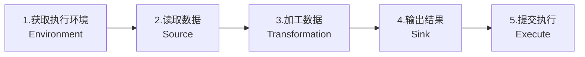
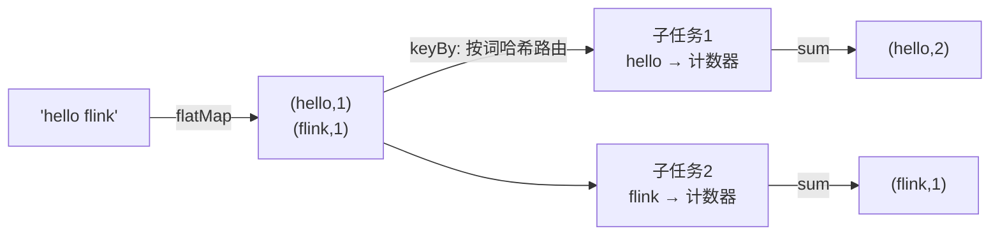
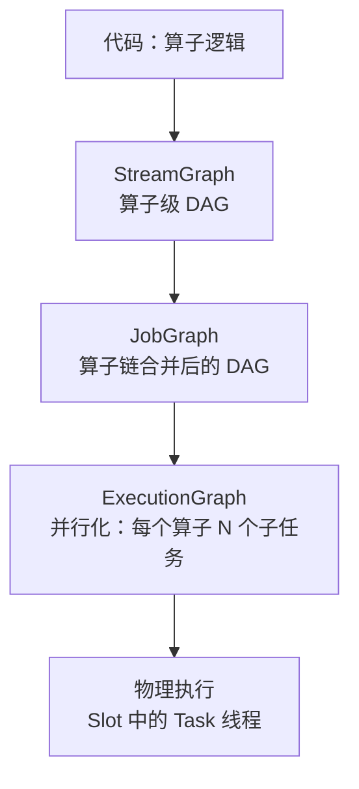

# 第2章 · 流批一体初体验

 

> **本章目标**：通过经典的 WordCount，掌握 Flink 作业的**骨架结构**（Environment → Source → Transformation → Sink → Execute），亲眼见证同一个引擎处理**无界流**与**有界数据**。

**业务场景**：舆情系统每天需要统计热词。离线场景：统计昨天日志文件里的词频（有界）；实时场景：统计正在直播的弹幕热词（无界）。

---

## 2.1 Flink 作业的骨架

任何 Flink 程序都是同一个套路：



对应到代码就是五行：

```java
StreamExecutionEnvironment env = StreamExecutionEnvironment.getExecutionEnvironment(); // ① 环境
DataStream<String> lines = env.socketTextStream("localhost", 9999);                    // ② 数据源
DataStream<Tuple2<String, Integer>> counts = lines
        .flatMap(new Tokenizer())          // ③ 拆词
        .keyBy(value -> value.f0)          // ③ 按词分组
        .sum(1);                           // ③ 累加计数
counts.print();                             // ④ 输出
env.execute("Stream WordCount");            // ⑤ 触发执行（必须！）
```

!> **新手第一大坑**：忘记调用 `env.execute()`。前四步只是"画流程图"，第五步才真正把作业交给集群执行。没有它，程序直接结束且**没有任何报错**。

## 2.2 实战一：无界流词频统计（实时弹幕热词）

完整代码：`code/src/main/java/com/flinkcourse/ch02/StreamWordCount.java`

```java
package com.flinkcourse.ch02;

import org.apache.flink.api.common.functions.FlatMapFunction;
import org.apache.flink.api.java.tuple.Tuple2;
import org.apache.flink.streaming.api.datastream.DataStream;
import org.apache.flink.streaming.api.environment.StreamExecutionEnvironment;
import org.apache.flink.util.Collector;

/**
 * 场景：实时弹幕热词统计（无界流）
 * 运行：先 nc -lk 9999，再运行本类 main
 */
public class StreamWordCount {

    public static void main(String[] args) throws Exception {
        // 1. 获取执行环境
        StreamExecutionEnvironment env = StreamExecutionEnvironment.getExecutionEnvironment();

        // 2. Socket 数据源（无界流：永远不知道下一条什么时候来）
        DataStream<String> lines = env.socketTextStream("localhost", 9999);

        // 3. 拆词 → 分组 → 计数
        DataStream<Tuple2<String, Integer>> counts = lines
                .flatMap(new Tokenizer())       // "hello world" → (hello,1) (world,1)
                .keyBy(value -> value.f0)       // 按单词分组
                .sum(1);                        // 对第2个字段求和

        // 4. 输出到控制台
        counts.print();

        // 5. 触发执行
        env.execute("Stream WordCount");
    }

    /** 把一行文本拆成 (单词, 1) */
    public static final class Tokenizer
            implements FlatMapFunction<String, Tuple2<String, Integer>> {
        @Override
        public void flatMap(String value, Collector<Tuple2<String, Integer>> out) {
            for (String word : value.toLowerCase().split("\\W+")) {
                if (!word.isEmpty()) {
                    out.collect(Tuple2.of(word, 1));
                }
            }
        }
    }
}
```

### 运行并观察

```bash
nc -lk 9999
mvn exec:exec -Dexec.mainClass="com.flinkcourse.ch02.StreamWordCount"
```

输入 `hello flink` 后再输入 `hello world`：

```
3> (hello,1)
4> (flink,1)
3> (hello,2)      ← 注意！累计值变成了 2
2> (world,1)
```

**两个关键观察**：

1. **状态在积累**：`hello` 第二次出现时输出的是 `2` 而不是 `1`——Flink 在内存里"记住"了每个词的计数，这就是**状态计算**，第6章深入；
2. **前缀数字**：`3>`、`4>` 是并行子任务编号。同一个词永远由同一个子任务处理（keyBy 的哈希路由），否则无法累计。

## 2.3 实战二：有界数据词频统计（昨日日志热词）

把 Socket 换成有限集合，其余代码**一个字不改**，就从流处理变成了批处理：

完整代码：`code/src/main/java/com/flinkcourse/ch02/BoundedWordCount.java`

```java
public class BoundedWordCount {
    public static void main(String[] args) throws Exception {
        StreamExecutionEnvironment env = StreamExecutionEnvironment.getExecutionEnvironment();

        // 有界数据：元素个数有限，读完全部数据后作业自动结束
        DataStream<String> lines = env.fromElements(
                "flink spark flink",
                "kafka flink redis",
                "flink kafka hive flink"
        );

        lines.flatMap(new StreamWordCount.Tokenizer())
             .keyBy(value -> value.f0)
             .sum(1)
             .print();

        env.execute("Bounded WordCount");
    }
}
```

输出（一次算完，程序自动退出）：

```
flink, 5
kafka, 2
spark, 1
redis, 1
hive, 1
```

?> **流批一体的本质**：Flink 用"流"作为一等公民，"批"只是**有界流**的特例。对比之下，Spark 的批是本命、流靠微批次模拟。这一架构差异是 Flink 在实时场景延迟毫秒级的根本原因。

## 2.4 理解 Transformation：算子从哪来、到哪去

本章用到 3 个最基础的算子，先建立直觉：

| 算子 | 输入 → 输出 | 作用 | SQL 类比 |
|:---|:---|:---|:---|
| `flatMap` | 1 条 → N 条 | 拆分/展开（也可 1→0 过滤） | 无（类似 UDTF） |
| `keyBy` | 逻辑分组 | 相同 key 的数据路由到同一子任务 | `GROUP BY` |
| `sum` | 聚合 | 分组内累加 | `SUM()` |

数据流视角：



## 2.5 常见坑

**坑1：`env.execute()` 忘写** → 程序秒退无报错。记住：**没有 execute，一切白搭**。

**坑2：Lambda 序列化报错**（`Lambda serialization error`）→ IDE 运行一般没问题；提交集群时报错时，把 Lambda 换成显式的匿名内部类（如上面的 `Tokenizer`），或保证类可序列化。课程代码统一用匿名内部类规避此坑。

**坑3：`nc` 与 `socketTextStream` 顺序** → 必须先启动 `nc -lk 9999`。Flink 连不上会直接抛 `ConnectException`。

**坑4：Windows 没有 nc** → 用 WSL，或 PowerShell：`while($true){...}` 方案不优雅，推荐 WSL2 跑课程环境。

## 2.6 算子执行图：从代码到集群

了解一下即可，第3章详细展开：



## ✍️ 动手练习

1. **改造 BoundedWordCount**：只统计长度 ≥ 5 的单词（提示：`flatMap` 里跳过短词）；
2. **观察 keyBy 路由**：在 `StreamWordCount` 里连续输入同一单词 5 次，确认输出前缀编号相同；再输入不同单词，观察编号是否可能不同；
3. **思考题**：把 `keyBy(...).sum(1)` 换成不分组直接 `map` 累加，为什么得不到正确词频？（答案在第3章分区策略）

---

## 本章小结

- Flink 作业骨架五步：**环境 → 数据源 → 转换 → 输出 → execute**；
- `socketTextStream` = 无界流，`fromElements/fromCollection` = 有界流（批）；
- 同一套 API 处理流与批 = **流批一体**；
- `keyBy` 按哈希把相同 key 路由到同一子任务，是状态累计的前提；
- 状态（`hello,2`）在作业内存中持续累积，这是后续状态管理的雏形。

---

<div class="chapter-nav">

[⬅️ 第1章 · 环境搭建](ch01.md)
[➡️ 第3章 · DataStream API](ch03.md)

</div>
