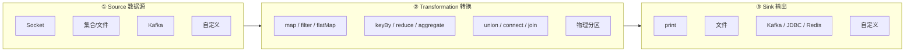
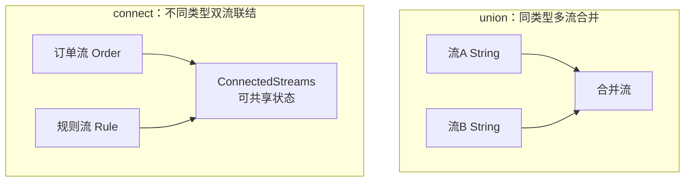
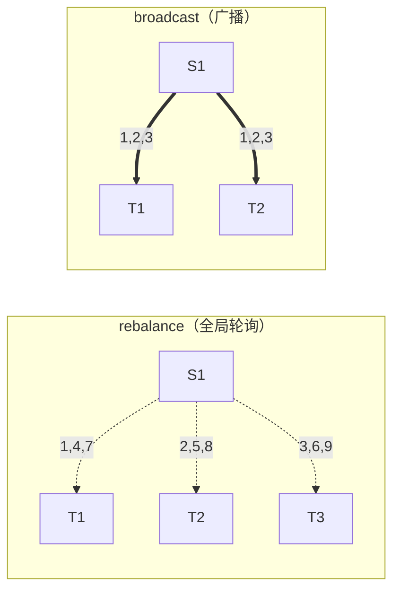
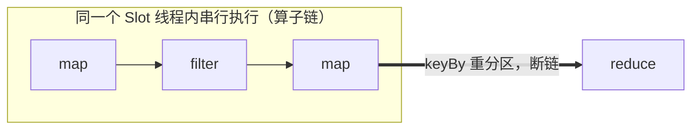

# 第3章 · DataStream API 核心

 

> **本章目标**：掌握 DataStream API 三大件——**Source（数据从哪来）**、**Transformation（怎么加工）**、**Sink（结果到哪去）**，理解并行度与数据分区策略，为后续所有章节打地基。

**业务场景**：电商平台的后端埋点日志质量参差——有脏数据、有重复格式。数据团队需要一条清洗管道：**过滤无效订单 → 统一格式 → 按用户累计消费额**，输出给下游实时数仓。

---

## 3.1 数据流编程模型总览



## 3.2 Source：数据从哪来

### 内置 Source 速查

| Source | 有界? | 典型用途 | 章节 |
|:---|:---:|:---|:---:|
| `env.fromElements(...)` / `fromCollection` | ✅ | 教学演示、测试数据 | 本课大量使用 |
| `env.fromSequence(1, 100)` | ✅ | 生成序列 | 测试 |
| `env.socketTextStream(host, port)` | ❌ | 教学演示、快速调试 | 本课大量使用 |
| `env.fromSource(FileSource, ...)` | ✅ | 读文件/目录 | 批处理 |
| `KafkaSource.builder()...build()` | ❌ | **生产 90% 的选择** | 第10/11章 |
| 自定义 `SourceFunction` | — | 遗留 API，新项目避免 | 不展开 |

?> **选型直觉**：学习和调试用 Socket/集合；一进生产，Source 几乎必然是 Kafka。

### 生产标配：Kafka Source（先混个脸熟）

```java
KafkaSource<String> source = KafkaSource.<String>builder()
        .setBootstrapServers("localhost:9092")
        .setTopics("orders")
        .setGroupId("order-clean")
        .setStartingOffsets(OffsetsInitializer.earliest())   // 无消费记录时从头读
        .setValueOnlyDeserializer(new SimpleStringSchema())  // 只取 value，不要 key
        .build();

DataStream<String> raw = env.fromSource(
        source,
        WatermarkStrategy.noWatermarks(),  // 第4章讲为什么要 Watermark
        "kafka-orders");
```

细讲放第10章，本章知道"长这样"即可。

## 3.3 Transformation：怎么加工

### 单条级算子（不分组）

| 算子 | 输入→输出 | 订单场景示例 |
|:---|:---|:---|
| `map` | 1 → 1 | JSON 字符串 → Order 对象 |
| `filter` | 1 → 0或1 | 丢弃金额 ≤ 0 的脏数据 |
| `flatMap` | 1 → N | 一行日志拆出多个事件 |

```java
DataStream<Order> orders = raw
        .map(JsonUtil::toOrder)                    // 字符串 → POJO
        .filter(o -> o.getAmount() > 0)            // 过滤脏数据
        .filter(o -> o.getStatus() == Order.PAID); // 只留已支付
```

### 分组聚合算子

| 算子 | 说明 |
|:---|:---|
| `keyBy` | 逻辑分组（≠物理分组！只是按 key 哈希路由） |
| `reduce` | 分组内滚动聚合：`(acc, 新数据) → 新acc` |
| `sum/max/min/maxBy/minBy` | reduce 的语法糖 |

```java
// 每个用户的累计消费额（滚动更新）
orders
    .keyBy(Order::getUserId)
    .reduce((acc, o) -> Order.copyOf(acc, acc.getAmount() + o.getAmount()))
    .print();
```

**reduce 的直觉**：每个 key 维护一个"账本"（状态），来一条就记一笔，输出最新余额。

### 多流算子（先知道，实战篇用）



| 算子 | 要求 | 典型场景 |
|:---|:---|:---|
| `union` | 类型必须相同 | 多个机房日志合并 |
| `connect` + `CoProcessFunction` | 类型可不同 | 订单流关联规则流（第12章实战） |

### 物理分区：数据怎么路由到并行子任务

这是理解 Flink 数据流转的关键，也是面试高频题：

| 策略 | 行为 | 何时发生 |
|:---|:---|:---|
| **forward** | 1对1顺序发 | 相邻算子并行度相同时 |
| **hash（keyBy）** | 按 key 哈希 | 调用 `keyBy()` |
| **rebalance** | 轮询分发到所有子任务 | 数据倾斜时重分布 |
| **rescale** | 轮询分发到**本机/部分**子任务 | 局部均衡，省网络 |
| **broadcast** | 广播到**所有**子任务 | 小维度表下发（第10章维表 Join） |
| **global** | 全部发给 1 号子任务 | 极少用，慎用（强制单点） |
| **shuffle** | 随机分发 | 测试用 |



## 3.4 实战：订单清洗管道

完整代码：`code/src/main/java/com/flinkcourse/ch03/OrderCleanJob.java`

```java
package com.flinkcourse.ch03;

import com.flinkcourse.common.model.Order;
import com.flinkcourse.common.util.JsonUtil;
import org.apache.flink.api.common.eventtime.WatermarkStrategy;
import org.apache.flink.api.common.serialization.SimpleStringSchema;
import org.apache.flink.connector.kafka.source.KafkaSource;
import org.apache.flink.connector.kafka.source.enumerator.initializer.OffsetsInitializer;
import org.apache.flink.streaming.api.datastream.DataStream;
import org.apache.flink.streaming.api.environment.StreamExecutionEnvironment;

/**
 * 场景：订单清洗管道（第3章主示例）
 *   Kafka 原始日志 → 解析 → 去脏 → 统一 POJO → 按用户累计消费
 *
 * 两种运行模式：
 *   1. IDEA 直接运行 —— 使用内置测试数据（无需任何外部组件）
 *   2. args[0] == "kafka" —— 从 Kafka topic "ods_orders" 读取（需 docker compose 环境）
 */
public class OrderCleanJob {

    public static void main(String[] args) throws Exception {
        StreamExecutionEnvironment env = StreamExecutionEnvironment.getExecutionEnvironment();

        DataStream<String> raw = (args.length > 0 && "kafka".equals(args[0]))
                ? env.fromSource(buildKafkaSource(), WatermarkStrategy.noWatermarks(), "orders")
                : demoSource(env);

        raw.map(JsonUtil::toOrder)                         // ① 反序列化
           .filter(o -> o != null && o.getAmount() > 0)    // ② 去脏数据
           .filter(o -> o.getStatus() == Order.STATUS_PAID)// ③ 只看已支付
           .map(o -> {                                     // ④ 脱敏：手机号打码
               o.setPhone(o.getPhone().replaceAll("(\\d{3})\\d{4}(\\d{4})", "$1****$2"));
               return o;
           })
           .keyBy(Order::getUserId)                        // ⑤ 按用户分组
           .reduce((acc, o) -> {                           // ⑥ 累计消费额
               acc.setAmount(acc.getAmount() + o.getAmount());
               return acc;
           })
           .print();

        env.execute("Order Clean Job");
    }

    private static KafkaSource<String> buildKafkaSource() {
        return KafkaSource.<String>builder()
                .setBootstrapServers("localhost:9092")
                .setTopics("ods_orders")
                .setGroupId("order-clean")
                .setStartingOffsets(OffsetsInitializer.earliest())
                .setValueOnlyDeserializer(new SimpleStringSchema())
                .build();
    }

    private static DataStream<String> demoSource(StreamExecutionEnvironment env) {
        return env.fromElements(
                "{\"userId\":1001,\"amount\":299.0,\"city\":\"深圳\",\"status\":2,\"phone\":\"13800000001\",\"ts\":1730000001000}",
                "{\"userId\":1001,\"amount\":1299.0,\"city\":\"深圳\",\"status\":2,\"phone\":\"13800000001\",\"ts\":1730000002000}",
                "{\"userId\":1002,\"amount\":-5.0,\"city\":\"杭州\",\"status\":1,\"phone\":\"13800000002\",\"ts\":1730000003000}",
                "{\"userId\":1002,\"amount\":399.0,\"city\":\"杭州\",\"status\":2,\"phone\":\"13800000002\",\"ts\":1730000004000}",
                "{\"userId\":1003,\"amount\":89.0,\"city\":\"北京\",\"status\":1,\"phone\":\"13800000003\",\"ts\":1730000005000}",
                "{\"userId\":1002,\"amount\":59.9,\"city\":\"杭州\",\"status\":2,\"phone\":\"13800000002\",\"ts\":1730000006000}"
        );
    }
}
```

### 运行与验证

IDEA 直接运行 main，预期输出：

```
1> Order{userId=1001, amount=299.00, ...phone=138****0001}
1> Order{userId=1002, amount=399.00, ...}
2> Order{userId=1002, amount=458.90, ...}   ← 1002 累计：399.00 + 59.90
1> Order{userId=1001, amount=1598.00, ...}  ← 1001 累计：299 + 1299
```

验证三个行为：
1. `-5.0` 的脏订单被过滤（无输出）；
2. 未支付订单（status=1）被过滤；
3. 手机号被打码、金额按用户累计。

## 3.5 并行度：一个作业同时跑几路？

并行度可以设置在**三层**，优先级从高到低：

```mermaid
flowchart LR
    A[算子级<br/>.setParallelism(2)] -->|优先| B[环境级<br/>env.setParallelism(4)] -->|次之| C[集群级<br/>flink-conf.yaml<br/>taskmanager.numberOfTaskSlots]
```

```java
env.setParallelism(4);          // 全局默认
xxx.map(...).setParallelism(2); // 单算子覆盖
xxx.print().setParallelism(1);  // 输出强制单路（便于看日志）
```

### 上 Web UI 亲眼看（实验）

把 `OrderCleanJob` 的 `env.setParallelism(2)` 设置后运行，浏览器开 <http://localhost:8081>，提交或观察运行的作业：

```
Source(map) ──forward──> filter ──rebalance──> keyBy/reduce ──> print
并行度: 2              并行度: 2         并行度: 2           并行度: 2
```

?> **Slot 消耗规则**：一个作业占用 slot 数 = **各算子链的最大并行度之和**（不是所有算子并行度之和！），这正是"算子链"的意义——同链算子共享 slot 线程，串行执行。

## 3.6 算子链：性能优化的第一课

**默认策略**：两个算子如果满足——① 前后并行度相同 ② 不是 keyBy 之类的重分区 ③ 没有禁链——Flink 会把它们**串在同一个线程**里执行（算子链），省去线程切换与网络序列化：



```java
xxx.map(...).startNewChain();   // 从当前算子开启新链
xxx.map(...).disableChaining(); // 当前算子独立成链
env.disableOperatorChaining();  // 全局禁链（调试看数据流向用）
```

!> **调试技巧**：Web UI 上看不清数据怎么流转时，`env.disableOperatorChaining()` 会让每个算子独立展示，代价是性能下降——只用于调试。

## 3.7 常见坑

| 坑 | 现象 | 解法 |
|:---|:---|:---|
| POJO 不符合规范 | 日志刷 `has been deserialized` 警告/状态读取异常 | POJO 需要：**public 类 + public 无参构造 + public getter/setter**。课程 `common/model` 全部合规 |
| `keyBy` 后丢数据 | 数据莫名消失 | 多半是 filter 在 keyBy 之前把数据滤没了，链路顺序画图确认 |
| 并行度 > Slot 数 | 作业卡在 `CREATED` 不运行 | 2 TM × 4 Slot = 8，总并行度不能超 |
| reduce 返回新对象 vs 改 acc | 恢复时状态错乱 | reduce 尽量**修改并返回 acc**（同一对象），避免歧义 |
| Lambda 提交集群报序列化错 | `LinkedHashMap is not serializable` | 用匿名内部类或静态方法引用（见第2章坑2） |

## ✍️ 动手练习

1. **手机号脱敏移到 keyBy 之后**，思考为什么结果不变但性能可能变差（提示：脱敏是 map，keyBy 前后算子链是否断裂）；
2. **rebalance 实验**：写一个并行度 2 的 source（奇偶数各一路），用 `rebalance()` 后观察输出分布；不设置任何分区策略观察默认行为差异；
3. **统计城市维度订单数**：改造 OrderCleanJob，按 `city` 分组，输出 `(城市, 订单数)` 的滚动计数；
4. **思考题**：`rebalance` 与 `rescale` 的区别什么场景下才有意义？（提示：TaskManager 数量）

---

## 本章小结

- 三大件：**Source（集合/Socket/Kafka）→ Transformation（map/filter/flatMap/keyBy/reduce/union/connect）→ Sink**；
- `keyBy` 是**逻辑分组**（哈希路由），`reduce` 依赖分组做滚动聚合；
- 分区策略：forward / **hash** / **rebalance** / rescale / **broadcast** / global，重点掌握加粗四个；
- 并行度三层设置：算子 > 环境 > 集群；作业 slot 消耗 = 各链最大并行度之和；
- 算子链默认开启，同链算子串行共享线程，`disableChaining` 只用于调试。

---

<div class="chapter-nav">

[⬅️ 第2章 · 流批一体初体验](ch02.md)
[➡️ 第4章 · 时间与水印](ch04.md)

</div>
