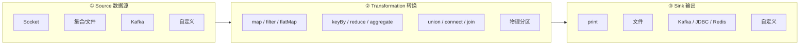
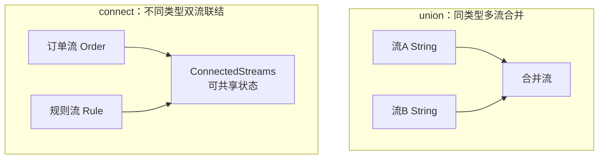
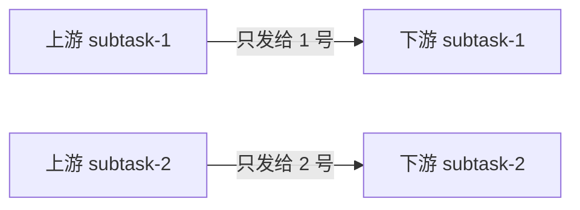
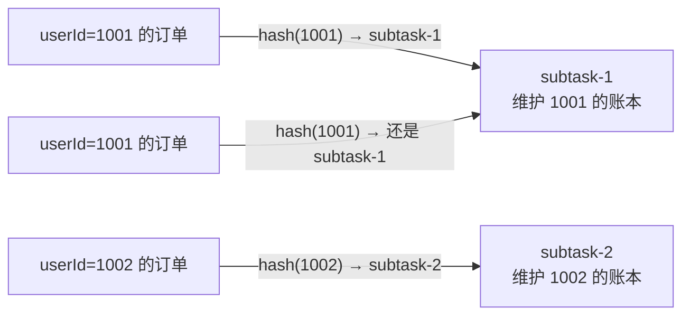
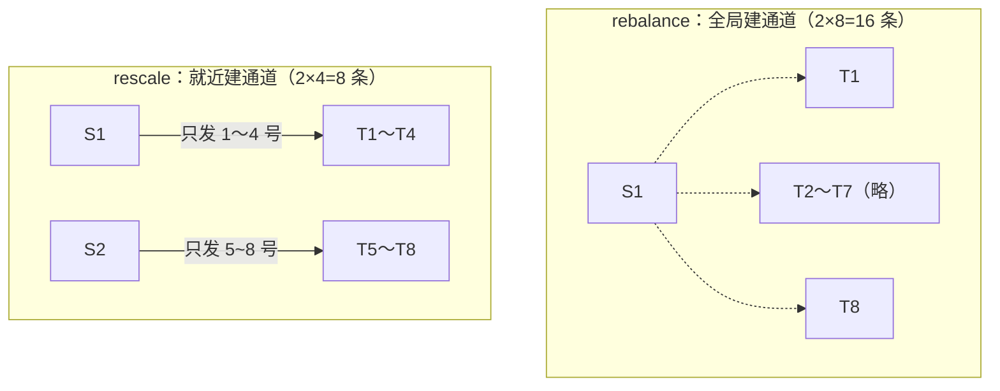
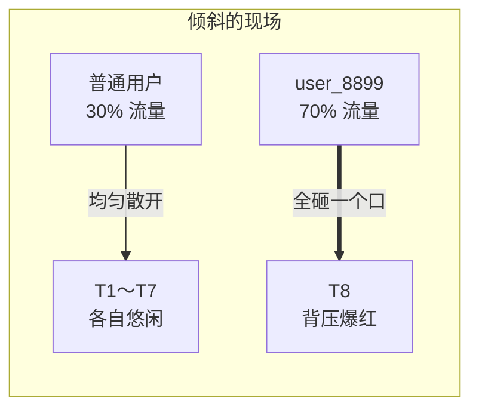
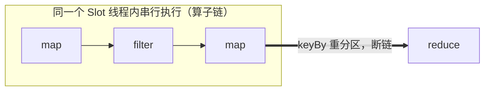

# 第3章 · DataStream API 核心

 

> **本章目标**：掌握 DataStream API 三大件——**Source（数据从哪来）**、**Transformation（怎么加工）**、**Sink（结果到哪去）**，理解并行度与数据分区策略，为后续所有章节打地基。

**业务场景**：电商平台的后端埋点日志质量参差——有脏数据、有重复格式。数据团队需要一条清洗管道：**过滤无效订单 → 统一格式 → 按用户累计消费额**，输出给下游实时数仓。

---

## 3.1 数据流编程模型总览



## 3.2 Source：数据从哪来

### 内置 Source 速查

| Source | 有界? | 典型用途 | 章节 |
|:---|:---:|:---|:---:|
| `env.fromElements(...)` / `fromCollection` | ✅ | 教学演示、测试数据 | 本课大量使用 |
| `env.fromSequence(1, 100)` | ✅ | 生成序列 | 测试 |
| `env.socketTextStream(host, port)` | ❌ | 教学演示、快速调试 | 本课大量使用 |
| `env.fromSource(FileSource, ...)` | ✅ | 读文件/目录 | 批处理 |
| `KafkaSource.builder()...build()` | ❌ | **生产 90% 的选择** | 第10/11章 |
| 自定义 `SourceFunction` | — | 遗留 API，新项目避免 | 不展开 |

?> **选型直觉**：学习和调试用 Socket/集合；一进生产，Source 几乎必然是 Kafka。

### 生产标配：Kafka Source（先混个脸熟）

```java
KafkaSource<String> source = KafkaSource.<String>builder()
        .setBootstrapServers("localhost:9092")
        .setTopics("orders")
        .setGroupId("order-clean")
        .setStartingOffsets(OffsetsInitializer.earliest())   // 无消费记录时从头读
        .setValueOnlyDeserializer(new SimpleStringSchema())  // 只取 value，不要 key
        .build();

DataStream<String> raw = env.fromSource(
        source,
        WatermarkStrategy.noWatermarks(),  // 第4章讲为什么要 Watermark
        "kafka-orders");
```

细讲放第10章，本章知道"长这样"即可。

## 3.3 Transformation：怎么加工

### 单条级算子（不分组）

| 算子 | 输入→输出 | 订单场景示例 |
|:---|:---|:---|
| `map` | 1 → 1 | JSON 字符串 → Order 对象 |
| `filter` | 1 → 0或1 | 丢弃金额 ≤ 0 的脏数据 |
| `flatMap` | 1 → N | 一行日志拆出多个事件 |

```java
DataStream<Order> orders = raw
        .map(JsonUtil::toOrder)                    // 字符串 → POJO
        .filter(o -> o.getAmount() > 0)            // 过滤脏数据
        .filter(o -> o.getStatus() == Order.PAID); // 只留已支付
```

### 分组聚合算子

| 算子 | 说明 |
|:---|:---|
| `keyBy` | 逻辑分组（≠物理分组！只是按 key 哈希路由） |
| `reduce` | 分组内滚动聚合：`(acc, 新数据) → 新acc` |
| `sum/max/min/maxBy/minBy` | reduce 的语法糖 |

```java
// 每个用户的累计消费额（滚动更新）
orders
    .keyBy(Order::getUserId)
    .reduce((acc, o) -> Order.copyOf(acc, acc.getAmount() + o.getAmount()))
    .print();
```

**reduce 的直觉**：每个 key 维护一个"账本"（状态），来一条就记一笔，输出最新余额。

### 多流算子（先知道，实战篇用）



| 算子 | 要求 | 典型场景 |
|:---|:---|:---|
| `union` | 类型必须相同 | 多个机房日志合并 |
| `connect` + `CoProcessFunction` | 类型可不同 | 订单流关联规则流（第12章实战） |

### 物理分区：数据怎么路由到并行子任务

这是理解 Flink 数据流转的关键，也是面试高频题。

**先建立一个直觉**：把 Flink 想成一个快递分拣中心。上游算子的每个并行子任务（subtask）是一件包裹的"发货口"，下游算子的每个子任务是"收货口"。每条数据离开发货口时，系统必须回答一个问题——**发给哪个收货口？** 回答这个问题的规则，就是物理分区策略。

| 分区策略 | 快递分拣类比 | 一句话 |
|:---|:---|:---|
| **forward** | 传送带直行 | 1 号口发的货只给 1 号收货口 |
| **hash（keyBy）** | 按收件人城市分拣 | 同一个收件人永远进同一个口 |
| **rebalance** | 全局轮询派单 | 依次派给所有分拣员 |
| **rescale** | 就近轮询派单 | 只派给隔壁几个分拣员 |
| **broadcast** | 每人复印一份 | 所有收货口都拿到完整副本 |
| **global** | 全部走 VIP 通道 | 只给 1 号口，其他全闲着 |
| **shuffle** | 闭眼随机扔 | 测试用 |
| **partitionCustom** | 自定义分拣手册 | 你说了算 |

> 💡 **一个重要前提**：分区只在"重分区边界"发生。如果相邻算子并行度相同、也没有调用任何分区 API，数据走的是 **forward + 算子链**——上下游跑在同一个线程里，**根本不出网络**（见 3.6 节）。所以"分区策略"真正影响性能的时刻，是你调用 `keyBy/rebalance/...` 或上下游并行度不一致的那一刻。

---

#### ① forward —— 传送带直行（默认，性能最好）

**机制**：上游 subtask `i` 的数据只发给下游 subtask `i`，严格 1 对 1。



**真实场景**——订单清洗管道（本章 `OrderCleanJob`）：

```java
raw.map(JsonUtil::toOrder)          // 解析 JSON
   .filter(o -> o.getAmount() > 0)  // 去脏数据
   .map(o -> maskPhone(o))          // 手机号打码
```

三步并行度都是 2：subtask-1 收到的订单从解析到打码**一条龙跑完**，中间零网络传输、零序列化。这是 Flink 默认给你的最优路径。

**什么时候会"失去" forward**：下游并行度变了（如 2→4），Flink 自动切换成 rebalance。所以**无脑调大某一步并行度，可能悄悄引入网络开销**——这是新手常见的隐形性能坑。

---

#### ② hash（keyBy）—— 按收件人分拣（正确性的基石）

**机制**：对 key 做哈希（MurmurHash）后取模，路由到固定的 subtask。**相同 key 的数据，永远进同一个 subtask**。



**为什么必须这样做**——看一个算错的反例：

> 统计每个用户的累计消费额。假如 1001 的两笔订单（299 元、1299 元）被分到**不同** subtask，各自拿着半份"账本"，输出就是两条 `1001 → 299` 和 `1001 → 1299`，而不是正确的 `1001 → 1598`。
> **有状态计算的正确性，完全依赖"同 key 同 subtask"这条铁律。**

**真实场景**（贯穿全课程）：

| 业务 | keyBy 的 key | 要维护的状态 |
|:---|:---|:---|
| 电商：用户累计消费 | `userId` | 每用户的累计金额 |
| 电商：实时 UV 大屏 | `userId` | 窗口内用户去重集合 |
| IoT：设备温度告警（第13章） | `deviceId` | 每设备的窗口温度序列 |
| 风控：转账反欺诈（第12章） | `cardNo` | 每卡的转账行为状态机 |

**陷阱预告**：hash 保证"分得对"，不保证"分得匀"。头部用户（大 V、热门商品）会把一个 subtask 打爆——这就是数据倾斜，解法见本节末尾的专题。

---

#### ③ rebalance —— 全局轮询（治"源头太窄"）

**机制**：上游**每个** subtask 与下游**所有** subtask 建立通道，严格轮询发送：第 1 条给 T1、第 2 条给 T2……均分到极致。

**真实场景 1 —— Socket 源的单点瓶颈**：

`nc -lk 9999` 起的 Socket 源**并行度恒为 1**（一个 TCP 连接没法拆）。如果后面接的是重计算（JSON 解析 + 正则脱敏 + 调外部接口打分），不重分布的话所有压力都在这 1 个 subtask 上：

```java
env.socketTextStream("localhost", 9999)  // 并行度永远是 1
    .rebalance()                          // ← 轮询铺开到所有 slot
    .map(s -> heavyParse(s))              // 并行度 = 环境并行度，重计算不再单点
```

**真实场景 2 —— Kafka 分区数跟不上**：topic 只有 2 个 partition（source 并行度最多 2），但下游解析要 8 并行才扛得住流量，中间加 `.rebalance()` 把 2 路摊成 8 路。

**代价**：2 上游 × 8 下游 = **16 条通道**，且大概率跨 TaskManager 走网络（TCP + 序列化）。

---

#### ④ rescale —— 就近轮询（省网络版 rebalance）⭐ 面试最爱考的区分点

**机制**：每个上游 subtask 只连接**自己负责的那一小片**下游。以上游 2、下游 8 为例：subtask-1 只发给下游 1~4 号，subtask-2 只发给 5~8 号。



| 对比项 | rebalance | rescale |
|:---|:---|:---|
| 通道数 | 上游 × 下游（全连接） | 每上游只连 `下游数/上游数` 个 |
| 网络路径 | 可能跨机器 | 大概率同 TaskManager 内（本地内存拷贝） |
| 数据均匀度 | 绝对均匀 | 组间可能不匀（若上游本身不匀） |
| 适用 | 上游数据本身就倾斜 | 上下游并行度成倍数、上游已大致均匀 |

**真实场景**——双十一大屏的两阶段 UV 聚合：

8 个解析子任务先把各自收到的 userId 去重（**局部聚合**），再把中间结果发给 2 个全局聚合子任务合并。中间结果流量只有原始流量的 1/20，用 `rescale` 让每个全局子任务只对接 4 个固定的上游，通道全部落在本机，不走网络：

```java
parsed.keyBy(UserAction::getUserId)     // 局部去重
    .window(...).aggregate(...)          // 局部聚合，输出量大幅缩小
    .rescale()                           // ← 就近发给全局聚合，省掉跨机网络
    .keyBy(s -> "ALL")                   // 全局合并
    ...
```

> 💡 **选择口诀**：上游已经匀（如 Kafka 多分区）→ `rescale` 省网络；上游不匀（如单分区源）→ `rebalance` 强制均分。

---

#### ⑤ broadcast —— 每人复印一份（小数据的特权）

**机制**：每条数据复制到**所有**下游 subtask。上游 1 条、下游 8 个 subtask = 落地 8 份拷贝。

**真实场景 1 —— 风控规则热更新**（第12章完整实现）：

风控引擎并行度 8，规则只有几十条（"单笔 > 5000 元转人工"、"1 分钟内 3 笔失败交易冻结"）。运营在管理后台改规则 → 规则变更流 `broadcast` 到 8 个风控子任务，每个子任务把规则存进自己的 Broadcast State，**秒级全量生效**，不用重启作业：

```java
// 规则流（极小）广播，订单流（极大）正常流转
BroadcastStream<Rule> ruleStream = rules.broadcast(RULE_DESCRIPTOR);
orderStream.connect(ruleStream)
    .process(new RiskControlFunction())  // 每个订单在本地内存中匹配最新规则
    ...
```

**真实场景 2 —— 维表 Join**（第10章）：几百行的城市维表广播出去，千万级订单流本地 Join，不用每条订单查一次数据库。

**铁律**：只广播**小**数据。广播 10 万行维表 × 32 个 subtask = 320 万行内存占用，OOM 只是时间问题。大数据量请走 lookup Join（第10章）。

---

#### ⑥ global —— 全部塞给 1 号（几乎别用）

**机制**：所有数据发给 subtask-0，其余 subtask 空转等待。

**仅存的合理用法**：调试时把结果汇总成单路输出（如写本地 SQLite、控制台打印）。生产流上用 `global` 等于亲手制造单点瓶颈——1 个 subtask 的吞吐上限就是你整个作业的上限。

---

#### ⑦ shuffle —— 随机扔

随机均匀分发。与 rebalance 的区别：不保证轮询的严格顺序，纯随机。**实际项目中几乎只在压测/测试时用**，面试提到能说清与 rebalance 的区别即可。

---

#### ⑧ partitionCustom —— 自定义分拣手册

业务需要完全掌控路由规则时使用。

**真实场景 —— 数据亲和路由**：订单按"收货城市"路由到部署在同区域的集群节点，后续 Join 城市维表时直接命中本地缓存：

```java
orders.partitionCustom(
    (key, numPartitions) -> regionOf(key) % numPartitions,  // 自定义路由函数
    Order::getCity)                                          // 分区 key
```

---

### 数据倾斜专题：hash 分区的"富户问题"

**现象**（Web UI 里一眼识别）：某主播开播后，点赞流中 70% 的数据 key 都是 `user_8899`，全部涌入同一个 subtask。



- Web UI 表现：T8 的 **Received Records** 是其他 subtask 的几十倍，下游算子背压（BackPressure）标红，整个作业吞吐被 T8 拖死；
- 恶性循环：T8 处理不过来 → checkpoint 超时 → 作业失败重启。

**经典解法：加盐（salt）两阶段聚合**——把大象拆成小块先算一遍：

```java
// 第一阶段：key 加随机前缀，把大 key 拆散到多个 subtask 分别预聚合
stream.keyBy(s -> s.getUserId() + "_" + ThreadLocalRandom.current().nextInt(10))
      .window(...).aggregate(...局部聚合...)

// 第二阶段：去掉前缀，把 10 份局部结果做最终合并
      .keyBy(s -> s.getUserId())
      .reduce(...全局合并...)
```

大 key 的 70% 流量被拆成 10 份，摊到 10 个 subtask 上；第二阶段处理的只是预聚合结果（流量缩小了几十倍），全局单 key 也不再是瓶颈。完整代码模式在第11章 UV 统计中实践。

---

### 上 Web UI 亲眼看（PartitioningDemo 实验）

代码：`code/src/main/java/com/flinkcourse/ch03/PartitioningDemo.java`（本地上跑起 8082 端口的迷你 Web UI）。

```bash
mvn exec:exec -Dexec.mainClass="com.flinkcourse.ch03.PartitioningDemo"
# 浏览器打开 http://localhost:8082 → 点击作业 → 看 Overview 的连线标注
```

作业里埋了 4 个阶段，对照观察算子之间的**连线标签**：

| 阶段 | 代码 | 预期连线标注 | 观察什么 |
|:---|:---|:---|:---|
| A：source → map | 并行度相同 | `FORWARD` | 1 对 1，同色 slot 内直行 |
| B：`.rebalance()` | 显式调用 | `REBALANCE` | 全连接轮询 |
| B2：`.rescale()` | 显式调用 | `RESCALE` | 就近连接 |
| C：`.keyBy(单词)` | 逻辑分区 | `HASH` | 相同单词的计数永远出自同一个 subtask 编号 |

**验证 hash 的"同 key 同口"**：输出行的前缀是 subtask 编号（如 `1> (apple,4)`）。跑几次会发现 `apple` 的结果**永远**带同一个编号——这就是 hash 分区在起作用。

### 面试速答（背下来）

| 策略 | 一句话回答 |
|:---|:---|
| forward | 并行度相同的相邻算子 1 对 1 直传，配合算子链零网络开销 |
| hash | keyBy 按 key 哈希路由，保证同 key 进同 subtask，是状态正确性的前提 |
| rebalance | 全局轮询均分，用于单分区源扩并行或数据倾斜重分布，代价是全连接网络 |
| rescale | 就近分组轮询，通道少且多走本地，适合上游已均匀的成倍数并行度调整 |
| broadcast | 复制到所有 subtask，仅适合小数据（规则、维表） |
| global | 全部给 1 号 subtask，调试用，生产等于单点 |
| shuffle | 随机分发，测试用 |
| 数据倾斜 | 大 key 打爆单个 subtask → 加盐两阶段聚合 |

## 3.4 实战：订单清洗管道

完整代码：`code/src/main/java/com/flinkcourse/ch03/OrderCleanJob.java`

```java
package com.flinkcourse.ch03;

import com.flinkcourse.common.model.Order;
import com.flinkcourse.common.util.JsonUtil;
import org.apache.flink.api.common.eventtime.WatermarkStrategy;
import org.apache.flink.api.common.serialization.SimpleStringSchema;
import org.apache.flink.connector.kafka.source.KafkaSource;
import org.apache.flink.connector.kafka.source.enumerator.initializer.OffsetsInitializer;
import org.apache.flink.streaming.api.datastream.DataStream;
import org.apache.flink.streaming.api.environment.StreamExecutionEnvironment;

/**
 * 场景：订单清洗管道（第3章主示例）
 *   Kafka 原始日志 → 解析 → 去脏 → 统一 POJO → 按用户累计消费
 *
 * 两种运行模式：
 *   1. IDEA 直接运行 —— 使用内置测试数据（无需任何外部组件）
 *   2. args[0] == "kafka" —— 从 Kafka topic "ods_orders" 读取（需 docker compose 环境）
 */
public class OrderCleanJob {

    public static void main(String[] args) throws Exception {
        StreamExecutionEnvironment env = StreamExecutionEnvironment.getExecutionEnvironment();

        DataStream<String> raw = (args.length > 0 && "kafka".equals(args[0]))
                ? env.fromSource(buildKafkaSource(), WatermarkStrategy.noWatermarks(), "orders")
                : demoSource(env);

        raw.map(JsonUtil::toOrder)                         // ① 反序列化
           .filter(o -> o != null && o.getAmount() > 0)    // ② 去脏数据
           .filter(o -> o.getStatus() == Order.STATUS_PAID)// ③ 只看已支付
           .map(o -> {                                     // ④ 脱敏：手机号打码
               o.setPhone(o.getPhone().replaceAll("(\\d{3})\\d{4}(\\d{4})", "$1****$2"));
               return o;
           })
           .keyBy(Order::getUserId)                        // ⑤ 按用户分组
           .reduce((acc, o) -> {                           // ⑥ 累计消费额
               acc.setAmount(acc.getAmount() + o.getAmount());
               return acc;
           })
           .print();

        env.execute("Order Clean Job");
    }

    private static KafkaSource<String> buildKafkaSource() {
        return KafkaSource.<String>builder()
                .setBootstrapServers("localhost:9092")
                .setTopics("ods_orders")
                .setGroupId("order-clean")
                .setStartingOffsets(OffsetsInitializer.earliest())
                .setValueOnlyDeserializer(new SimpleStringSchema())
                .build();
    }

    private static DataStream<String> demoSource(StreamExecutionEnvironment env) {
        return env.fromElements(
                "{\"userId\":1001,\"amount\":299.0,\"city\":\"深圳\",\"status\":2,\"phone\":\"13800000001\",\"ts\":1730000001000}",
                "{\"userId\":1001,\"amount\":1299.0,\"city\":\"深圳\",\"status\":2,\"phone\":\"13800000001\",\"ts\":1730000002000}",
                "{\"userId\":1002,\"amount\":-5.0,\"city\":\"杭州\",\"status\":1,\"phone\":\"13800000002\",\"ts\":1730000003000}",
                "{\"userId\":1002,\"amount\":399.0,\"city\":\"杭州\",\"status\":2,\"phone\":\"13800000002\",\"ts\":1730000004000}",
                "{\"userId\":1003,\"amount\":89.0,\"city\":\"北京\",\"status\":1,\"phone\":\"13800000003\",\"ts\":1730000005000}",
                "{\"userId\":1002,\"amount\":59.9,\"city\":\"杭州\",\"status\":2,\"phone\":\"13800000002\",\"ts\":1730000006000}"
        );
    }
}
```

### 运行与验证

IDEA 直接运行 main，预期输出：

```
1> Order{userId=1001, amount=299.00, ...phone=138****0001}
1> Order{userId=1002, amount=399.00, ...}
2> Order{userId=1002, amount=458.90, ...}   ← 1002 累计：399.00 + 59.90
1> Order{userId=1001, amount=1598.00, ...}  ← 1001 累计：299 + 1299
```

验证三个行为：
1. `-5.0` 的脏订单被过滤（无输出）；
2. 未支付订单（status=1）被过滤；
3. 手机号被打码、金额按用户累计。

## 3.5 并行度：一个作业同时跑几路？

并行度可以设置在**三层**，优先级从高到低：

```mermaid
flowchart LR
    A[算子级<br/>.setParallelism(2)] -->|优先| B[环境级<br/>env.setParallelism(4)] -->|次之| C[集群级<br/>flink-conf.yaml<br/>taskmanager.numberOfTaskSlots]
```

```java
env.setParallelism(4);          // 全局默认
xxx.map(...).setParallelism(2); // 单算子覆盖
xxx.print().setParallelism(1);  // 输出强制单路（便于看日志）
```

### 上 Web UI 亲眼看（实验）

把 `OrderCleanJob` 的 `env.setParallelism(2)` 设置后运行，浏览器开 <http://localhost:8081>，提交或观察运行的作业：

```
Source(map) ──forward──> filter ──rebalance──> keyBy/reduce ──> print
并行度: 2              并行度: 2         并行度: 2           并行度: 2
```

?> **Slot 消耗规则**：一个作业占用 slot 数 = **各算子链的最大并行度之和**（不是所有算子并行度之和！），这正是"算子链"的意义——同链算子共享 slot 线程，串行执行。

## 3.6 算子链与线程模型：性能优化的第一课

先回答一个高频疑问：**"每个算子都是独立的线程吗？"——不是，恰恰相反：Flink 会尽量把多个算子合并到同一个线程里跑。**

### 先搞清楚：谁才对应线程

| 概念 | 是什么 | 与线程的关系 |
|:---|:---|:---|
| **Operator（算子）** | 逻辑执行图里的节点（map、filter…） | 纯概念，**不直接对应线程** |
| **SubTask（子任务）** | 算子 × 并行度切出来的实例 | 物理执行单元 |
| **OperatorChain（算子链）** | 满足链化条件的多个 subtask **合并成一个 Task** | **一条链 = 1 个线程** |
| **TaskManager** | 一个 JVM 进程 | 进程内有 N 个 Task 线程（N = 部署的 Task 数） |

```
Slot-1 ─ 线程A: [ Source → map → filter ]   ← 三个算子串在同一个线程
Slot-2 ─ 线程B: [ Source → map → filter ]
            │  (keyBy = 重分区，断链)
Slot-3 ─ 线程C: [ reduce ]                   ← 断链后才是独立线程
Slot-4 ─ 线程D: [ reduce ]
```

线程 A 内部发生的事：来一条数据 → Source 发出 → **同一线程里直接方法调用** `map.processElement()` → `filter.processElement()`——零队列、零锁、零序列化。这就是算子链被称为"性能优化第一课"的底层原因。

### 链化条件：什么时候算子会被串起来

**默认策略**：两个相邻算子如果满足——① 前后并行度相同 ② 分区策略是 forward（不是 keyBy/rebalance 之类的重分区）③ 没有主动禁链 ④ slot 共享组相同——Flink 就把它们串进同一个线程：



反过来说，**只有断链时算子才是独立线程**，共四种情况：

1. **重分区边界**：`keyBy` / `rebalance` / `rescale` / `broadcast`——数据必须跨线程流动（同进程走内存队列，跨进程走网络）；
2. **并行度不同**：上游 2 → 下游 4，forward 的 1 对 1 语义不成立；
3. **主动禁链**：`disableChaining()` / `startNewChain()` / `env.disableOperatorChaining()`；
4. **slot 共享组不同**：`.slotSharingGroup("xxx")`。

```java
xxx.map(...).startNewChain();   // 从当前算子开启新链
xxx.map(...).disableChaining(); // 当前算子独立成链
env.disableOperatorChaining();  // 全局禁链（调试看数据流向用）
```

### Mailbox 单线程模型：为什么算子代码不用加锁

每个 Task 线程内部是一个 **mailbox（信箱）队列**：数据、Watermark、Checkpoint Barrier 全部按序进信箱，线程从信箱里一条条取出串行处理。推论：

- 一个 Task 线程内部（包括链上所有算子、所有状态读写）**不存在并发访问**；
- 所以你在 `KeyedProcessFunction` 里操作 ValueState **永远不需要加锁**——这是 Flink 状态编程模型简单的根本原因；
- 也因此**别在算子里写阻塞代码**（同步调外部接口）：一个线程被卡住，整条链、整个信箱全部停摆（第14章异步 IO 讲正规解法）。

?> **Slot 数 ≠ 线程数**：默认 slot 共享组下，同一作业的多条算子链可以挤进同一个 slot——一个 slot 里有几个 Task 就有几个线程。这正是 3.5 节"作业 slot 消耗 = 各链最大并行度之和"的准确含义。

### 30 秒亲眼验证（jstack）

对 TaskManager 进程执行 `jstack <pid>`，每个 Task 是一条命名清晰的线程（形如 `Source: orders -> map -> filter (1/2)`）。对比 Web UI 里 FORWARD 连线两端的算子——它们显示在同一个 box 里，因为它们本来就在同一个线程里。

!> **调试技巧**：Web UI 上看不清数据怎么流转时，`env.disableOperatorChaining()` 会让每个算子独立展示（代价是每个算子独立成线程、性能下降）——只用于调试。

## 3.7 常见坑

| 坑 | 现象 | 解法 |
|:---|:---|:---|
| POJO 不符合规范 | 日志刷 `has been deserialized` 警告/状态读取异常 | POJO 需要：**public 类 + public 无参构造 + public getter/setter**。课程 `common/model` 全部合规 |
| `keyBy` 后丢数据 | 数据莫名消失 | 多半是 filter 在 keyBy 之前把数据滤没了，链路顺序画图确认 |
| 并行度 > Slot 数 | 作业卡在 `CREATED` 不运行 | 2 TM × 4 Slot = 8，总并行度不能超 |
| reduce 返回新对象 vs 改 acc | 恢复时状态错乱 | reduce 尽量**修改并返回 acc**（同一对象），避免歧义 |
| Lambda 提交集群报序列化错 | `LinkedHashMap is not serializable` | 用匿名内部类或静态方法引用（见第2章坑2） |

## ✍️ 动手练习

1. **手机号脱敏移到 keyBy 之后**，思考为什么结果不变但性能可能变差（提示：脱敏是 map，keyBy 前后算子链是否断裂）；
2. **rebalance 实验**：写一个并行度 2 的 source（奇偶数各一路），用 `rebalance()` 后观察输出分布；不设置任何分区策略观察默认行为差异；
3. **统计城市维度订单数**：改造 OrderCleanJob，按 `city` 分组，输出 `(城市, 订单数)` 的滚动计数；
4. **思考题**：`rebalance` 与 `rescale` 的区别什么场景下才有意义？（提示：TaskManager 数量）

---

## 本章小结

- 三大件：**Source（集合/Socket/Kafka）→ Transformation（map/filter/flatMap/keyBy/reduce/union/connect）→ Sink**；
- `keyBy` 是**逻辑分组**（哈希路由），`reduce` 依赖分组做滚动聚合；
- 分区策略：forward / **hash** / **rebalance** / rescale / **broadcast** / global，重点掌握加粗四个；
- 并行度三层设置：算子 > 环境 > 集群；作业 slot 消耗 = 各链最大并行度之和；
- 算子链默认开启，一条链 = 一个线程（Mailbox 单线程模型，算子内不加锁）；断链的四种情况：重分区 / 并行度不同 / 主动禁链 / slot 共享组不同，`disableChaining` 只用于调试。

---

<div class="chapter-nav">

[⬅️ 第2章 · 流批一体初体验](ch02.md)
[➡️ 第4章 · 时间与水印](ch04.md)

</div>
