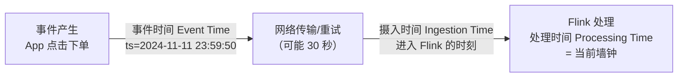
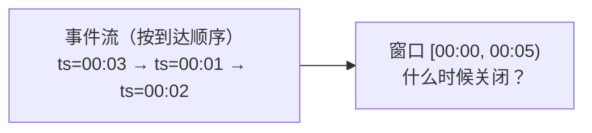
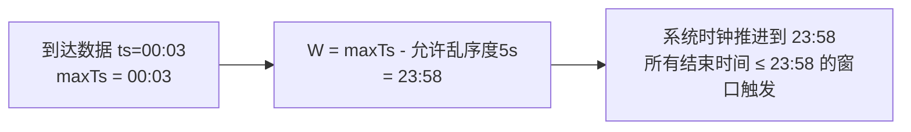
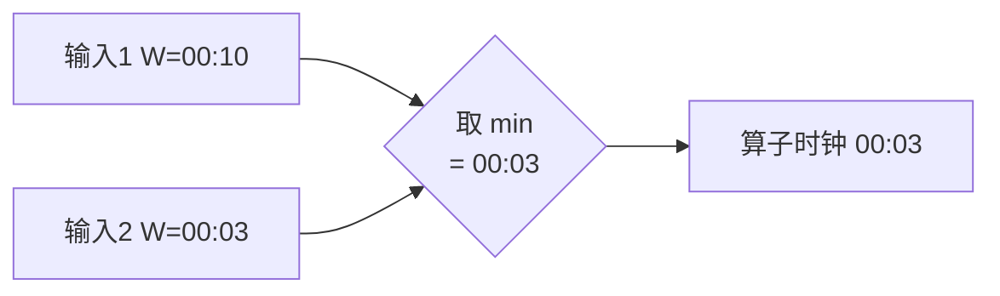

# 第4章 · 时间语义与水印（Watermark）

 

> **本章目标**：搞懂 Flink 最重要、面试必问的概念——**事件时间**与**Watermark**。学完你能回答：数据乱序了怎么办？窗口什么时候触发？为什么说"Watermark 是流处理对'迟到'的妥协"？

**业务场景**：用户在地铁里下了单，手机信号差，埋点日志在 **30 秒后**才到达服务器；第二天复盘大屏发现：23:59:50 的订单被算进了"第二天"的 GMV。**用数据自己携带的时间（事件时间）而非机器收到的时间（处理时间）计算，才能算对账。**

---

## 4.1 三种时间语义



| 时间语义 | 取值来源 | 特点 | 适用 |
|:---|:---|:---|:---|
| **事件时间 Event Time** | 数据自带字段 | 可重放、结果确定 | **生产默认选择**：GMV/风控/监控 |
| 处理时间 Processing Time | 机器时钟 | 延迟最低，但结果不确定 | 对准确性无要求的监控 |
| 摄入时间 Ingestion Time | 进入 Flink 时刻 | 折中，已不常用 | 了解即可 |

?> **为什么生产选事件时间**：① 重跑历史数据（回溯/故障恢复）结果一致；② 不受消费延迟影响——Kafka 积压一小时，GMV 依然算得准。

## 4.2 乱序问题：事件时间带来的新麻烦

选了事件时间，窗口（下一章）就会问：**"23:59:50 这条数据到了，但我怎么知道 23:59:00~23:59:59 的数据都到齐了？"**——网络延迟让到达顺序 ≠ 事件顺序：



三种极端选择的困境：

| 策略 | 问题 |
|:---|:---|
| 数据一来就关窗 | 00:03 到达就关 [00:00,00:05)，后面 00:01、00:02 全丢 |
| 等固定时间（如 10s）再关 | 等多久？网络抖动没有上限，等 10 秒仍有更晚的 |
| 永远等待 | 窗口永不关闭，结果永不输出 |

**Watermark 就是这个问题的工程解**：用一个"逻辑时钟"声明——**"时间戳 ≤ W 的数据都到齐了，可以放心关窗"**，并允许 W 适度滞后于真实事件时间，给迟到的数据留缓冲。

## 4.3 Watermark 原理（核心！）

> **定义**：Watermark 是一个特殊的时间戳 W(t)。它向系统声明：**今后不会再收到时间戳 ≤ W(t) 的数据**（个别违约数据叫"迟到数据"，另行处理）。

### 推进规则



**公式**：`W = 观察到的最大事件时间 maxTs − 乱序容忍度 delay`

举例（delay = 5 秒）：

| 到达顺序 | 事件 ts | maxTs | Watermark | 动作 |
|:-:|:-:|:-:|:-:|:---|
| 1 | 00:03 | 00:03 | **23:58** | 窗口 [00:00,00:05) 未到 00:04 不关 |
| 2 | 00:01（乱序！） | 00:03 | 23:58 | 正常落入 [00:00,00:05) |
| 3 | 00:06 | 00:06 | **00:01** | 继续等 |
| 4 | 00:09 | 00:09 | **00:04** | **窗口 [00:00,00:05) 关闭并触发计算！** |
| 5 | 00:02（迟到） | 00:09 | 00:04 | Watermark 已越过 → 默认丢弃（见 4.6） |

### 多输入流的 Watermark 传播

一个算子有多个上游输入（如 keyBy 后聚合、多 Source union）时，取**所有输入中最小的 Watermark** 作为自己的时钟——木桶效应，最慢的输入决定整体进度：



!> **必考题**：为什么 Kafka Source 多分区时，某个分区没数据会导致 Watermark 停滞？——因为多分区取 min，没数据的分区 W 不推进，把整体卡住。解法：`withIdleness(...)`（见 4.5）。

## 4.4 WatermarkStrategy：代码怎么写

```java
WatermarkStrategy<Order> strategy = WatermarkStrategy
        // ① 乱序容忍度：事件时间比实际晚到 5 秒以内都算正常
        .<Order>forBoundedOutOfOrderness(Duration.ofSeconds(5))
        // ② 告诉 Flink 从哪个字段取事件时间（毫秒）
        .withTimestampAssigner((order, recordTs) -> order.getEventTime());
```

| 工厂方法 | 含义 | 适用 |
|:---|:---|:---|
| `forMonotonousTimestamps()` | 数据严格按时间升序（delay=0） | 传感器有序上报 |
| `forBoundedOutOfOrderness(d)` | 允许最大乱序 d 秒 | **90% 业务场景** |
| `noWatermarks()` | 不生成水印 | 不需要事件时间语义时 |
| `forGenerator(...)` | 完全自定义 | 特殊策略（很少用） |

**放置位置**：跟在 Source 后（最佳，框架可感知分区）或任意算子后：

```java
DataStream<Order> orders = env
        .fromSource(kafkaSource, strategy, "orders");   // 推荐位置

// 或
DataStream<Order> orders2 = raw.map(...)
        .assignTimestampsAndWatermarks(strategy);       // 算子后补挂
```

## 4.5 实战一：亲手推进一个 Watermark（交互式）

完整代码：`code/src/main/java/com/flinkcourse/ch04/WatermarkSocketDemo.java`

```java
package com.flinkcourse.ch04;

import org.apache.flink.api.common.eventtime.WatermarkStrategy;
import org.apache.flink.api.common.typeinfo.Types;
import org.apache.flink.streaming.api.datastream.SingleOutputStreamOperator;
import org.apache.flink.streaming.api.environment.StreamExecutionEnvironment;
import org.apache.flink.streaming.api.functions.windowing.ProcessWindowFunction;
import org.apache.flink.streaming.api.windowing.assigners.TumblingEventTimeWindows;
import org.apache.flink.streaming.api.windowing.time.Time;
import org.apache.flink.streaming.api.windowing.windows.TimeWindow;
import org.apache.flink.util.Collector;

import java.time.Duration;

/**
 * 场景：观察 Watermark 如何驱动窗口触发（第4章主示例）
 * 运行：nc -lk 9999 后运行本类
 * 输入格式：单词,事件时间秒（如 apple,3 表示 ts=3 秒）
 * 每条数据会打印：数据本身 + 当前 Watermark + 窗口触发情况
 */
public class WatermarkSocketDemo {

    public static void main(String[] args) throws Exception {
        StreamExecutionEnvironment env = StreamExecutionEnvironment.getExecutionEnvironment();
        env.setParallelism(1);   // 单并行度，方便观察水印推进

        SingleOutputStreamOperator<String> result = env
                .socketTextStream("localhost", 9999)
                .map(line -> {
                    String[] parts = line.split(",");
                    return new Event(parts[0], Long.parseLong(parts[1]) * 1000L);
                })
                .assignTimestampsAndWatermarks(WatermarkStrategy
                        .<Event>forBoundedOutOfOrderness(Duration.ofSeconds(2))
                        .withTimestampAssigner((e, ts) -> e.getEventTime()))
                // 5 秒一个滚动事件时间窗口（语法下一章详解，本章只关注"何时触发"）
                .keyBy(e -> "all")
                .window(TumblingEventTimeWindows.of(Time.seconds(5)))
                .process(new WindowWithMetaFunction());

        result.print();
        env.execute("Watermark Demo");
    }

    /** 输出窗口内容 + 元信息 */
    public static class WindowWithMetaFunction
            extends ProcessWindowFunction<Event, String, String, TimeWindow> {
        @Override
        public void process(String key, Context ctx, Iterable<Event> elems, Collector<String> out) {
            StringBuilder sb = new StringBuilder();
            sb.append("窗口[").append(ctx.window().getStart() / 1000).append("," )
              .append(ctx.window().getEnd() / 1000).append(") 内容: ");
            elems.forEach(e -> sb.append(e.getWord()).append(" "));
            sb.append("| 窗口在 watermark=").append(ctx.currentWatermark() / 1000).append("s 时触发");
            out.collect(sb.toString());
        }
    }

    /** 简单事件 POJO */
    public static class Event {
        private String word;
        private long eventTime;
        public Event() {}
        public Event(String word, long eventTime) { this.word = word; this.eventTime = eventTime; }
        public String getWord() { return word; }
        public long getEventTime() { return eventTime; }
    }
}
```

### 实验脚本（照着输入，预测输出再验证）

乱序容忍度 = 2 秒，窗口 5 秒一个：

```text
输入: apple,1        → 无输出   (W = 1-2 = -1)
输入: banana,4       → 无输出   (W = 4-2 = 2)
输入: cat,8          → 输出窗口[0,5)!  (W = 8-2 = 6 ≥ 5)
输入: dog,3          → 无输出，被丢弃! (ts=3 < W=6，迟到数据)
输入: egg,13         → 输出窗口[5,10)!  (W = 13-2 = 11 ≥ 10)
```

预期输出：

```
窗口[0,5) 内容: apple banana | 窗口在 watermark=5s 时触发
窗口[5,10) 内容: cat | 窗口在 watermark=10s 时触发
```

?> **把 delay 改成 10 秒**再跑一遍：dog,3 就能赶上窗口[0,5)（触发要等到 ts≥15 的数据）。体会 **delay 越大 → 越不丢数据 → 但窗口触发越晚**，这就是流处理的经典取舍。

## 4.6 迟到数据的两级兜底

Watermark 只保证 delay 范围内的乱序。超出 delay 的迟到数据，有两道防线：

```mermaid
flowchart LR
    A[迟到数据<br/>ts < 当前 W] --> B{allowedLateness?}
    B --|窗口未真正销毁| C["① allowedLateness(extra)<br/>窗口延迟关闭期内 → 数据补进去<br/>窗口重算再输出一次"]
    B --|超过额外宽限| D["② 侧输出流 getSideOutput(lateTag)<br/>兜底收集，绝不静默丢弃"]
```

```java
// ① 窗口级：允许窗口关闭后再等 10 秒，期间迟到数据触发窗口重算
.window(...).allowedLateness(Time.seconds(10))

// ② 终极兜底：彻底迟到的数据进侧输出流
OutputTag<Event> lateTag = new OutputTag<Event>("late"){};

SingleOutputStreamOperator<Event> main = stream.keyBy(...)...;
DataStream<Event> late = main.getSideOutput(lateTag);   // 单独处理：落库/告警
```

侧输出流实战在第13章 IoT 场景完整演练，本章记住口诀：**先 Watermark 兜乱序，再 allowedLateness 兜迟到，最后侧输出流兜底线**。

## 4.7 空闲源问题与解法

```java
WatermarkStrategy
    .<Order>forBoundedOutOfOrderness(Duration.ofSeconds(5))
    .withTimestampAssigner((o, ts) -> o.getEventTime())
    // 分区 60 秒没数据就标记为 idle，不阻塞其他分区的水印推进
    .withIdleness(Duration.ofSeconds(60));
```

**什么时候用**：Kafka topic 多分区，某分区长时间无数据（如按 key 分区后热点 key 缺失）→ 整个作业 Watermark 停滞 → 窗口不触发 → 大屏不刷新。**Kafka Source 场景建议默认带上。**

## 4.8 常见坑

| 坑 | 现象 | 解法 |
|:---|:---|:---|
| 忘记 `withTimestampAssigner` | 窗口全挤在初始时间 | 事件时间字段没生效，检查 assigner |
| 时间戳单位搞错 | 窗口乱跳 | Flink 内部用**毫秒**，秒级时间戳要 ×1000 |
| Watermark 不推进 | 窗口永不触发 | ① 数据停了 ② 多输入取 min 被慢流卡住 ③ 并行度>1 且只有部分子任务有数据 |
| delay 设太小 | 大量数据被丢 | 观察数据延迟分布（P99），delay 取略大于 P99 延迟 |
| delay 设太大 | 大屏延迟明显 | 一般 1~10 分钟，按业务时效要求定 |
| 处理时间窗口混用 | 重跑结果不一致 | 生产统一事件时间窗口，`TumblingProcessingTimeWindows` 只用于无时间字段的场景 |

## ✍️ 动手练习

1. 把 `WatermarkSocketDemo` 的乱序容忍度从 2 秒改为 0 秒（`forMonotonousTimestamps`），重复实验脚本，对比窗口触发时机的差异；
2. 输入 `apple,100` 然后再输入 `banana,1`，观察 banana 的下场；给作业加上 `allowedLateness(Time.seconds(5))` 再试一次；
3. **思考题**：如果输入流 10 分钟没有任何数据，Watermark 会自动推进吗？为什么？（提示：Watermark 由数据驱动）

---

## 本章小结

- 生产用**事件时间**：结果可重放、不受消费延迟影响；
- **Watermark W = maxTs − delay**，声明"W 之前的数据已到齐"；窗口在 `W ≥ 窗口结束时间` 时触发；
- 多输入取 **min**：最慢的输入/分区决定整体进度，空闲分区用 `withIdleness` 解锁；
- 迟到三级防线：**Watermark 兜乱序 → allowedLateness 兜迟到 → 侧输出流兜底线**；
- delay 是取舍：大→不丢数据但触发慢，小→实时性好但丢数据。

---

<div class="chapter-nav">

[⬅️ 第3章 · DataStream API](ch03.md)
[➡️ 第5章 · 窗口](ch05.md)

</div>
