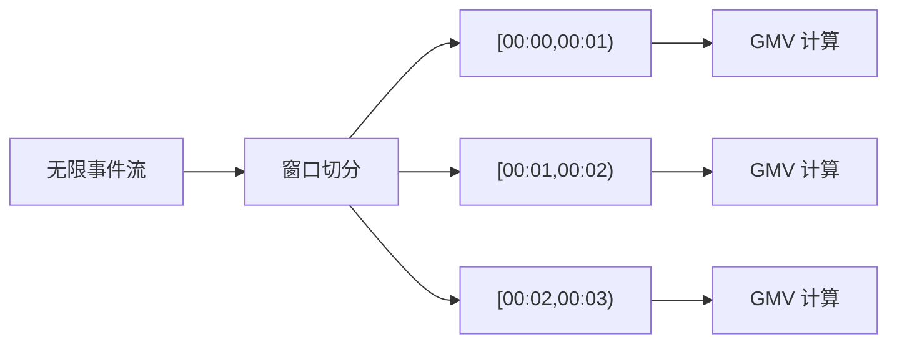
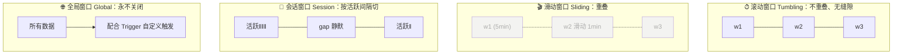
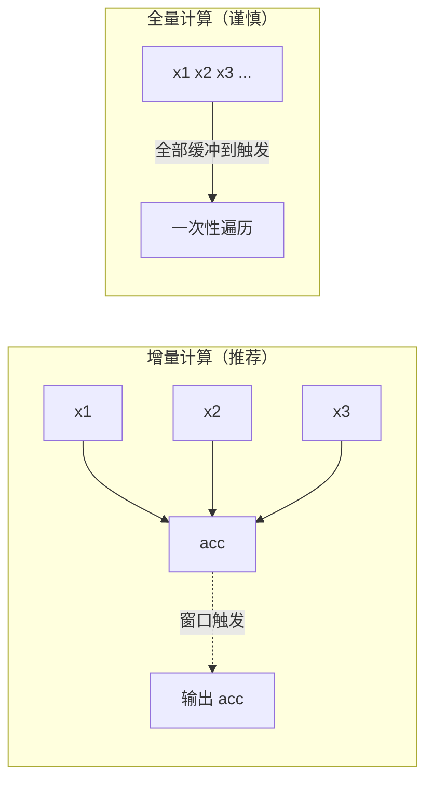
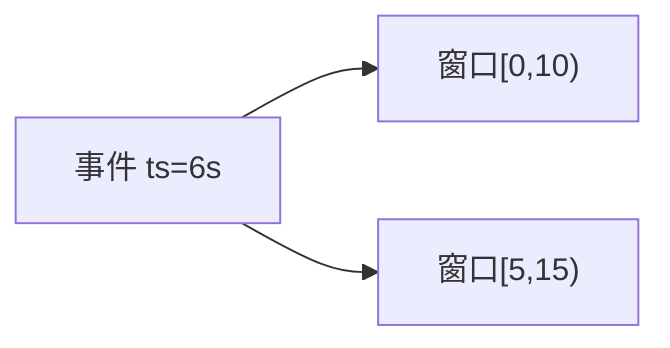
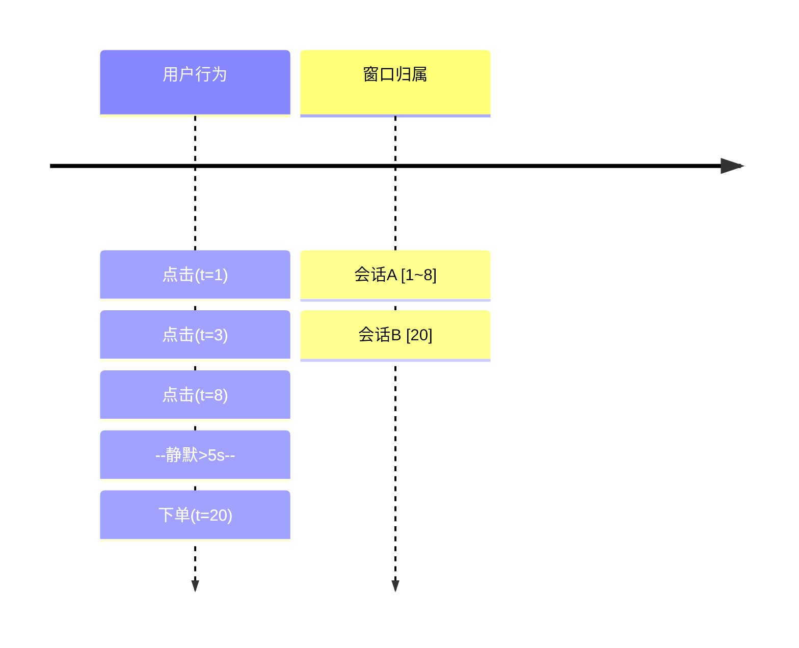

# 第5章 · 窗口（Window）

 

> **本章目标**：掌握 Flink 窗口的两大体系——**窗口分配器**（数据进哪个窗）与**窗口函数**（窗内怎么算），能独立实现"分钟级 GMV""近 5 分钟每分钟 UV""用户行为会话切分"三大经典需求。

**业务场景**：双11 大屏要求——① 每分钟刷新一次全国 GMV；② 显示"近 5 分钟"的 UV 趋势（每分钟移动）；③ 分析用户一次"逛店会话"的行为序列。三个需求分别对应**滚动窗口、滑动窗口、会话窗口**。

---

## 5.1 为什么需要窗口？

无界流没有"终点"，无法像批处理一样等数据到齐再算。窗口 = **把无限流切成有限的数据切片，逐片计算**：



> 窗口 = **分配器（Assigner：决定归属）+ 函数（Function：决定算法）**，语法上先 `.window(...)` 再 `.aggregate/reduce/process(...)`。

## 5.2 四种窗口分配器



| 分配器 | 语义 | 业务对应 | 模板 |
|:---|:---|:---|:---|
| `TumblingEventTimeWindows.of(size)` | 定长、无重叠 | 每分钟 GMV | 通用统计 |
| `SlidingEventTimeWindows.of(size, slide)` | 定长、按 slide 步进 | 近5分钟每1分钟 UV | 趋势监控 |
| `EventTimeSessionWindows.withGap(gap)` | 静默 gap 切一刀 | 一次逛店会话 | 行为序列分析 |
| `GlobalWindows.create()` | 全部数据一个窗 | 配合自定义 Trigger | 全局去重计数 |
| `countWindow(N)` | 按**条数**非时间 | 每 100 条批量落库 | 微批写库 |

!> 事件时间窗口的触发依赖上一章的 Watermark：**窗口在 `Watermark ≥ 窗口end` 时触发**。本章所有事件时间示例都需要 `assignTimestampsAndWatermarks`。

## 5.3 三种窗口函数：性能从高到低

| 函数 | 计算方式 | 内存 | 能拿到窗口元信息吗 |
|:---|:---|:---:|:---|
| `reduce` | **增量**：来一条算一条 `(acc, x) → acc` | O(状态) | ❌ |
| `aggregate` | **增量**：四段式，支持类型转换 | O(状态) | ❌（配合 process 可拿到） |
| `process` | **全量**：窗口触发时一次性遍历全部数据 | O(窗口数据量) | ✅ 窗口起止/当前水印/状态 |



?> **黄金组合**：`.aggregate(增量聚合, ProcessWindowFunction 包装)` —— 增量保性能，包装函数补窗口元信息（起止时间、水印），**生产代码 90% 用这个组合**。

## 5.4 实战一：滚动窗口算分钟级 GMV

完整代码：`code/src/main/java/com/flinkcourse/ch05/TumblingGmvDemo.java`

```java
package com.flinkcourse.ch05;

import com.flinkcourse.common.model.Order;
import org.apache.flink.api.common.eventtime.WatermarkStrategy;
import org.apache.flink.api.common.functions.AggregateFunction;
import org.apache.flink.streaming.api.datastream.SingleOutputStreamOperator;
import org.apache.flink.streaming.api.environment.StreamExecutionEnvironment;
import org.apache.flink.streaming.api.functions.windowing.ProcessWindowFunction;
import org.apache.flink.streaming.api.windowing.assigners.TumblingEventTimeWindows;
import org.apache.flink.streaming.api.windowing.time.Time;
import org.apache.flink.streaming.api.windowing.windows.TimeWindow;
import org.apache.flink.util.Collector;

import java.time.Duration;

/**
 * 场景：每 10 秒（demo 用，生产为 1 分钟）统计一次已支付订单 GMV 与订单数
 * 运行：IDEA 直接运行（内置测试数据，时间压缩在 30 秒内）
 * 要点：AggregateFunction 增量聚合 + ProcessWindowFunction 补窗口元信息
 */
public class TumblingGmvDemo {

    public static void main(String[] args) throws Exception {
        StreamExecutionEnvironment env = StreamExecutionEnvironment.getExecutionEnvironment();
        env.setParallelism(1);

        SingleOutputStreamOperator<String> result = env
                .fromElements(
                        new Order(1001L, 299.0, "深圳", 2, 1730000000000L),   // ts=0s
                        new Order(1002L, 59.9,  "杭州", 2, 1730000001000L),   // ts=1s
                        new Order(1001L, 1299.0,"深圳", 2, 1730000008000L),   // ts=8s
                        new Order(1003L, 89.0,  "北京", 1, 1730000009000L),   // ts=9s 未支付→应被过滤
                        new Order(1002L, 399.0, "杭州", 2, 1730000012000L),   // ts=12s
                        new Order(1004L, 25.5,  "成都", 2, 1730000019000L)    // ts=19s
                )
                .assignTimestampsAndWatermarks(WatermarkStrategy
                        .<Order>forBoundedOutOfOrderness(Duration.ofSeconds(2))
                        .withTimestampAssigner((o, ts) -> o.getEventTime()))
                .filter(o -> o.getStatus() == Order.STATUS_PAID)
                .keyBy(o -> "all")
                .window(TumblingEventTimeWindows.of(Time.seconds(10)))
                .aggregate(new GmvAgg(), new GmvWindow());

        result.print();
        env.execute("Tumbling GMV");
    }

    /** 增量聚合：累加器只存两个 long/double，与窗口内订单量无关 */
    public static class GmvAgg implements AggregateFunction<Order, GmvAcc, GmvResult> {
        @Override public GmvAcc createAccumulator() { return new GmvAcc(); }
        @Override public GmvAcc add(Order o, GmvAcc acc) {
            acc.count++; acc.amount += o.getAmount(); return acc;
        }
        @Override public GmvResult getResult(GmvAcc acc) {
            return new GmvResult(acc.count, acc.amount);
        }
        @Override public GmvAcc merge(GmvAcc a, GmvAcc b) { return a; } // 会话窗口合并时才用
    }

    /** 包装函数：补上窗口起止时间 */
    public static class GmvWindow
            extends ProcessWindowFunction<GmvResult, String, String, TimeWindow> {
        @Override
        public void process(String key, Context ctx, Iterable<GmvResult> elems, Collector<String> out) {
            GmvResult r = elems.iterator().next();   // 增量聚合后这里只有一个结果
            out.collect(String.format("窗口[%d ~ %d) GMV=%.2f 订单数=%d",
                    ctx.window().getStart(), ctx.window().getEnd(), r.amount, r.count));
        }
    }

    // ---- 值对象 ----
    public static class GmvAcc { public long count; public double amount; }
    public static class GmvResult { public long count; public double amount;
        public GmvResult(long c, double a) { count = c; amount = a; } }
}
```

预期输出：

```
窗口[1730000000000 ~ 1730000010000) GMV=1657.90 订单数=3   ← 299+59.9+1299
窗口[1730000010000 ~ 1730000020000) GMV=424.50 订单数=2   ← 399+25.5
```

（89 元的未支付订单被过滤；末窗口在数据流结束时以 `Long.MAX_VALUE` 水印强制触发。）

## 5.5 实战二：滑动窗口算"近 5 分钟 UV"

滑动窗口 size=10s、slide=5s（demo 压缩时间），**同一份数据会落在多个窗口**：



完整代码：`code/src/main/java/com/flinkcourse/ch05/SlidingUvDemo.java`（关键差异段）

```java
env.fromElements(/* 用户点击流，ts 依次 1,2,3,7,8,12,13,16 秒 */)
   .assignTimestampsAndWatermarks(/* 同上，乱序 2s */)
   .keyBy(u -> "all")
   .window(SlidingEventTimeWindows.of(Time.seconds(10), Time.seconds(5)))  // ← 唯一区别
   .aggregate(
       // UV 不能 count 一下完事：要去重！聚合器里放一个 HashSet
       new AggregateFunction<UserClick, Set<Long>, Long>() {
           @Override public Set<Long> createAccumulator() { return new HashSet<>(); }
           @Override public Set<Long> add(UserClick u, Set<Long> acc) { acc.add(u.getUserId()); return acc; }
           @Override public Long getResult(Set<Long> acc) { return (long) acc.size(); }
           @Override public Set<Long> merge(Set<Long> a, Set<Long> b) { a.addAll(b); return a; }
       },
       /* ProcessWindowFunction 输出 "窗口[x,y) UV=n" */)
   .print();
```

预期输出（size=10s、slide=5s，注意窗口可以对齐到负时间，且末窗可以越过最后一条数据）：

```
窗口[-5~5) UV=3       ← 第一条 ts=1 落入对齐窗口 [-5,5)
窗口[0~10) UV=3       ← 用户 1001,1002,1003
窗口[5~15) UV=3
窗口[10~20) UV=3      ← ts=16 的用户 1005 也落入本窗
窗口[15~25) UV=1
```

!> **UV 去重的内存陷阱**：HashSet 随 UV 增长线性膨胀，大促百万级 UV 会把状态撑爆。生产方案：用 **Bitmap（RoaringBitmap）** 或 Redis HyperLogLog 近似去重（第10/11章）。课程用 HashSet 是为了看清语义。

## 5.6 实战三：会话窗口切分"逛店会话"

会话窗口没有固定大小：**相邻两条数据间隔 < gap 就算同一个会话**，一旦静默超过 gap，窗口关闭：



完整代码：`code/src/main/java/com/flinkcourse/ch05/SessionWindowDemo.java`（关键差异段）

```java
env.fromElements(/* 同一用户行为流，间隔见上图 */)
   .assignTimestampsAndWatermarks(/* 同上 */)
   .keyBy(UserClick::getUserId)                                  // 会话通常按用户分 key
   .window(EventTimeSessionWindows.withGap(Time.seconds(5)))     // ← 静默 5 秒切会话
   .process(new ProcessWindowFunction<UserClick, String, Long, TimeWindow>() {
       @Override
       public void process(Long userId, Context ctx, Iterable<UserClick> clicks,
                           Collector<String> out) {
           List<String> actions = new ArrayList<>();
           clicks.forEach(c -> actions.add(c.getAction()));
           out.collect(String.format("用户%d 会话[%d~%d): %s",
                   userId, ctx.window().getStart(), ctx.window().getEnd(),
                   String.join("→", actions)));
       }
   })
   .print();
```

预期输出（会话窗口的"结束时间"= 最后一条数据时间 + gap）：

```
用户1001 会话[1~8): 点击→点击
用户1002 会话[5~13): 点击→加购→点击
用户1001 会话[20~25): 下单
```

?> **会话窗口的代价**：窗口边界依赖数据动态确定，框架内部可能合并相邻候选窗口，状态和触发逻辑都比定长窗口复杂——**没有会话语义需求时，优先用滚动/滑动**。

## 5.7 Trigger 与 Evictor（进阶，了解即可）

| 组件 | 作用 | 默认 |
|:---|:---|:---|
| `Trigger` | 决定窗口**何时**触发计算 | 事件时间窗口：Watermark 过 end 触发 |
| `Evictor` | 触发后**驱逐**部分数据再计算 | 无 |

典型自定义场景：**每来一条就输出一次最新累计值**（提前触发），大屏"秒级刷新"的实现基础：

```java
.window(TumblingEventTimeWindows.of(Time.seconds(60)))
.trigger(ContinuousProcessingTimeTrigger.of(Time.seconds(1)))  // 每秒触发一次
```

## 5.8 常见坑

| 坑 | 现象 | 解法 |
|:---|:---|:---|
| 窗口永远不触发 | 无输出 | Watermark 没设置/没推进（回看第4章）；**数据量小 + 测试数据时间戳集中**也会让最后一个窗口不关——`env.fromElements` 结束时会发 MAX 水印强关 |
| 滑动窗口数据重复 | 结果"偏大" | 同一数据落在多个窗口是**设计使然**，不是 bug；检查是不是该用滚动 |
| ProcessWindowFunction OOM | 大促时 TaskManager 崩 | 全量函数缓冲整窗数据 → 换成 aggregate 增量 |
| UV HashSet 状态膨胀 | 状态几十 GB | RoaringBitmap / HLL / 窗口内预聚合 |
| 会话窗口状态堆积 | Checkpoint 超时 | gap 设置合理 + 会话 key 基数可控 |
| countWindow 无 Watermark 概念 | 触发"不按时间" | countWindow 按条数触发，与事件时间无关，别混用语义 |

## ✍️ 动手练习

1. 改造 `TumblingGmvDemo`：按**城市**输出每 10 秒 GMV（提示：`keyBy(Order::getCity)`）；
2. 改造 `SlidingUvDemo`：同时输出窗口内 PV（总点击数）与 UV，观察两者差异；
3. 把会话窗口 gap 从 5 秒调成 3 秒，重新运行 `SessionWindowDemo`，解释输出变化；
4. **思考题**：`window(AllWindow)`（不 keyBy 直接开窗）和 `keyBy 后 window` 并行度上有什么区别？大屏全局 GMV 该用哪种？（提示：全窗口算子并行度只能为 1）

---

## 本章小结

- 窗口 = **分配器 + 函数**；四种分配器：滚动（不重叠）/ 滑动（重叠）/ 会话（静默切分）/ 全局（配 Trigger）；
- 窗口函数三种：`reduce`、`aggregate`（增量，性能好）、`process`（全量，有窗口元信息）；
- **生产黄金组合**：`aggregate(增量, ProcessWindowFunction)`；
- 事件时间窗口触发条件：`Watermark ≥ 窗口end`；
- UV 去重在窗口内用 HashSet 会被体量打爆，生产用 Bitmap/HLL。

---

<div class="chapter-nav">

[⬅️ 第4章 · 时间与水印](ch04.md)
[➡️ 第6章 · 状态管理](ch06.md)

</div>
