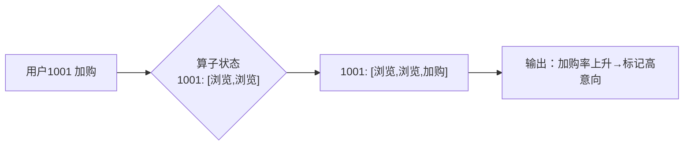
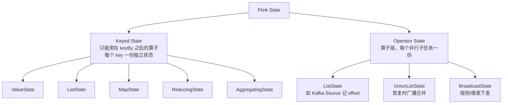
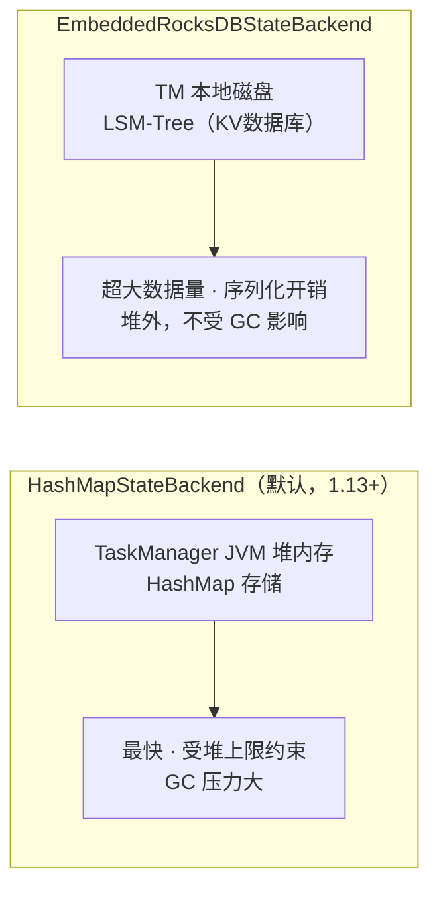

# 第6章 · 状态管理（State）

 

> **本章目标**：理解 Flink "状态是一等公民"的含义，掌握 Keyed State 五种类型与实际选型、状态 TTL 防膨胀、以及 HashMap vs RocksDB 两种状态后端。学完你能实现"用户购买轨迹追踪""实时去重"这类有记忆的算子。

**业务场景**：营销团队要识别"高意向用户"：**追踪每个用户最近 10 分钟的浏览→加购→下单行为轨迹**；同时运营侧要求"每个设备只发一次优惠券"——**实时去重**。两者都要求算子"记得"之前发生过什么，这就是状态。

---

## 6.1 状态：让算子拥有记忆

回想第2章 `(hello, 2)` ——词频能累计，正是因为 Flink 在内存里为每个 key 存了计数器。**状态 = 算子在计算过程中记住的中间结果**。



对比"用外部存储（Redis）记忆"的方案：

| 维度 | Flink 内置状态 | 外部 Redis/DB |
|:---|:---|:---|
| 延迟 | 本地内存/RocksDB 读，纳秒~微秒 | 网络 RTT，毫秒级 |
| 一致性 | 随 Checkpoint 原子快照，**Exactly-Once** | 外部事务，复杂且易错 |
| 编程模型 | 算子内直接读写，天然局部性 | 全局 KV，需自己处理并发 |

?> **经验法则**：计算过程要记的中间态 → Flink State；跨系统共享/要被人读的 → 外部存储。**用 Redis 替代 Flink State 做"计算状态"是最常见的架构反模式**：每条数据一次网络往返，还破坏一致性。

## 6.2 两大状态体系



| 体系 | 作用域 | 典型持有者 |
|:---|:---|:---|
| **Keyed State** | 每个逻辑 key 一份 | keyBy 后的 process/reduce/window 算子 |
| **Operator State** | 每个并行子任务一份 | Source（offset）、自定义 Sink（缓冲区） |

## 6.3 Keyed State 五种类型速查

| 类型 | 语义 | 购物场景例子 |
|:---|:---|:---|
| `ValueState<T>` | 单值 | 用户画像标签（最新一条） |
| `ListState<T>` | 列表（追加） | 最近 N 次浏览的商品 |
| `MapState<K,V>` | KV 映射 | 商品→加购次数 |
| `ReducingState<T>` | 滚动归约 `(T,T)→T` | 累计消费额 |
| `AggregatingState<IN,OUT>` | 滚动聚合（进出类型可不同） | 平均客单价 |

?> 前三种覆盖 95% 场景。`Reducing/Aggregating` 与 `reduce/aggregate` 算子同思想，通常直接用算子更简洁——**只有需要在 ProcessFunction 里手动管理时才用它们**。

## 6.4 实战一：用户购买轨迹（ListState + ValueState）

完整代码：`code/src/main/java/com/flinkcourse/ch06/UserBehaviorTrackJob.java`

```java
package com.flinkcourse.ch06;

import com.flinkcourse.common.model.UserAction;
import org.apache.flink.api.common.state.ListState;
import org.apache.flink.api.common.state.ListStateDescriptor;
import org.apache.flink.api.common.state.ValueState;
import org.apache.flink.api.common.state.ValueStateDescriptor;
import org.apache.flink.configuration.Configuration;
import org.apache.flink.streaming.api.environment.StreamExecutionEnvironment;
import org.apache.flink.streaming.api.functions.KeyedProcessFunction;
import org.apache.flink.util.Collector;

import java.util.ArrayList;
import java.util.List;

/**
 * 场景：追踪每个用户最近的行为轨迹，出现"加购"时输出完整轨迹，识别高意向用户
 * 运行：IDEA 直接运行（内置测试数据）
 * 要点：ListState 存轨迹 + ValueState 存活跃时间
 */
public class UserBehaviorTrackJob {

    public static void main(String[] args) throws Exception {
        StreamExecutionEnvironment env = StreamExecutionEnvironment.getExecutionEnvironment();
        env.setParallelism(1);

        env.fromElements(
                new UserAction(1001L, "view",  "sku_A", 1L),
                new UserAction(1001L, "view",  "sku_B", 2L),
                new UserAction(1002L, "view",  "sku_C", 3L),
                new UserAction(1001L, "cart",  "sku_A", 4L),   // ← 1001 加购，输出轨迹
                new UserAction(1002L, "view",  "sku_C", 5L),
                new UserAction(1002L, "cart",  "sku_C", 6L)    // ← 1002 加购，输出轨迹
        )
        .keyBy(UserAction::getUserId)
        .process(new TrackFunction())
        .print();

        env.execute("User Behavior Track");
    }

    /** KeyedProcessFunction：Flink 状态管理的"完全体"，可同时访问多种状态 */
    public static class TrackFunction
            extends KeyedProcessFunction<Long, UserAction, String> {

        private transient ListState<String> traceState;    // 行为轨迹
        private transient ValueState<Long> firstTsState;   // 首次活跃时间

        @Override
        public void open(Configuration parameters) {
            // 状态在 open() 里声明，生命周期跟随算子（不是每条数据 new）
            traceState = getRuntimeContext().getListState(
                    new ListStateDescriptor<>("trace", String.class));
            firstTsState = getRuntimeContext().getState(
                    new ValueStateDescriptor<>("firstTs", Long.class));
        }

        @Override
        public void processElement(UserAction action, Context ctx, Collector<String> out)
                throws Exception {
            traceState.add(action.getAction() + ":" + action.getSku());
            if (firstTsState.value() == null) {
                firstTsState.update(action.getTs());
            }

            if ("cart".equals(action.getAction())) {
                List<String> trace = new ArrayList<>();
                traceState.get().forEach(trace::add);
                out.collect(String.format("🔥 高意向用户 %d（首次活跃 t=%d）轨迹: %s",
                        ctx.getCurrentKey(), firstTsState.value(), String.join(" → ", trace)));
            }
        }
    }
}
```

预期输出：

```
🔥 高意向用户 1001（首次活跃 t=1）轨迹: view:sku_A → view:sku_B → cart:sku_A
🔥 高意向用户 1002（首次活跃 t=3）轨迹: view:sku_C → view:sku_C → cart:sku_C
```

**三个关键点**：
1. `open()` 里声明状态（只执行一次），`processElement()` 里读写（每条执行一次）；
2. 状态按 key 隔离——1001 和 1002 的轨迹互不干扰，框架自动按 `ctx.getCurrentKey()` 路由；
3. `transient` 修饰：状态对象由框架序列化管理，不随算子对象 Java 序列化。

## 6.5 实战二：状态 TTL——让状态"过期"

上面的轨迹列表**只增不减**，跑一个月就是状态灾难。TTL 让状态自动过期：

```java
StateTtlConfig ttlConfig = StateTtlConfig
        .newBuilder(Time.minutes(10))                    // ① 存活 10 分钟
        .setUpdateType(StateTtlConfig.UpdateType.OnCreateAndWrite)  // ② 何时重置计时
        .setStateVisibility(StateTtlConfig.StateVisibility.NeverReturnExpired) // ③ 过期数据可见性
        .build();

ValueStateDescriptor<String> desc = new ValueStateDescriptor<>("tag", String.class);
desc.enableTimeToLive(ttlConfig);
```

| 配置 | 选项 | 说明 |
|:---|:---|:---|
| 存活时间 | `Time.minutes(10)` | 过期基准 |
| 更新类型 | `OnCreateAndWrite`（默认）/ `OnReadAndWrite` | 写时续期 vs 读写都续期 |
| 可见性 | `NeverReturnExpired` / `ReturnExpiredIfNotCleanedUp` | 过期但未物理清理的数据，读时给不给 |

!> **TTL 的坑**：过期数据是**惰性清理**（读时判断 + 后台过期），不是秒级精准删除。`ReturnExpiredIfNotCleanedUp` 模式可能读到"已过期但未清理"的脏数据，生产建议用默认 `NeverReturnExpired`。完整示例见 `code/.../ch06/StateTtlDemo.java`。

**去重场景的 TTL 玩法**：优惠券"每设备发一次"，`MapState<deviceId, ts>` + TTL 1 天，天然实现"当日去重、次日可再发"。

## 6.6 状态后端：状态存在哪？



| 维度 | HashMap | RocksDB |
|:---|:---|:---:|
| 数据位置 | JVM 堆 | 磁盘 + 堆外内存 |
| 状态大小上限 | 堆内存（几 GB） | **TB 级** |
| 读写延迟 | 纳秒 | 微秒（序列化+磁盘） |
| 增量 Checkpoint | ❌ | ✅（大状态必备） |
| 适用 | 状态 < 1GB 的中小作业 | **大状态/长窗口/大 key 基数** |

```java
// 代码指定（也可在 flink-conf.yaml 全局配置）
env.setStateBackend(new EmbeddedRocksDBStateBackend());     // 需加 rocksdb 依赖
env.getCheckpointConfig().setCheckpointStorage("file:///tmp/ckpt");
```

?> **选型直觉**：状态在几百 MB 以内 → HashMap 省心；大促实时数仓、状态几十 GB 以上 → RocksDB + 增量 Checkpoint。第14章会结合调优再深入。

## 6.7 Operator State 与 BroadcastState（了解+会抄）

```java
/** 经典应用：自定义 Sink 做批量缓冲写库（每攒 10 条/每 2 秒 flush 一次） */
public class BufferingSink extends RichSinkFunction<Order> {
    private transient ListState<Order> checkpointedBuffer;  // 每 5 条一 flush，失败可恢复

    @Override
    public void snapshotState(FunctionSnapshotContext ctx) throws Exception {
        checkpointedBuffer.clear();
        checkpointedBuffer.addAll(localBuffer);   // Checkpoint 时把缓冲区快照
    }
    @Override
    public void initializeState(FunctionInitializationContext ctx) throws Exception {
        checkpointedBuffer = ctx.getOperatorStateStore()
                .getListState(new ListStateDescriptor<>("buffer", Order.class));
        if (ctx.isRestored()) {                   // 故障恢复：从快照还原
            checkpointedBuffer.get().forEach(localBuffer::add);
        }
    }
}
```

完整可运行版本：`code/.../ch06/BufferingSinkDemo.java`。**BroadcastState**（规则流广播到所有并行实例）在第12章风控实战中现场教学。

## 6.8 常见坑

| 坑 | 现象 | 解法 |
|:---|:---|:---|
| 状态没清理，无限膨胀 | Checkpoint 越来越慢、OOM | 该用 TTL 用 TTL；窗口状态用完即释 |
| POJO 不合规导致 RocksDB 慢 | CPU 高吞吐低 | RocksDB 存序列化字节，POJO 必须符合规范（public 无参构造+getter/setter） |
| 在 `processElement` 里 new 状态描述符 | 每条数据一次查找开销 | 统一放 `open()` |
| ValueState 当全局变量用 | 不同 key 数据"串"了 | Keyed State 天然按 key 隔离，"串数据"多半是 keyBy 字段选错 |
| TTL + RocksDB 清理滞后 | 磁盘占用不降 | RocksDB compaction 时才物理删除，属正常；监控 `state.rocksdb` 指标 |
| 想跨算子共享状态 | 没有 Flink 原生方案 | 状态是算子私有的！跨算子/跨作业共享 → 广播流/外部存储 |

## ✍️ 动手练习

1. 给 `UserBehaviorTrackJob` 的 `traceState` 加上 **10 秒 TTL**，把测试数据的时间戳拉开到 20 秒以上，验证"隔夜用户"轨迹被重置；
2. 用 `MapState<sku, 次数>` 统计每个用户**每个商品**的浏览次数，加购时输出 `用户→商品→次数`；
3. **思考题**：`ReducingState` 和第3章的 `reduce()` 算子什么关系？什么场景必须用前者？（提示：需要在 ProcessFunction 里"手动"读聚合结果时）

---

## 本章小结

- 状态是算子的私有记忆，**计算状态放 State、共享数据放外部存储**；
- Keyed State（key 隔离，五大类型）vs Operator State（子任务隔离，Source/Sink 用）；
- 状态在 `open()` 声明、`processElement()` 读写，`KeyedProcessFunction` 是完全体；
- **TTL 防膨胀**：注意惰性清理语义；
- 后端选型：小状态 HashMap、大状态 RocksDB（可增量 Checkpoint）。

---

<div class="chapter-nav">

[⬅️ 第5章 · 窗口](ch05.md)
[➡️ 第7章 · 容错机制](ch07.md)

</div>
