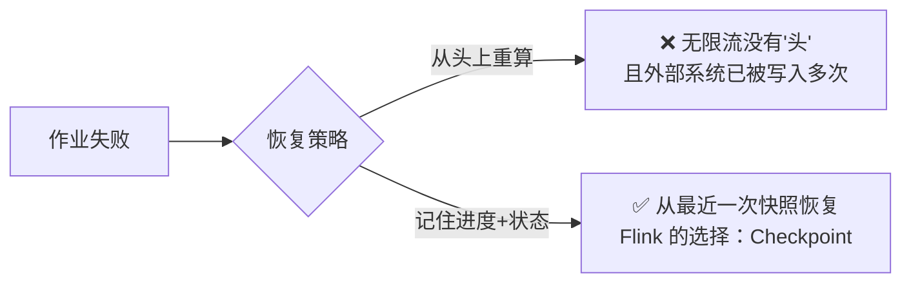
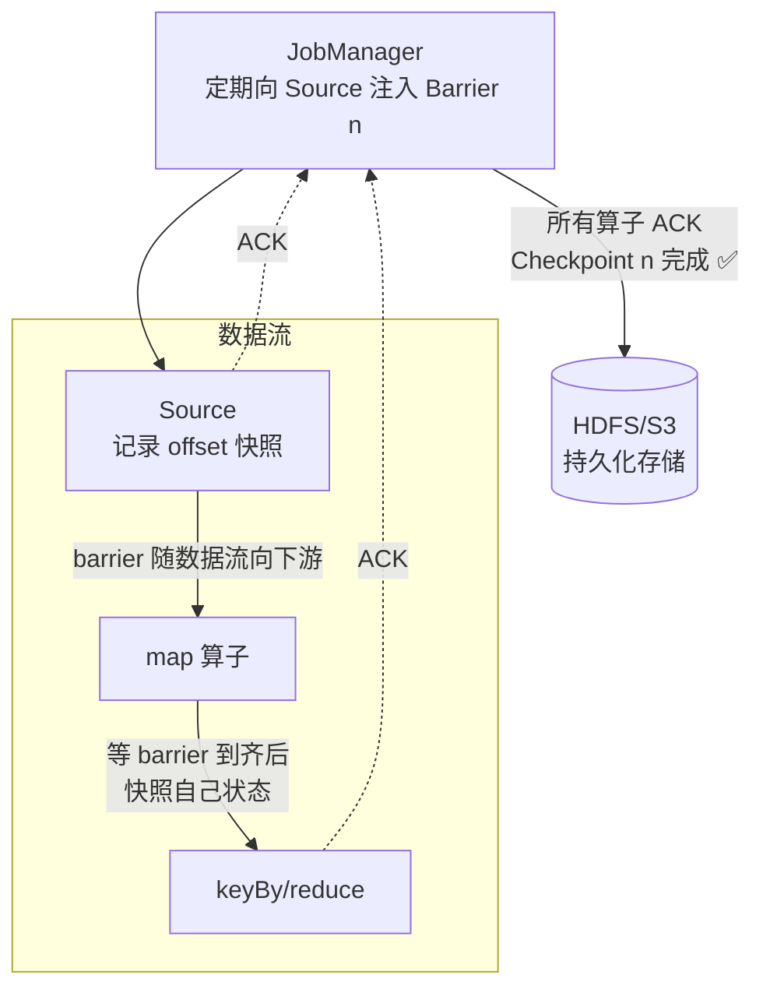
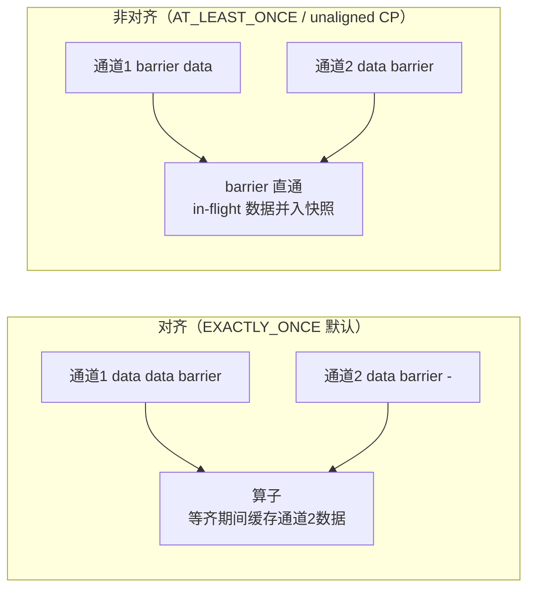
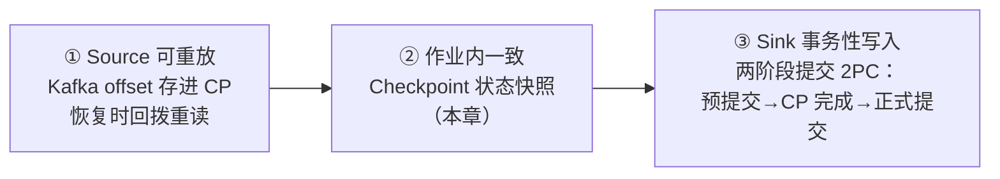

# 第7章 · 容错机制（Checkpoint 与 Exactly-Once）

 

> **本章目标**：理解 Flink 容错的杀手锏——基于分布式快照的 **Checkpoint**，掌握配置与恢复流程，搞懂"端到端 Exactly-Once"的三个前提条件。这是生产面试的重灾区。

**业务场景**：实时交易对账作业跑了 3 天，TaskManager 宕机重启后，**已统计的 1.2 亿成交额不能丢也不能多算**——Kafka 里被消费但没来得及算的数据怎么办？算到一半的状态怎么办？

---

## 7.1 问题：故障后从哪里恢复？

流处理作业 7×24 运行，机器宕机是**必然事件**。恢复有两个层次：



**Checkpoint 要同时记住两样东西**：
1. **算子状态快照**：词频计数器算到多少了（第6章的状态）；
2. **输入位置**：Kafka 消费到哪个 offset 了。

恢复时：状态装回算子 + Source 回拨 offset 重放 → 计算结果就像故障从没发生过。

## 7.2 Checkpoint 原理：Barrier 对齐快照

Flink 基于 **Chandy-Lamport 分布式快照算法**，核心道具是 **Barrier（屏障）**——一条注入数据流的特殊标记：



**一次 Checkpoint 的完整时序**：

1. JM 定时向所有 Source 注入 barrier；
2. Source 收到后**先快照自己的 offset**，把 barrier 发往下游；
3. 中间算子 barrier 到达即快照状态；**多输入算子要等所有输入通道的 barrier 都到齐**（对齐）；
4. 全部算子 ACK → 本次 Checkpoint 成功，持久化到远程存储。

### Barrier 对齐与不对齐



| 模式 | 语义 | 代价 |
|:---|:---|:---|
| Aligned（对齐） | Exactly-Once | 背压时 barrier 流动慢 → **Checkpoint 超时** |
| Unaligned（非对齐） | Exactly-Once（in-flight 数据进快照） | 快照变大，但**背压下依然能成** |

?> **背压导致 Checkpoint 超时**是生产第一大故障。1.11+ 的 `unaligned checkpoint` 就是为它而生：barrier 不排队直接插队，代价是快照里多带一点在途数据。

## 7.3 Checkpoint 配置（生产模板）

完整代码：`code/src/main/java/com/flinkcourse/ch07/CheckpointDemo.java`

```java
StreamExecutionEnvironment env = StreamExecutionEnvironment.getExecutionEnvironment();

// ---- 基础三件套 ----
env.enableCheckpointing(60_000, CheckpointingMode.EXACTLY_ONCE);  // 60s 一次，精确一次
CheckpointConfig cfg = env.getCheckpointConfig();
cfg.setCheckpointTimeout(120_000);            // 超时 2 分钟：做不完就放弃，别堆积
cfg.setMinPauseBetweenCheckpoints(30_000);    // 两次 CP 最小间隔：防止"全部时间都在快照"
cfg.setMaxConcurrentCheckpoints(1);           // 同时最多 1 个在跑

// ---- 高级选项（按需开启） ----
cfg.setExternalizedCheckpointCleanup(
        CheckpointConfig.ExternalizedCheckpointCleanup.RETAIN_ON_CANCELLATION); // 取消作业也保留 CP
cfg.enableUnalignedCheckpoints();             // 背压严重时开启
cfg.setCheckpointStorage("file:///tmp/flink-ckpt");   // CP 存哪（生产：HDFS/S3/OSS）

// ---- 状态后端（配合第6章） ----
// env.setStateBackend(new EmbeddedRocksDBStateBackend());  // 大状态必配
```

### 运行实验：亲眼看一次故障恢复

```bash
# IDEA 运行 CheckpointDemo（每 5 秒一次 CP，统计累计输入条数）
# 记录控制台累计值，比如 count=100
# 点击 IDEA 的红色 Stop 强杀，再立刻重启 main
```

```java
// CheckpointDemo 核心逻辑：带状态的计数器
public static class CountWithState extends KeyedProcessFunction<String, String, String> {
    private transient ValueState<Long> countState;

    @Override
    public void open(Configuration parameters) {
        countState = getRuntimeContext().getState(
                new ValueStateDescriptor<>("count", Long.class));
    }

    @Override
    public void processElement(String value, Context ctx, Collector<String> out) throws Exception {
        Long c = countState.value();
        c = (c == null ? 0 : c) + 1;
        countState.update(c);
        // 看似普通的计数，恢复时 c 从 Checkpoint 还原，不会从 0 重来
        out.collect("key=" + ctx.getCurrentKey() + " 累计=" + c);
    }
}
```

**注意**：IDE 本地 kill 后重启，从 `file:///tmp/flink-ckpt` 自动恢复的前提是开启了 `-Dexecution.savepoint...`？——不，本地实验更简单的做法是**故意制造异常**：当计数到 50 时 `throw new RuntimeException("模拟故障")`，框架自动重启作业（默认无限重启策略），从最近 Checkpoint 恢复，观察计数从快照值继续而不是从 1 开始。`CheckpointDemo.java` 内置了这个实验，注释切换即可。

## 7.4 Savepoint vs Checkpoint

| 对比项 | Checkpoint | Savepoint |
|:---|:---|:---|
| 触发 | 自动（定时） | **手动**（升级/迁移/扩缩容前） |
| 粒度 | 轻量、可能增量的 | 全量、标准化格式 |
| 保留 | 新版完成旧版可删（可配置） | **永久保留直到手删** |
| 典型用途 | 故障恢复 | 版本升级、A/B 集群迁移、修改并行度 |

```bash
# 触发 savepoint
$FLINK_HOME/bin/flink savepoint <jobId> file:///tmp/flink-sp

# 从 savepoint 启动（可改并行度、升级代码）
$FLINK_HOME/bin/flink run -s file:///tmp/flink-sp/<sp-id> -c com.xxx.Job app.jar

# 允许忽略无法恢复的状态位（删了某个算子时）
$FLINK_HOME/bin/flink run -s sp-path --allowNonRestoredState ...
```

> **生产铁律**：发版必停作业前先 savepoint；savepoint 目录和作业 ID 记录在案。改了算子 UID 记得"兼容"问题——见下节坑 2。

## 7.5 端到端 Exactly-Once：三个前提

Checkpoint 只保证**作业内部**的一致性。数据从 Kafka 进、到 Kafka/MySQL 出，端到端精确一次需要三段配合：



| 环节 | 机制 | 谁负责 |
|:---|:---|:---|
| Source 可重放 | offset 随 Checkpoint 快照 | Kafka Connector 已实现 |
| 内部状态一致 | Barrier 快照 | Flink 框架 |
| Sink 不重不漏 | **两阶段提交（2PC）**：数据先预提交（事务暂不可见），收到 Checkpoint 完成通知才真正提交 | Sink Connector |

**Kafka 事务 Sink 示例**（`EXACTLY_ONCE` 模式）：

```java
KafkaSink<String> sink = KafkaSink.<String>builder()
        .setBootstrapServers("localhost:9092")
        .setRecordSerializer(KafkaRecordSerializationSchema.builder()
                .setTopic("dws_result")
                .setValueSerializationSchema(new SimpleStringSchema())
                .build())
        .setDeliveryGuarantee(DeliveryGuarantee.EXACTLY_ONCE)   // ← 事务性写入
        .setTransactionalIdPrefix("gmv-sink-")                   // ← 2PC 必配，唯一前缀
        .build();
```

!> **下游必须能读事务消息**：Kafka 事务写入后，消费端要设 `isolation.level=read_committed` 才能读到已提交数据，否则"消费不到/有延迟"排查到怀疑人生。**JDBC 默认无事务 Sink，MySQL 场景通常退而求 AT_LEAST_ONCE + 下游幂等（唯一键去重）**——这是工程上更常用的路线。

## 7.6 重启策略

Checkpoint 做好了"恢复到哪"，重启策略决定"要不要恢复、隔多久恢复"：

```java
env.setRestartStrategy(RestartStrategies.fixedDelayRestart(
        3,                                   // 最多尝试 3 次
        Time.of(10, TimeUnit.SECONDS)));     // 每次间隔 10s

// 生产常用：失败率策略
env.setRestartStrategy(RestartStrategies.failureRateRestart(
        3, Time.of(5, TimeUnit.MINUTES),     // 5 分钟内最多 3 次失败
        Time.of(30, TimeUnit.SECONDS)));     // 否则间隔 30s 重试
```

## 7.7 常见坑

| 坑 | 现象 | 解法 |
|:---|:---|:---|
| Checkpoint 超时失败 | 日志 `Checkpoint expired before completing` | ① 背压（第14章）② 状态太大 → RocksDB 增量 CP ③ interval 拉大 ④ 开 unaligned |
| 改代码后 Savepoint 恢复失败 | `Failed to restore state` | 算子链变了/算子删了；给算子显式 `.uid("xxx")` 固定身份 |
| Checkpoint 都成功但数据重复 | 下游 Kafka 出现重复 | CP 只管内部！Sink 没用事务 → `EXACTLY_ONCE` + read_committed |
| 两阶段提交卡住 | Sink 长期无数据 | 事务超时（默认 15 分钟）< Kafka transaction timeout 配置有坑，需调 `transaction.timeout.ms` |
| minPause 没设 | CPU 全耗在快照 | interval 60s + minPause 30s 起步 |
| 恢复后从最新消费 | 数据"丢了" | Kafka 消费组 offset 提交与 CP 状态是两回事，恢复用 CP 里的 offset；检查是否误用 `setStartingOffsets(latest)` 且无 CP |

## ✍️ 动手练习

1. 运行 `CheckpointDemo` 的内置故障实验，观察重启后累计值从快照续算，并回答：**为什么重放的数据不会导致重复计数？**（提示：状态和 offset 是同一快照的一部分）；
2. 把 checkpoint interval 改为 1 秒、`minPause=0`，观察日志风暴，理解为什么不能这么做；
3. **思考题**：`AT_LEAST_ONCE`（非对齐 barrier）模式下，恢复后可能多算吗？为什么 Flink 默认还要坚持 EXACTLY_ONCE？（提示：多算的影响由谁承担）

---

## 本章小结

- Checkpoint = **分布式快照**（Chandy-Lamport）：Barrier 流动 + 状态与 offset 原子快照；
- 对齐保语义但怕背压，**unaligned checkpoint** 治超时；
- Checkpoint（自动恢复）vs Savepoint（手动、发版迁移），**算子记得设 uid**；
- 端到端 Exactly-Once 三前提：**可重放 Source + CP + 事务 Sink(2PC)**；
- JDBC 类 Sink 走 **AT_LEAST_ONCE + 幂等** 是工程常态。

---

<div class="chapter-nav">

[⬅️ 第6章 · 状态管理](ch06.md)
[➡️ 第8章 · Flink SQL](ch08.md)

</div>
