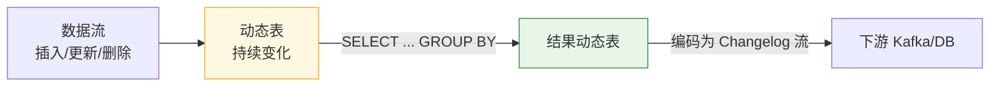

# 第8章 · Flink SQL 与 Table API

 

> **本章目标**：掌握用 SQL 开发实时作业——动态表概念、CREATE TABLE 连接器 DDL、窗口 TVF、Top-N，实现"实时 GMV 大屏"。体会为什么说"SQL 是 Flink 流批一体的终极形态"。

**业务场景**：大屏需求又来了，但这次数据团队只有 0.5 个人力。SQL 版 GMV 大屏：`SELECT 城市, SUM(金额) FROM 订单 GROUP BY 城市`，加个窗口就是实时版。**Flink SQL 让 90% 的实时数仓开发退化成写 SQL。**

---

## 8.1 为什么需要 Flink SQL？

| 维度 | DataStream API | Flink SQL |
|:---|:---|:---|
| 上手门槛 | 要懂 Java/算子/状态 | 会 SQL 就行 |
| 流批统一 | 同一套 API | **同一份 SQL**，切执行模式即可 |
| 优化 | 手工 | 框架自动优化（谓词下推、算子复用） |
| 灵活性 | 完全自由 | 复杂逻辑要 UDF |
| 适用 | 复杂事件逻辑（风控/CEP） | **实时数仓主流** |

?> **分工直觉**：实时数仓（90% 场景）用 SQL；复杂状态机/CEP/精细控制用 DataStream。两者可通过 `toDataStream()/fromDataStream()` 互转，混搭使用。

## 8.2 核心概念：动态表（Dynamic Table）

关系代数的 SQL 是对**静态表**的查询；流处理的 SQL 查询的是**动态表**——随数据到达持续变化的表：



**Changelog（变更日志流）三种消息**：

| 消息类型 | 语义 | 例子 |
|:---|:---|:---|
| `+I` Insert | 新增一行 | 新订单插入 |
| `-U` / `+U` Update | 撤回旧值 / 写入新值 | GMV 从 100 更新为 150 |
| `-D` Delete | 删除一行 | 撤单 |

```sql
-- 输入：INSERT 深圳 100 → INSERT 深圳 200
-- 查询：SELECT city, SUM(amount) FROM orders GROUP BY city
-- 输出 changelog： +I(深圳,100)  -U(深圳,100) +U(深圳,300)
```

!> **Sink 必须匹配 changelog 类型**：聚合查询产出更新流，**只能写支持 upsert 的 Sink**（Kafka 主键表/JDBC/Redis）；写普通 Kafka append topic 会直接报错 `doesn't support consuming update changes`。

## 8.3 实战一：五分钟版实时 GMV（SQL 完整流程）

完整代码：`code/src/main/java/com/flinkcourse/ch08/SqlDashboardJob.java`

```java
package com.flinkcourse.ch08;

import org.apache.flink.table.api.bridge.java.StreamTableEnvironment;
import org.apache.flink.table.api.EnvironmentSettings;
import org.apache.flink.streaming.api.environment.StreamExecutionEnvironment;

/**
 * 场景：SQL 版实时 GMV 大屏（第8章主示例）
 * 运行：需 docker compose 环境（Kafka + MySQL）
 * 提前准备：运行 ch11 的 MockUserActionProducer 或手动灌数据到 topic ods_orders
 */
public class SqlDashboardJob {

    public static void main(String[] args) {
        StreamExecutionEnvironment env = StreamExecutionEnvironment.getExecutionEnvironment();
        env.enableCheckpointing(60000);
        StreamTableEnvironment tEnv = StreamTableEnvironment.create(env,
                EnvironmentSettings.inStreamingMode());

        // ① Source 表：Kafka 订单日志
        tEnv.executeSql("""
            CREATE TABLE ods_orders (
                user_id   BIGINT,
                amount    DECIMAL(10, 2),
                city      STRING,
                status    INT,
                event_time TIMESTAMP(3) METADATA FROM 'timestamp',   -- 从 Kafka 记录元数据取时间
                WATERMARK FOR event_time AS event_time - INTERVAL '5' SECOND
            ) WITH (
                'connector' = 'kafka',
                'topic' = 'ods_orders',
                'properties.bootstrap.servers' = 'localhost:9092',
                'properties.group.id' = 'sql-dashboard',
                'scan.startup.mode' = 'earliest-offset',
                'format' = 'json',
                'json.fail-on-missing-field' = 'false',
                'json.ignore-parse-errors' = 'true'
            )
            """);

        // ② 结果表：MySQL（主键表 → 自动 upsert，大屏读 MySQL 即可）
        tEnv.executeSql("""
            CREATE TABLE dws_gmv (
                stat_time  STRING,
                city       STRING,
                order_cnt  BIGINT,
                gmv_amount DECIMAL(16, 2),
                PRIMARY KEY (stat_time, city) NOT ENFORCED
            ) WITH (
                'connector' = 'jdbc',
                'url' = 'jdbc:mysql://localhost:3306/flink_course',
                'table-name' = 'dws_gmv',
                'username' = 'root',
                'password' = 'flink123'
            )
            """);

        // ③ 核心逻辑：一行 SQL 完成第5章滚动窗口 GMV 的全部工作
        tEnv.executeSql("""
            INSERT INTO dws_gmv
            SELECT
                DATE_FORMAT(window_start, 'HH:mm') AS stat_time,
                city,
                COUNT(*)        AS order_cnt,
                SUM(amount)     AS gmv_amount
            FROM TABLE(
                TUMBLE(TABLE ods_orders, DESCRIPTOR(event_time), INTERVAL '1' MINUTE))
            WHERE status = 2
            GROUP BY window_start, window_end, city
            """);
    }
}
```

**看 SQL 的姿势**：`TUMBLE(TABLE t, DESCRIPTOR(time), INTERVAL size)` 是**窗口表值函数（TVF）**——1.13+ 的标准窗口写法，取代老式的 `GROUP BY TUMBLE(...)`。`WATERMARK` 声明在 DDL 里，与第4章 `WatermarkStrategy` 等价。

### 验证

```bash
# 终端1：灌数据（需先建 topic，见第11章；或直接运行 ch11 MockUserActionProducer）
docker exec flink-kafka kafka-console-producer.sh --topic ods_orders \
  --bootstrap-server localhost:9092
# 输入：{"userId":1001,"amount":299.0,"city":"深圳","status":2,"ts":1730000000000}
#      {"userId":1002,"amount":59.9,"city":"杭州","status":2,"ts":1730000005000}

# 终端2：跑作业，1 分钟窗口触发后查 MySQL
docker exec -it flink-mysql mysql -uroot -pflink123 flink_course \
  -e "SELECT * FROM dws_gmv ORDER BY stat_time DESC LIMIT 10"
```

## 8.4 窗口 TVF 全家福

```sql
-- ① 滚动窗口：每 1 分钟 GMV（本章主示例）
FROM TABLE(TUMBLE(TABLE t, DESCRIPTOR(ts), INTERVAL '1' MINUTE))

-- ② 滑动窗口：近 5 分钟每 1 分钟 UV
FROM TABLE(HOP(TABLE t, DESCRIPTOR(ts), INTERVAL '1' MINUTE, INTERVAL '5' MINUTE))

-- ③ 累积窗口：当天 0 点起，每 10 分钟"累计"一次（大屏最爱！全天累计 GMV）
FROM TABLE(CUMULATE(TABLE t, DESCRIPTOR(ts), INTERVAL '10' MINUTE, INTERVAL '1' DAY))

-- ④ 会话窗口
FROM TABLE(SESSION(TABLE t, DESCRIPTOR(ts), INTERVAL '30' MINUTE))
```

?> **CUMULATE 是大屏神器**：双11 实时战报"截至当前总 GMV"，本质就是从 0 点开始的累积窗口，每 10 分钟输出一次最新累计值——比滑动窗口表达力强得多。

## 8.5 Top-N：实时热榜

```sql
-- 每分钟每个城市的 TOP 3 销量商品（实时热销榜）
SELECT *
FROM (
    SELECT *,
        ROW_NUMBER() OVER (
            PARTITION BY window_start, window_end, city
            ORDER BY sales DESC) AS rn
    FROM TABLE(TUMBLE(TABLE dwd_sales, DESCRIPTOR(event_time), INTERVAL '1' MINUTE))
)
WHERE rn <= 3
```

`ROW_NUMBER() OVER` 就是 Flink SQL 的 Top-N 模式，输出 `-U/+U` 更新流——**榜单排名变化时自动更新**，天然对接大屏。

## 8.6 DataStream ⇄ Table 互转

```java
// DataStream → Table（快速给流套 SQL）
Table table = tEnv.fromDataStream(orderStream);
tEnv.createTemporaryView("orders_view", table);

// Table → DataStream（SQL 结果继续用算子加工）
TableResult result = tEnv.executeSql("SELECT city, SUM(amount) FROM orders_view GROUP BY city");
// 视图/聚合表转流：更新流用 changelog 流
DataStream<Row> changelog = tEnv.toChangelogStream(result.getTable());
changelog.print();
```

## 8.7 常见坑

| 坑 | 现象 | 解法 |
|:---|:---|:---|
| 聚合结果写 Kafka 失败 | `doesn't support consuming update changes` | 聚合产出更新流，Kafka 需配 `key.format` + 主键（upsert-kafka），或改写 JDBC |
| 时区问题 | 窗口时间差 8 小时 | DDL 里 `TIMESTAMP(3)` 配 `table.local-time-zone`；窗口边界用 UTC 计算，展示时格式化 |
| JSON 字段缺失导致作业挂 | 反序列化异常 | `'json.ignore-parse-errors' = 'true'` + 容错日志 |
| 窗口不触发 | 结果迟迟不来 | WATERMARK 声明缺失/乱序度不足；SQL 日志里有 watermark 指标 |
| TVF 语法报错 | `TUMBLE is not a function` | 老版本语法已废弃，确认 1.13+；课程 1.20 全部用 TVF |
| 主键 NOT ENFORCED 疑惑 | 为什么主键不强制 | 流数据无法实时校验唯一性，`NOT ENFORCED` 声明"业务自己保证"，Flink 只用来做 upsert 路由 |

## ✍️ 动手练习

1. 把主示例改成 **CUMULATE 累积窗口**：每 30 秒输出"当天截至当前的全国总 GMV"；
2. 增加实时 UV：`COUNT(DISTINCT user_id)`，思考为什么 DISTINCT 聚合的状态可能很大、如何缓解；
3. 写一个热销榜：每分钟全国 TOP 3 城市（按 GMV），结果打到大屏表。

---

## 本章小结

- 流上的 SQL 查询的是**动态表**，结果编码为 **Changelog**（+I/-U/+U/-D）；
- DDL 即连接器：`CREATE TABLE ... WITH ('connector'=...)`，Watermark 在 DDL 中声明；
- 窗口标准写法 = **窗口 TVF**：TUMBLE / HOP / **CUMULATE（大屏累计神器）** / SESSION；
- Top-N 用 `ROW_NUMBER() OVER`；
- 聚合输出是更新流 → **Sink 必须支持 upsert**（JDBC 主键表 / upsert-kafka）。

---

<div class="chapter-nav">

[⬅️ 第7章 · 容错机制](ch07.md)
[➡️ 第9章 · Flink CDC](ch09.md)

</div>
