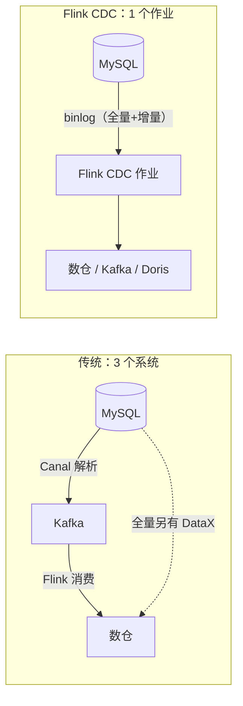
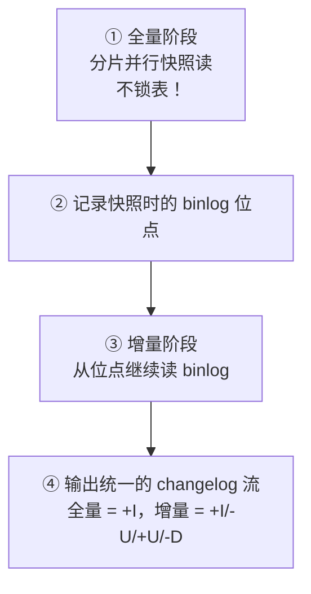

# 第9章 · Flink CDC：数据库实时同步

 

> **本章目标**：理解 CDC（Change Data Capture）的原理，用 Flink CDC 实现 MySQL 数据库的**全量+增量一体化**实时同步，打通"业务库 → 实时数仓"的最后一公里。

**业务场景**：实时数仓需要关联商品维表（存在 MySQL 里），但维表**每天变更几万次**（改名、调价、上下架）。T+1 全量同步？大屏显示下架商品。双写业务库+ES？侵入业务代码。**CDC 直接订阅数据库的变更日志（binlog），变更发生毫秒后即捕获**。

---

## 9.1 数据同步方案演进

| 方案 | 原理 | 延迟 | 全量 | 增量 | 痛点 |
|:---|:---|:---:|:---:|:---:|:---|
| 定时全量（DataX/Sqoop） | 周期性 SELECT 全表 | 小时级 | ✅ | ❌ | 时效差，扫描压力 |
| 双写 | 业务代码同时写两处 | 毫秒 | ✅ | ✅ | **侵入业务**，一致性难保 |
| 传统 CDC（Canal/Debezium+Kafka） | 独立集群解析 binlog → Kafka | 秒级 | ❌ 需另做 | ✅ | 多一套运维；**全量+增量衔接复杂** |
| **Flink CDC** | Flink 作业直接读 binlog | 秒级 | ✅ **一体化** | ✅ | 无中间件、精确一次 |



## 9.2 原理：全量 + 增量无缝切换

Flink CDC（基于 Debezium）的精妙之处——**无锁全量读取算法**（Flink CDC 2.0+）：



**为什么无锁是大事**：生产 MySQL 上 `LOCK TABLES` 哪怕 1 秒，业务都在流血。Debezium 原生全量阶段要锁表，Flink CDC 用**增量快照算法**（分片 + 高水位）绕开了锁。

## 9.3 前置条件：MySQL 侧配置

课程 `docker-compose.yml` 已配好（第1章），核对三项：

```yaml
command:
  --server-id=1            # ① CDC 要求，集群内唯一
  --log-bin=mysql-bin      # ② 开启 binlog
  --binlog-format=ROW      # ③ 必须 ROW 格式（记录每行变化）
```

账号权限：`SELECT, REPLICATION SLAVE, REPLICATION CLIENT`（课程 root 已授予，生产必须独立账号+最小权限）。

> ⚠️ **版本匹配坑（实战高频）**：`flink-connector-mysql-cdc ≤ 3.3` 读 binlog 位点用的 `SHOW MASTER STATUS` 在 **MySQL 8.4+ 已被移除**（9.x 只有 `SHOW BINARY LOG STATUS`），会报 `SQLSyntaxErrorException`。
> 本课程固定 **`3.6.0-1.20`**（支持 MySQL 8.0~9.x）。如果你的 MySQL ≥ 8.4 且 CDC 报这个错，升级连接器版本即可。

## 9.4 实战：SQL 版 CDC（推荐，3 分钟）

完整代码：`code/src/main/java/com/flinkcourse/ch09/CdcSqlJob.java`

```java
package com.flinkcourse.ch09;

import org.apache.flink.table.api.bridge.java.StreamTableEnvironment;
import org.apache.flink.table.api.EnvironmentSettings;
import org.apache.flink.streaming.api.environment.StreamExecutionEnvironment;

/**
 * 场景：MySQL orders 表实时同步到 Kafka（第9章主示例）
 * 运行：需 docker compose 环境；启动后去 MySQL 改一条订单数据观察输出
 */
public class CdcSqlJob {

    public static void main(String[] args) {
        StreamTableEnvironment tEnv = StreamTableEnvironment.create(
                StreamExecutionEnvironment.getExecutionEnvironment(),
                EnvironmentSettings.inStreamingMode());

        // ① CDC Source 表：MySQL orders
        tEnv.executeSql("""
            CREATE TABLE orders_cdc (
                order_id    BIGINT,
                user_id     BIGINT,
                amount      DECIMAL(10, 2),
                city        STRING,
                status      TINYINT,
                create_time TIMESTAMP(3),
                PRIMARY KEY (order_id) NOT ENFORCED      -- 主键 = upsert 依据
            ) WITH (
                'connector' = 'mysql-cdc',
                'hostname' = 'localhost',
                'port' = '3306',
                'username' = 'root',
                'password' = 'flink123',
                'database-name' = 'flink_course',
                'table-name' = 'orders'
            )
            """);

        // ② 打印实时变更（也可 INSERT INTO kafka/jdbc 目标表）
        tEnv.executeSql("""
            CREATE TABLE print_sink (
                order_id BIGINT, user_id BIGINT, amount DECIMAL(10,2),
                city STRING, status TINYINT, create_time TIMESTAMP(3),
                PRIMARY KEY (order_id) NOT ENFORCED
            ) WITH ('connector' = 'print')
            """);

        tEnv.executeSql("INSERT INTO print_sink SELECT * FROM orders_cdc");
    }
}
```

### 运行与验证（关键实验！）

```bash
# 1. 启动作业：先全量输出 7 条初始订单
#    +I(1, 1001, 299.00, 深圳, 2, ...)

# 2. 另开终端，改 MySQL：
docker exec -it flink-mysql mysql -uroot -pflink123 flink_course
UPDATE orders SET amount = 399.00 WHERE order_id = 1;

# 3. 回到作业控制台，毫秒级出现：
#    -U(1, 1001, 299.00, 深圳, 2, ...)     ← 撤回旧值
#    +U(1, 1001, 399.00, 深圳, 2, ...)     ← 写入新值

# 4. 再 INSERT 一条新订单 → +I 新增
```

**这一刻，MySQL 的每次心跳都变成了流**——这就是"数据库流化"。

## 9.5 DataStream 版 CDC（需要精细控制时）

完整代码：`code/src/main/java/com/flinkcourse/ch09/CdcDataStreamJob.java`

```java
import org.apache.flink.cdc.connectors.mysql.source.MySqlSource;

MySqlSource<String> mySqlSource = MySqlSource.<String>builder()
        .hostname("localhost")
        .port(3306)
        .databaseList("flink_course")          // 库级监听
        .tableList("flink_course.orders")      // 精确到表
        .username("root")
        .password("flink123")
        .deserializer(new JsonDebeziumDeserializationSchema())  // 变更序列化为 JSON
        .startupOptions(StartupOptions.initial())  // 全量+增量（默认）
        .build();

env.fromSource(mySqlSource, WatermarkStrategy.noWatermarks(), "MySQL CDC")
   .print();   // 输出 JSON：{"before":{...}, "after":{...}, "op":"u", ...}
```

| StartupOptions | 语义 | 场景 |
|:---|:---|:---|
| `initial()` | 全量 + 增量（默认） | 首次建仓 |
| `latest()` | 只增量 | 已有全量快照 |
| `specificOffset(...)` | 从指定位点 | 精确回补 |

## 9.6 CDC 的三大杀手级用法

```sql
-- 用法①：实时同步（本章）
INSERT INTO kafka_target SELECT * FROM orders_cdc;

-- 用法②：实时维表（第10章展开 lookup join）
SELECT o.amount, p.product_name
FROM orders AS o JOIN products FOR SYSTEM_TIME AS OF o.proc_time AS p
  ON o.product_id = p.id;

-- 用法③：实时数仓 ODS 层（第11章）
-- 业务库 binlog 直接作为数仓 ODS 输入，替代"埋点双写"
```

## 9.7 常见坑

| 坑 | 现象 | 解法 |
|:---|:---|:---|
| binlog 未开/格式不对 | 连接报错 / 读不到变更 | `ROW` 格式 + 开 binlog；`SHOW VARIABLES LIKE 'log_bin'` 检查 |
| server-id 冲突 | 互相踢线 | 每个 CDC 实例唯一 server-id（多作业要显式 `.serverId(...)`） |
| 全量阶段读取慢 | 快照迟迟不完成 | 大表分片并行读：`scan.incremental.snapshot.enabled=true`（3.x 默认）+ `scan.snapshot.chunk.size` 调小 |
| CDC 作业与业务库时区不一致 | 时间差 N 小时 | `server-time-zone=Asia/Shanghai` 必配（容器 UTC） |
| 权限不足 | `ACCESS DENIED` | `REPLICATION SLAVE` 权限别漏 |
| 单表无主键 | 增量阶段报错 | **CDC 要求表有主键**（upsert 依据）；没有主键的表加自增 ID |

## ✍️ 动手练习

1. 给 MySQL 新增一张 `products` 商品表，写一个 CDC 作业实时同步到 `products_kafka` topic；
2. 实验 `DELETE` 一条订单，观察 changelog 输出的消息类型（`-D`）；
3. **思考题**：CDC 全量阶段作业失败重启，全量数据会重复读取吗？为什么？（提示：回想第7章 Checkpoint，全量分片进度也是状态）

---

## 本章小结

- CDC = 订阅数据库变更日志（binlog），把"表"变成"流"；
- Flink CDC 亮点：**全量+增量一体化、无锁快照、Exactly-Once**，一个作业替代 Canal+DataX；
- SQL 用法：`'connector'='mysql-cdc'` + 主键；API 用法：`MySqlSource.builder()`；
- MySQL 要求：ROW 格式 binlog、唯一 server-id、主键表、复制权限；
- 三大用法：**实时同步 / 维表 lookup / 数仓 ODS 直连**。

---

<div class="chapter-nav">

[⬅️ 第8章 · Flink SQL](ch08.md)
[➡️ 第10章 · 常用连接器](ch10.md)

</div>
