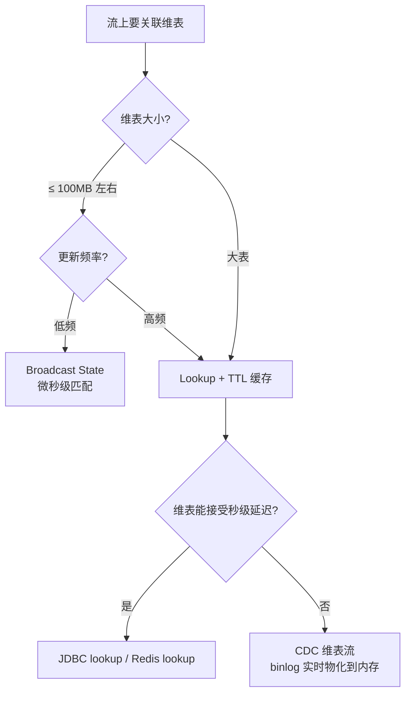

# 第10章 · 常用连接器与维表 Join

 

> **本章目标**：系统掌握生产最高频的三个连接器——**Kafka（数据总线）、JDBC（结果落库）、Redis（去重/维表）**，并实现"流表关联维表"的 Lookup Join 与 Broadcast Join。

**业务场景**：订单流里只有 `city_id`，大屏要显示城市名；城市映射表 5 万行，存在 MySQL。**流上的每条订单都要"查表补全"**——怎么又快又准？

---

## 10.1 连接器全景

| 连接器 | 角色 | 一致性 | 章节 |
|:---|:---|:---|:---|
| **Kafka** | 数据源 + 数据总线 | EXACTLY_ONCE（事务） | 本章 |
| **JDBC (MySQL)** | 结果表 + 维表 | AT_LEAST_ONCE（幂等 upsert） | 本章 |
| **Redis** | 去重/维表/输出 | 自定义实现 | 本章 |
| 文件系统/HDFS | 批/归档 | EXACTLY_ONCE | 不展开 |
| Doris/StarRocks/Hologres | 实时 OLAP | EXACTLY_ONCE | 第11章提及 |
| Elasticsearch | 检索 | AT_LEAST_ONCE | 用法同 JDBC，不展开 |

## 10.2 Kafka Source 深度配置

```java
KafkaSource<String> source = KafkaSource.<String>builder()
        .setBootstrapServers("localhost:9092")
        .setTopics("orders")                       // 多 topic：setTopics("a","b")
        .setGroupId("order-job")
        // ---- 消费起点：无位点时的行为 ----
        .setStartingOffsets(OffsetsInitializer.earliest())       // 从头
        // .setStartingOffsets(OffsetsInitializer.latest())      // 只看新数据
        // .setStartingOffsets(OffsetsInitializer.timestamp(1730000000000L)) // 按时间
        // .setStartingOffsets(OffsetsInitializer.committedOffsets(OffsetsInitializer.SpecificOffsets...)) // 消费组位点
        .setValueOnlyDeserializer(new SimpleStringSchema())
        .build();
```

> **关键认知**：Flink 不靠 Kafka 消费组位点保证一致性——**offset 存在 Checkpoint 里**（第7章），恢复时回拨。消费组位点只用于监控展示。

### Kafka Sink 与一致性

```java
KafkaSink<String> sink = KafkaSink.<String>builder()
        .setBootstrapServers("localhost:9092")
        .setRecordSerializer(KafkaRecordSerializationSchema.builder()
                .setTopic("dws_result")
                .setKeySerializationSchema(new SimpleStringSchema())  // 有 key 才能按 key 分区保序
                .setValueSerializationSchema(new SimpleStringSchema())
                .build())
        .setDeliveryGuarantee(DeliveryGuarantee.AT_LEAST_ONCE)  // 见下表
        .build();
```

| DeliveryGuarantee | 语义 | 要求 |
|:---|:---|:---|
| `AT_LEAST_ONCE` | 至少一次，下游幂等去重 | 无 |
| `EXACTLY_ONCE` | 事务写入（2PC，见第7章） | `setTransactionalIdPrefix` + 下游 `read_committed` |
| `NONE` | 发了就算 | 极少用 |

!> **同 key 保序**：需要"同一用户的事件有序"时，**必须设 Key 序列化**（按 key 哈希分区）；无 key 轮询写分区，同用户事件会乱。

## 10.3 JDBC Sink：结果落 MySQL

完整代码：`code/src/main/java/com/flinkcourse/ch10/JdbcSinkDemo.java`

```java
// 流式 upsert 落库：主键冲突自动更新（幂等 = AT_LEAST_ONCE 也能最终一致）
// Sink2 API（1.20 推荐）：builder 三步走
JdbcSink<CityStat> mysqlSink = JdbcSink
    .<CityStat>builder()
    .withQueryStatement(
        "INSERT INTO dws_gmv (stat_time, city, order_cnt, gmv_amount) VALUES (?, ?, 1, ?) "
      + "ON DUPLICATE KEY UPDATE order_cnt = order_cnt + 1, gmv_amount = gmv_amount + VALUES(gmv_amount)",
        (ps, stat) -> {                       // PreparedStatement 参数绑定
            ps.setString(1, stat.getStatTime());
            ps.setString(2, stat.getCity());
            ps.setDouble(3, stat.getAmount());
        })
    .withExecutionOptions(JdbcExecutionOptions.builder()
        .withBatchSize(100)               // 攒 100 条
        .withBatchIntervalMs(1000)        // 或每秒 flush 一次（先到先触发）
        .withMaxRetries(3)
        .build())
    .buildAtLeastOnce(
        new JdbcConnectionOptions.JdbcConnectionOptionsBuilder()
            .withUrl("jdbc:mysql://localhost:3306/flink_course")
            .withDriverName("com.mysql.cj.jdbc.Driver")
            .withUsername("root").withPassword("flink123")
            .build());

stream.sinkTo(mysqlSink);
```

**批量写入三件套**（面试常问）：`batchSize` + `batchInterval` + `maxRetries`。不攒批 = 每条一个连接往返 = 数据库被打爆。

## 10.4 Redis：自定义 Sink（教学级实现）

完整代码：`code/src/main/java/com/flinkcourse/ch10/RedisSinkDemo.java`

```java
/**
 * 用 Jedis 实现的 Redis Sink —— 演示自定义 Sink 写法
 * 状态随 Checkpoint 恢复见 ch06 BufferingSinkDemo；本例聚焦外部连接管理
 */
public class JedisRichSink extends RichSinkFunction<Tuple2<String, Double>> {
    private transient JedisPooled jedis;

    @Override
    public void open(Configuration parameters) {
        // open() 里建连接：每个并行子任务一次，不能每条数据一次！
        jedis = new JedisPooled("localhost", 6379);
    }

    @Override
    public void invoke(Tuple2<String, Double> value, Context ctx) {
        jedis.zincrby("city:rank:today", value.f1, value.f0);  // 城市GMV排行榜
    }

    @Override
    public void close() {
        if (jedis != null) jedis.close();
    }
}
```

!> **连接管理铁律**：外部连接在 `open()` 创建、`close()` 释放。**在 `invoke()` 里每条数据建一次连接**是新手性能杀手（TCP+AUTH 握手开销 × QPS）。

## 10.5 维表 Join：流上的"查表补全"

两种主流方案，按维表大小与时效性选型：

| 方案 | 原理 | 适用 | 延迟 |
|:---|:---|:---|:---:|
| **Lookup Join** | 每条流数据按 key **现查**外部表（带缓存） | 维表大、更新频繁 | 毫秒（网络） |
| **Broadcast Join** | 小维表**广播**到所有并行实例，内存匹配 | 维表小（<100MB）、更新低频 | 微秒 |

### 方案一：Lookup Join（SQL，主流）

```sql
-- 城市维表（MySQL），声明 lookup 缓存
CREATE TABLE dim_city (
    city_id BIGINT, city_name STRING, province STRING,
    PRIMARY KEY (city_id) NOT ENFORCED
) WITH (
    'connector' = 'jdbc',
    'url' = 'jdbc:mysql://localhost:3306/flink_course',
    'table-name' = 'dim_city',
    'username' = 'root', 'password' = 'flink123',
    'lookup.cache.max-rows' = '5000',        -- 缓存 5000 行
    'lookup.cache.ttl' = '10min'             -- 10 分钟过期（维表变更容忍度）
);

-- 流表 JOIN 维表：FOR SYSTEM_TIME AS OF 是固定语法
SELECT o.user_id, o.amount, c.city_name
FROM orders AS o
LEFT JOIN dim_city FOR SYSTEM_TIME AS OF o.proc_time AS c
  ON o.city_id = c.city_id;
```

**Lookup 缓存是性能生命线**：不加缓存，每条数据一次 MySQL 查询；加上 `"lookup.cache.max-rows" + "lookup.cache.ttl"`，命中率 99%+。

### 方案二：Broadcast State（DataStream）

```java
// 广播流：规则/维表（低频更新）
MapStateDescriptor<Void, Map<Long, String>> cityDesc =
    new MapStateDescriptor<>("cities", Types.VOID, Types.MAP(Types.LONG, Types.STRING));

BroadcastStream<Map<Long, String>> cityBroadcast =
    cityStream.broadcast(cityDesc);                     // 广播到所有子任务

// 主流 connect 广播流
orderStream
    .keyBy(Order::getCityId)
    .connect(cityBroadcast)                             // 注意：广播侧不需要 keyBy
    .process(new BroadcastProcessFunction<Order, Map<Long,String>, String>() {
        @Override   // 处理主流数据：从广播状态读维表补全
        public void processElement(Order order, ReadOnlyContext ctx, Collector<String> out)
                throws Exception {
            Map<Long, String> cities = ctx.getBroadcastState(cityDesc)
                    .get(null);                         // 广播状态只读！
            out.collect(order + " -> " + cities.get(order.getCityId()));
        }
        @Override   // 处理广播数据：更新广播状态
        public void processBroadcastElement(Map<Long, String> newCities, Context ctx,
                                            Collector<String> out) throws Exception {
            ctx.getBroadcastState(cityDesc).put(null, newCities);   // 只有这里可写
        }
    });
```

**Broadcast 三条铁律**（面试题）：
1. 广播状态**主流侧只读、广播侧可写**（防止并行实例各自为政，状态不一致）；
2. 广播流**不能 keyBy**；两侧 processElement 签名不同；
3. 恢复时广播状态从 Checkpoint 还原，**新加入的 TaskManager 靠重放广播流重建**——所以维表更新消息要幂等。

## 10.6 选型决策树



## 10.7 常见坑

| 坑 | 现象 | 解法 |
|:---|:---|:---|
| Lookup 打爆 MySQL | DB CPU 100% | 必加 lookup.cache；或维表 CDC 化 |
| 广播状态不更新 | 新规则不生效 | 广播流有数据但 key 覆盖逻辑写错；打印广播消息调试 |
| JDBC Sink 丢数据 | 重启后少了 | `maxRetries` 后仍失败会丢；关键数据走 CP + upsert 幂等 |
| Kafka EXACTLY_ONCE 下游读不到 | 消费延迟巨大 | `isolation.level=read_committed`；事务超时调大 |
| Redis 连接泄漏 | `too many clients` | 连接放 `open()`，`close()` 释放；或用连接池 |
| 维表 join 输出乱序 | 不算 bug | lookup 是异步并行的；需要有序就按 key 分区后看 |

## ✍️ 动手练习

1. 给 `JdbcSinkDemo` 加"批量缓冲"：每 50 条或每 2 秒 flush（提示：结合第6章 BufferingSink 思路，或直接依赖 JdbcSink 内置攒批参数）；
2. 建一张 `dim_city` 表灌 3 行数据，用 Lookup Join 补全订单流的城市名，然后 UPDATE 维表，观察 TTL 到期前后输出差异；
3. **思考题**：为什么广播状态在主流侧设计成只读？如果两边都能写，故障恢复时会发生什么？

---

## 本章小结

- Kafka Source 的位点管理由 **Checkpoint 接管**，消费组位点仅供监控；
- JDBC Sink 核心是 **攒批 + upsert 幂等**；
- 外部连接 `open()/close()` 管理生命周期，严禁每条数据建连接；
- 维表 Join 两板斧：**Lookup（大表、带缓存）** vs **Broadcast（小表、内存级）**；
- 广播状态铁律：**主流只读、广播侧可写、不能 keyBy**。

---

<div class="chapter-nav">

[⬅️ 第9章 · Flink CDC](ch09.md)
[➡️ 第11章 · 电商实时数仓](ch11.md)

</div>
