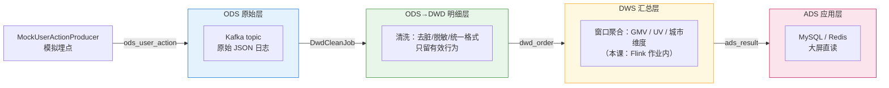

# 第11章 · 实战一：电商实时数仓（双11 大屏）

  

> **项目目标**：从零搭建"双11 实时大屏"——分钟级 GMV、实时 UV、城市热销榜，走完 **ODS→DWD→DWS→ADS** 完整数仓分层。这是实时数据方向最经典的简历项目。

---

## 11.1 需求拆解

产品经理的大屏原型：

| 指标 | 刷新频率 | 口径 |
|:---|:---|:---|
| **实时 GMV** | 每 10 秒 | 已支付订单金额累计（当日 0 点起） |
| **实时 UV** | 每 10 秒 | 当日去重访客数 |
| **城市榜** | 每分钟 | GMV TOP 5 城市 |

技术难点逐条映射到前面章节：

```
GMV 累计     → CUMULATE 窗口（第8章）
UV 去重      → 窗口 + 去重状态（第5/6章）
城市榜       → Top-N（第8章）
脏数据清洗   → filter/map（第3章）
乱序延迟     → Watermark（第4章）
数据源       → Kafka（第10章）
业务库维表   → CDC（第9章）
```

## 11.2 架构设计：数仓分层



**为什么要分层？**（面试必问）

| 层 | 职责 | 回答要点 |
|:---|:---|:---|
| ODS | 原样落 Kafka | 可重放，任何加工错误都能从源头重来 |
| DWD | 清洗 + 明细事实 | 一条订单一行，口径统一，**所有下游共用** |
| DWS | 按主题轻度汇总 | 大屏/BI 查询不必再扫明细，减轻 ADS 压力 |
| ADS | 面向应用的结果 | 直接对接大屏/接口 |

> 不分层 = 口径散落各作业、一次上游改字段全链路重写。**分层的本质是"复用与隔离"**。

## 11.3 数据契约

ODS 层 JSON 格式（`MockUserActionProducer` 产出）：

```json
{
  "userId": 1001,
  "action": "order",
  "amount": 299.0,
  "city": "深圳",
  "status": 2,
  "ts": 1730000001000
}
```

| 字段 | 说明 |
|:---|:---|
| action | `view` / `cart` / `order` |
| status | 仅 order 有：2=已支付，1=待支付（算 GMV 必须过滤） |
| ts | 事件时间（毫秒）——**Watermark 依据** |

## 11.4 代码实现（三个作业）

### 作业① 数据生产者

`code/src/main/java/com/flinkcourse/ch11/MockUserActionProducer.java`（普通 Java 程序，非 Flink 作业）

```java
/**
 * 模拟埋点：每 200ms 产生 1~3 条用户行为（含 5% 脏数据 + 3% 乱序延迟），
 * 写入 Kafka topic ods_user_action
 * 设计了脏数据与乱序，是为了让 DWD 的清洗和 Watermark 有用武之地
 */
public class MockUserActionProducer {
    public static void main(String[] args) throws Exception {
        String[] cities = {"深圳", "杭州", "北京", "上海", "成都", "武汉"};
        Random rnd = new Random();

        try (Producer<String, String> producer = new KafkaProducer<>(props())) {
            while (true) {
                long uid = 1000 + rnd.nextInt(200);
                String city = cities[rnd.nextInt(cities.length)];
                String action = rnd.nextInt(10) < 6 ? "view" : (rnd.nextInt(10) < 7 ? "cart" : "order");

                // 5% 脏数据：金额为负
                double amount = action.equals("order")
                        ? (rnd.nextInt(100) < 5 ? -rnd.nextInt(100) : rnd.nextInt(2000) + 1)
                        : 0;

                // 3% 乱序：ts 故意回拨 3~8 秒
                long ts = System.currentTimeMillis() - (rnd.nextInt(100) < 3
                        ? (3000 + rnd.nextInt(5000)) : 0);

                String json = String.format(
                    "{\"userId\":%d,\"action\":\"%s\",\"amount\":%.2f,\"city\":\"%s\",\"status\":%d,\"ts\":%d}",
                    uid, action, amount, city, action.equals("order") ? 2 : 0, ts);

                producer.send(new ProducerRecord<>("ods_user_action", String.valueOf(uid), json),
                        (meta, e) -> { if (e != null) e.printStackTrace(); });
                Thread.sleep(200);
            }
        }
    }
}
```

### 作业② DWD 清洗

`code/src/main/java/com/flinkcourse/ch11/DwdCleanJob.java`

```java
/**
 * ODS → DWD：只留有效订单（action=order 且 status=2 且 amount>0），
 * 手机号/用户ID脱敏后写入 dwd_order topic
 * 知识点：Kafka Source/Sink + map/filter + Watermark 挂载
 */
public class DwdCleanJob {
    public static void main(String[] args) throws Exception {
        StreamExecutionEnvironment env = StreamExecutionEnvironment.getExecutionEnvironment();
        env.enableCheckpointing(60_000, CheckpointingMode.EXACTLY_ONCE);
        env.setParallelism(2);

        KafkaSource<String> source = KafkaSource.<String>builder()
                .setBootstrapServers("localhost:9092")
                .setTopics("ods_user_action")
                .setGroupId("dwd-clean")
                .setStartingOffsets(OffsetsInitializer.earliest())
                .setValueOnlyDeserializer(new SimpleStringSchema())
                .build();

        KafkaSink<String> sink = KafkaSink.<String>builder()
                .setBootstrapServers("localhost:9092")
                .setRecordSerializer(KafkaRecordSerializationSchema.builder()
                        .setTopic("dwd_order")
                        .setValueSerializationSchema(new SimpleStringSchema())
                        .build())
                .setDeliveryGuarantee(DeliveryGuarantee.AT_LEAST_ONCE)  // 下游幂等，够用且高效
                .build();

        env.fromSource(source,
                        WatermarkStrategy.<String>forBoundedOutOfOrderness(Duration.ofSeconds(10))
                                .withTimestampAssigner((s, ts) ->
                                        JsonUtil.getLong(s, "ts")),  // 事件时间 = ts 字段
                        "ods-source")
            .filter(s -> {
                // ---- DWD 清洗规则 ----
                if (!"order".equals(JsonUtil.getStr(s, "action"))) return false; // 只留订单
                if (JsonUtil.getInt(s, "status") != 2)            return false; // 只留已支付
                return JsonUtil.getDouble(s, "amount") > 0;                    // 金额合法
            })
            .sinkTo(sink);

        env.execute("DWD Clean Job");
    }
}
```

### 作业③ DWS 聚合 → ADS

`code/src/main/java/com/flinkcourse/ch11/DwsGmvJob.java`

```java
/**
 * DWD → DWS → ADS：按城市 10 秒滚动窗口算 GMV，写 MySQL dws_gmv（大屏直读）
 * 知识点：滚动窗口 + aggregate/process 黄金组合 + JdbcSink 攒批 upsert
 */
public class DwsGmvJob {
    public static void main(String[] args) throws Exception {
        StreamExecutionEnvironment env = StreamExecutionEnvironment.getExecutionEnvironment();
        env.enableCheckpointing(60_000);

        KafkaSource<String> source = KafkaSource.<String>builder()
                .setBootstrapServers("localhost:9092")
                .setTopics("dwd_order")
                .setGroupId("dws-gmv")
                .setStartingOffsets(OffsetsInitializer.earliest())
                .setValueOnlyDeserializer(new SimpleStringSchema())
                .build();

        env.fromSource(source,
                        WatermarkStrategy.<String>forBoundedOutOfOrderness(Duration.ofSeconds(10))
                                .withTimestampAssigner((s, ts) -> JsonUtil.getLong(s, "ts")),
                        "dwd-source")
            .keyBy(s -> JsonUtil.getStr(s, "city"))
            .window(TumblingEventTimeWindows.of(Time.seconds(10)))
            .aggregate(
                new AggregateFunction<String, double[], double[]>() { /* 城市 GMV/单量 增量聚合 */ },
                new ProcessWindowFunction<...>() { /* 包装输出 城市+窗口+GMV */ })
            // ADS 落库：Sink2 API（JdbcSink.builder + sinkTo，完整实现见源码）
            .sinkTo(JdbcSink.<CityGmv>builder()...buildAtLeastOnce(connOptions));

        env.execute("DWS GMV Job");
    }
}
```

（模板中省略号处源码里有完整实现，思路与第5章 `TumblingGmvDemo` 完全一致——**这就是"学过的积木搭成项目"**。）

## 11.5 端到端运行手册

```bash
# 0. 环境
docker compose up -d

# 1. 建 topic（自动创建已开，可跳过；显式建更稳妥）
docker exec flink-kafka kafka-topics.sh --create --topic ods_user_action \
  --bootstrap-server localhost:9092 --partitions 2
docker exec flink-kafka kafka-topics.sh --create --topic dwd_order \
  --bootstrap-server localhost:9092 --partitions 2

# 2. 依次启动三个作业（IDEA 各开一个 Run 窗口，顺序无所谓）
#    ① DwdCleanJob   ② DwsGmvJob   ③ MockUserActionProducer

# 3. 观察数据流动
docker exec flink-kafka kafka-console-consumer.sh --topic dwd_order \
  --from-beginning --bootstrap-server localhost:9092

# 4. 查看大屏结果
docker exec -it flink-mysql mysql -uroot -pflink123 flink_course \
  -e "SELECT * FROM dws_gmv ORDER BY update_time DESC LIMIT 10"
```

**自检清单**：DWD topic 里只有合法订单 JSON ✓ / MySQL 每 10 秒一批新行 ✓ / 断掉 DwsGmvJob 再重启，GMV 从 Checkpoint 恢复不重算 ✓

## 11.6 生产化改造路线（简历加分项）

| 方向 | 课程版 | 生产版 |
|:---|:---|:---|
| UV 去重 | HashSet | RoaringBitmap / HLL（亿级 UV 常数内存） |
| ADS 存储 | MySQL | **Doris / StarRocks / Hologres**（OLAP，大屏亚秒查询） |
| 调度管理 | IDEA 手跑 | Flink SQL Gateway / StreamPark / 阿里 VVP |
| 指标监控 | 看日志 | Prometheus + Grafana（第14章） |
| 数据质量 | 无 | DQC 校验层：清洗白名单、丢弃率告警 |
| 维表 | 静态 | CDC 实时维表（第9章） |

## 11.7 常见坑

| 坑 | 现象 | 解法 |
|:---|:---|:---|
| 三个作业互相等 | 都在跑但无数据 | topic 名不一致 / producer 没启动；用 console-consumer 逐层验证 |
| 窗口数据"缺一块" | GMV 偏小 | 乱序 3% 被丢弃？Watermark delay 已设 10s；allowedLateness 可再兜底 |
| MySQL 主键冲突刷屏 | Duplicate entry | upsert 语句忘了 `ON DUPLICATE KEY`；或主键设计不是（stat_time, city） |
| 重启后 GMV 翻倍 | 数据重复 | Sink 没有幂等；DWD 层输出 AT_LEAST_ONCE 时**下游必须 upsert** |
| Kafka lag 持续增长 | 处理跟不上生产 | 并行度提升（=分区数）；看 Web UI 背压（第14章） |

## ✍️ 动手练习

1. **UV 指标**：在 DWS 层增加 10 秒窗口的 UV（按 city），用 `MapState` 或聚合器内 HashSet 实现，写入新表 `dws_uv`；
2. **城市榜**：用 SQL 作业（另写一个类）消费 `dwd_order`，`ROW_NUMBER()` 输出每分钟 TOP 5 城市；
3. **升级挑战**：把 producer 的乱序比例调到 20%，观察 GMV 误差，然后调整 delay/allowedLateness 让误差 < 0.1%。

---

## 本章小结

- 实时数仓分层：**ODS（可重放）→ DWD（口径统一）→ DWS（轻汇总）→ ADS（应用直读）**，本质是复用与隔离；
- 三作业流水线：**Producer → DwdCleanJob（清洗）→ DwsGmvJob（窗口聚合）→ MySQL**；
- 全链路知识点回收：Kafka 连接器、Watermark、滚动窗口、aggregate+process、JDBC upsert；
- 生产升级三件套：**Bitmap 去重、OLAP 存储、监控告警**。

---

<div class="chapter-nav">

[⬅️ 第10章 · 常用连接器](ch10.md)
[➡️ 第12章 · 实时风控引擎](ch12.md)

</div>
