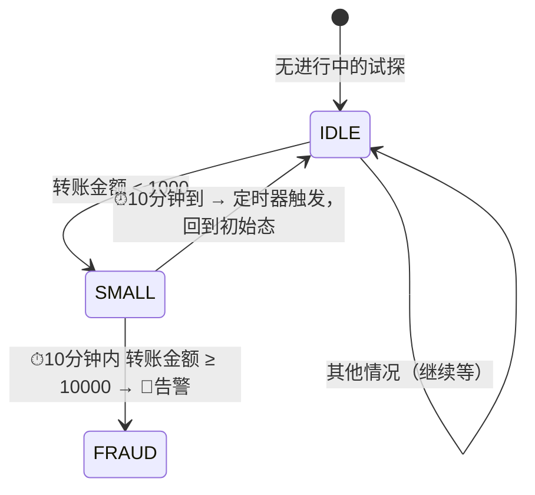

# 第12章 · 实战二：实时反欺诈引擎（状态机 + CEP）

  

> **项目目标**：实现银行级实时风控的经典规则——**"小额试探 + 大额转账"欺诈模式识别**。两种实现路线都做：`KeyedProcessFunction` 状态机（完全掌控）与 Flink CEP（声明式模式匹配），并对比取舍。

---

## 12.1 需求与规则建模

**欺诈手法**：盗号者先转 ¥50 试探密码是否正确，确认后 10 分钟内发起 ¥50000 大额转账。

**规则形式化**：



| 规则要素 | 技术映射 |
|:---|:---|
| 每个账户独立判断 | `keyBy(accountId)`（第3章） |
| 记住"发生过小额试探" | `ValueState`（第6章） |
| "10 分钟内" | **事件时间定时器 Timer**（本章新知识） |
| 告警输出（不阻断主流程） | 侧输出流（第4章预告，本章实战） |

## 12.2 新知识：定时器（Timer）

`KeyedProcessFunction` 不仅能管状态，还能**注册定时器**——在指定事件时间/处理时间"设闹钟"：

```java
@Override
public void processElement(TransferEvent e, Context ctx, Collector<String> out) {
    // 注册：当前事件时间 + 10 分钟后触发 onTimer
    ctx.timerService().registerEventTimeTimer(e.getTs() + 10 * 60 * 1000L);

    // 取消
    // ctx.timerService().deleteEventTimeTimer(timerTs);
}

@Override
public void onTimer(long timerTs, OnTimerContext ctx, Collector<String> out) {
    // "闹钟"响铃时执行：Watermark 已推进到 timerTs
    // 定时器状态也随 Checkpoint 恢复，不会因故障丢失
}
```

> **Timer 特性**（面试点）：① 基于 Watermark 推进触发（事件时间）；② 定时器**注册进状态、随 Checkpoint 快照**，故障恢复不丢；③ 同一 key 同一时刻只触发一次；④ `onTimer` 里可以读写该 key 的所有状态。

## 12.3 实现一：状态机（KeyedProcessFunction）

完整代码：`code/src/main/java/com/flinkcourse/ch12/FraudDetectStateJob.java`

```java
package com.flinkcourse.ch12;

import com.flinkcourse.common.model.TransferEvent;
import org.apache.flink.api.common.state.ValueState;
import org.apache.flink.api.common.state.ValueStateDescriptor;
import org.apache.flink.api.common.typeinfo.Types;
import org.apache.flink.configuration.Configuration;
import org.apache.flink.streaming.api.datastream.DataStream;
import org.apache.flink.streaming.api.environment.StreamExecutionEnvironment;
import org.apache.flink.streaming.api.functions.KeyedProcessFunction;
import org.apache.flink.util.Collector;

/**
 * 场景：转账反欺诈 —— 小额(<1000)试探后 10 分钟内大额(>=10000)转账 → 告警
 * 运行：nc -lk 9999，输入格式：账户ID,金额,事件秒（如 1001,50,1）
 * 要点：ValueState + 事件时间定时器 + 侧输出流
 */
public class FraudDetectStateJob {

    // 侧输出标签：正常流之外的告警通道
    static final OutputTag<String> ALERT_TAG = new OutputTag<String>("alerts"){};

    public static void main(String[] args) throws Exception {
        StreamExecutionEnvironment env = StreamExecutionEnvironment.getExecutionEnvironment();
        env.setParallelism(1);

        DataStream<String> alerts = env
                .socketTextStream("localhost", 9999)
                .map(line -> {
                    String[] p = line.split(",");
                    return new TransferEvent(Long.parseLong(p[0]),
                            Double.parseDouble(p[1]), Long.parseLong(p[2]) * 1000L);
                })
                .assignTimestampsAndWatermarks(WatermarkStrategy
                        .<TransferEvent>forMonotonousTimestamps()   // 演示数据按时间递增输入
                        .withTimestampAssigner((e, ts) -> e.getTs()))
                .keyBy(TransferEvent::getAccountId)
                .process(new FraudStateMachine())
                .getSideOutput(ALERT_TAG);      // 告警走侧输出

        alerts.print("🚨");
        env.execute("Fraud Detect (State Machine)");
    }

    /** 状态机核心：两个状态就够 —— 是否处于"小额试探中" + 试探时间 */
    public static class FraudStateMachine
            extends KeyedProcessFunction<Long, TransferEvent, TransferEvent> {

        private transient ValueState<Long> smallTsState;   // 非空 = 已发生小额试探，值为试探时间

        @Override
        public void open(Configuration parameters) {
            smallTsState = getRuntimeContext().getState(
                    new ValueStateDescriptor<>("smallTs", Long.class));
        }

        @Override
        public void processElement(TransferEvent e, Context ctx,
                                   Collector<TransferEvent> out) throws Exception {
            Long smallTs = smallTsState.value();

            if (e.getAmount() < 1000) {
                // ---- 小额：进入试探态，设 10 分钟闹钟 ----
                smallTsState.update(e.getTs());
                ctx.timerService().registerEventTimeTimer(e.getTs() + 10 * 60 * 1000L);

            } else if (e.getAmount() >= 10000) {
                if (smallTs != null && e.getTs() - smallTs <= 10 * 60 * 1000L) {
                    // ---- 大额 + 10 分钟内试探过 → 欺诈！走侧输出告警 ----
                    ctx.output(ALERT_TAG, String.format(
                            "🚨 账户%d 疑似盗号：t=%d 试探 ¥%.0f → t=%d 转走 ¥%.0f",
                            ctx.getCurrentKey(), smallTs, smallTs == 0 ? 0 : 50,
                            e.getTs(), e.getAmount()));
                    smallTsState.clear();        // 告警后复位，避免重复告警
                }
                // 大额但无试探 → 正常交易，透传主流
                out.collect(e);
            } else {
                out.collect(e);                  // 中等金额，透传
            }
        }

        @Override
        public void onTimer(long timerTs, OnTimerContext ctx, Collector<TransferEvent> out) {
            // 10 分钟到，试探窗口过期 → 状态机回到 IDLE
            smallTsState.clear();
        }
    }
}
```

### 实验脚本

```text
输入（nc）：            行为：                      输出：
1001,50,1              小额试探，进入试探态          -
1002,300,2             另一账户独立判断               -
1001,50000,10          10s后(<10min)大额 → 告警!     🚨 账户1001...
1002,50000,400         大额但试探已超10分钟(定时器已清理) 正常透传
```

注意 `1002` 的案例：定时器到点 `onTimer` 清空了状态，所以 400 秒的大额转账**不告警**——状态机的"时间窗"由 Timer 实现，而不是把事件都缓存着等。

## 12.4 实现二：CEP（Complex Event Processing）

Flink CEP 用**模式 DSL** 声明"按什么序列匹配"，框架负责匹配细节。

完整代码：`code/src/main/java/com/flinkcourse/ch12/FraudDetectCepJob.java`

```java
import org.apache.flink.cep.CEP;
import org.apache.flink.cep.PatternStream;
import org.apache.flink.cep.functions.PatternProcessFunction;
import org.apache.flink.cep.pattern.Pattern;
import org.apache.flink.cep.pattern.conditions.SimpleCondition;
import org.apache.flink.cep.nfa.aftermatch.AfterMatchSkipStrategy;

/** 与状态机版等价的 CEP 实现（数据源同上） */
public class FraudDetectCepJob {

    public static void main(String[] args) throws Exception {
        StreamExecutionEnvironment env = StreamExecutionEnvironment.getExecutionEnvironment();
        env.setParallelism(1);

        // ① 定义模式：小额 → (10分钟内) → 大额
        Pattern<TransferEvent, ?> pattern = Pattern
                .<TransferEvent>begin("small")                          // 第一事件
                .where(new SimpleCondition<TransferEvent>() {
                    @Override public boolean filter(TransferEvent e) {
                        return e.getAmount() < 1000;                     // 小额试探
                    }
                })
                .next("large")                                          // 紧邻的下一事件
                .where(new SimpleCondition<TransferEvent>() {
                    @Override public boolean filter(TransferEvent e) {
                        return e.getAmount() >= 10000;                  // 大额转账
                    }
                })
                .within(Time.minutes(10));                              // 整个模式 10 分钟内完成

        // ② 模式作用在 keyed 流上
        PatternStream<TransferEvent> patternStream = CEP.pattern(
                transfers.keyBy(TransferEvent::getAccountId), pattern);

        // ③ 匹配到的事件序列交给处理函数
        patternStream.process(new PatternProcessFunction<TransferEvent, String>() {
            @Override
            public void processMatch(Map<String, List<TransferEvent>> match,
                                     Context ctx, Collector<String> out) {
                TransferEvent small = match.get("small").get(0);
                TransferEvent large = match.get("large").get(0);
                out.collect(String.format("🚨 账户%d：%s 后 %d 秒转走 ¥%.0f",
                        large.getAccountId(), "小额试探",
                        (large.getTs() - small.getTs()) / 1000, large.getAmount()));
            }
        }).print();
    }
}
```

**Pattern DSL 速查**：

| API | 语义 |
|:---|:---|
| `begin("name")` | 模式起点 |
| `.next()` / `.followedBy()` / `.followedByAny()` | 严格紧邻 / 宽松跟随（跳过不匹配） / 非确定性跟随 |
| `.where()` / `.or()` / `.until()` | 条件 |
| `.times(3)` / `.oneOrMore()` | 量词：出现次数 |
| `.within(Time)` | 模式整体时限 |
| `AfterMatchSkipStrategy` | 匹配后跳过策略（防止一个事件被多个模式复用） |

## 12.5 状态机 vs CEP：怎么选？

| 维度 | KeyedProcessFunction 状态机 | Flink CEP |
|:---|:---|:---|
| 表达力 | 任意逻辑（状态转移手写） | 序列模式（begin-next-within） |
| 开发成本 | 高，但**完全可控** | 低，声明式 |
| 复杂度风险 | 逻辑复杂后难维护 | 循环模式/嵌套模式表达受限 |
| 状态与内存 | 只存必要状态（如一个时间戳） | 潜在匹配序列缓存，**乱序下可能膨胀** |
| 调试 | 断点直击 | 黑盒程度高，需要 dump NFA |
| 适用 | 规则引擎底座、超时/复杂状态转移 | 中等复杂度的事件序列规则 |

> **生产经验**：规则简单稳定 → CEP 快速交付；规则多且常变（风控平台）→ 自研状态机 + 规则下发（第10章 BroadcastState 传规则），把"规则"变成数据而不是代码。

## 12.6 风控工程化清单（简历话术素材）

1. **告警落地**：侧输出流 → `risk_alert` 表（`JdbcSink`，复用第10章模板）；
2. **规则热更新**：规则流（Kafka/CDC）`broadcast` 到检测算子，改规则不发版（第10章 BroadcastState）；
3. **多规则并行**：不同规则独立 Pattern，`union` 各告警流；
4. **降级与容错**：风控链路故障时业务**旁路放行**（不能因风控挂了让所有交易失败）——这是风控与数佣链路最大的架构差异；
5. **指标化**：告警量、误报率、规则命中率进 Prometheus（第14章）。

## 12.7 常见坑

| 坑 | 现象 | 解法 |
|:---|:---|:---|
| CEP 状态膨胀 OOM | 乱序/大流量下 TM 崩 | `within()` 必设时限；关注 NFA 状态缓存；必要时换状态机 |
| 状态机忘了 clear 状态 | 每账户状态泄漏 | 定时器兜底清理；或状态 TTL（第6章） |
| Timer 不触发 | onTimer 永远不来 | 事件时间 Timer 依赖 Watermark 推进（第4章），数据停了闹钟也不响 |
| 侧输出拿不到数据 | getSideOutput 空 | `getSideOutput()` 必须调在**process 之后的流**上，且 OutputTag 泛型/名称一致 |
| CEP 模式复用同一事件 | 一条小额匹配出多条告警 | 配 `AfterMatchSkipStrategy.skipToNext()` |
| 告警重复发送 | 同一欺诈行为多次告警 | 告警去重：状态记录"已告警"标记 + TTL |

## ✍️ 动手练习

1. 扩展规则：**同一账户 1 分钟内连续 3 次失败支付尝试**也告警（状态机版加计数 State；CEP 版用 `.times(3)`），两种实现都做；
2. 把告警写入 MySQL `risk_alert` 表（提示：侧输出流 `.addSink(JdbcSink.sink(...))`）；
3. **思考题**：规则改成"10 分钟内**任意位置**出现小额→大额（中间可能夹杂其他交易）"，CEP 的 `next` 该换成什么？状态机需要改吗？

---

## 本章小结

- 反欺诈 = `keyBy`（账户隔离）+ **ValueState**（试探记忆）+ **Timer**（时限）+ **侧输出流**（告警通道）；
- Timer 随 Checkpoint 恢复、由 Watermark 驱动，是"时间维度状态清理"的标准工具；
- CEP 用 Pattern DSL 声明序列（begin/next/within/量词），简单规则开发快，复杂规则选状态机；
- 生产风控三要素：**规则热更新（broadcast）、告警落地、旁路容灾**。

---

<div class="chapter-nav">

[⬅️ 第11章 · 电商实时数仓](ch11.md)
[➡️ 第13章 · IoT 设备监控](ch13.md)

</div>
