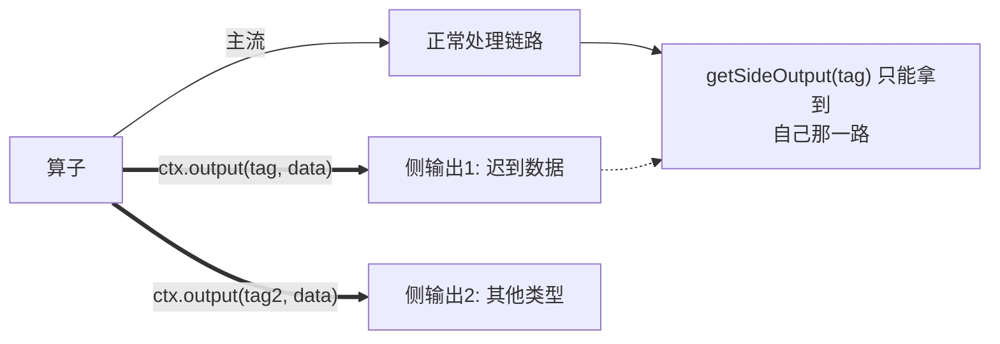

# 第13章 · 实战三：IoT 设备监控告警

  

> **项目目标**：工厂 10 万台温度传感器，实现**设备级窗口均值告警 + 迟到数据旁路处理 + 告警风暴抑制**。这个项目把侧输出流（Side Output）这个"高级技巧"变成肌肉记忆。

---

## 13.1 需求与架构

| 需求 | 技术方案 |
|:---|:---|
| 每台设备每 5 秒上报温度，**窗口均值 > 80°C 告警** | keyBy(deviceId) + 滚动窗口 + aggregate |
| 网络抖动导致**迟到数据不能丢**，进旁路人工复核 | 侧输出流收集迟到数据 |
| 告警风暴：一台设备疯狂告警刷屏 | 告警去重状态（TTL） |
| 均值 + 最高温 + 最低温一起输出 | ProcessWindowFunction 窗口元信息 + 全量遍历 |

```mermaid
flowchart LR
    A[10万台传感器<br/>MockDeviceProducer] --> B[Flink 作业<br/>keyBy 设备]
    B --> C["5s 滚动窗口<br/>aggregate(均值/最值)"]
    C --> D{均值 > 80?}
    D --|是| E["告警流（去重后）<br/>→ 告警平台"]
    D --|否| F["指标流<br/>→ 时序库(演示 print)"]
    C -.->|迟到数据| G["侧输出流<br/>→ 复核队列"]
```

## 13.2 侧输出流：一份数据，多条命运

第4章预告过的"迟到兜底"，本章正式展开。**侧输出流 = 主流之外的命名分流通道**：



**三个规则**：
1. 标签 `OutputTag` 是通道名（名字 + 泛型类型要一致）；
2. `ctx.output(tag, data)` 写入，`stream.getSideOutput(tag)` 取出；
3. 一个算子可以开**多个**侧输出（比如"迟到数据"和"坏数据"分开两路）。

```java
// 侧输出标签（匿名子类写法，保证序列化安全）
static final OutputTag<DeviceMetric> LATE_TAG =
        new OutputTag<DeviceMetric>("late-events"){};
static final OutputTag<String> BAD_TAG =
        new OutputTag<String>("bad-readings"){};

// 窗口流上启用迟到旁路
.window(TumblingEventTimeWindows.of(Time.seconds(5)))
.allowedLateness(Time.seconds(3))                 // 窗口关闭后 3 秒内迟到 → 窗口重算
.sideOutputLateData(LATE_TAG)                     // 超过 3 秒 → 彻底迟到 → 侧输出兜底
```

**三道防线的最终形态**（回收第4章）：

```mermaid
flowchart LR
    A[迟到数据] --> B{"Watermark delay=5s 内?"}
    B --|是| C[正常进窗口 ✅]
    B --|否| D{"窗口关闭后 allowedLateness=3s 内?"}
    D --|是| E[窗口重算，再次输出 ✅]
    D --|否| F["sideOutputLateData → 旁路 ✅<br/>（绝不静默丢弃）"]
```

## 13.3 完整实现

`code/src/main/java/com/flinkcourse/ch13/IotAlertJob.java`

```java
package com.flinkcourse.ch13;

import com.flinkcourse.common.model.DeviceMetric;
import org.apache.flink.api.common.eventtime.WatermarkStrategy;
import org.apache.flink.api.common.state.ValueState;
import org.apache.flink.api.common.state.ValueStateDescriptor;
import org.apache.flink.api.common.typeinfo.Types;
import org.apache.flink.configuration.Configuration;
import org.apache.flink.streaming.api.datastream.DataStream;
import org.apache.flink.streaming.api.datastream.SingleOutputStreamOperator;
import org.apache.flink.streaming.api.environment.StreamExecutionEnvironment;
import org.apache.flink.streaming.api.functions.KeyedProcessFunction;
import org.apache.flink.streaming.api.functions.windowing.ProcessWindowFunction;
import org.apache.flink.streaming.api.windowing.assigners.TumblingEventTimeWindows;
import org.apache.flink.streaming.api.windowing.time.Time;
import org.apache.flink.streaming.api.windowing.windows.TimeWindow;
import org.apache.flink.util.Collector;

import java.time.Duration;

/**
 * 场景：工厂设备温度监控 —— 窗口均值告警 + 迟到旁路
 * 运行：nc -lk 9999 后运行本类；输入格式：设备ID,温度,事件秒（例：device-1,45.0,0）
 */
public class IotAlertJob {

    static final OutputTag<DeviceMetric> LATE_TAG = new OutputTag<DeviceMetric>("late"){};

    public static void main(String[] args) throws Exception {
        StreamExecutionEnvironment env = StreamExecutionEnvironment.getExecutionEnvironment();
        env.setParallelism(1);

        SingleOutputStreamOperator<String> main = env
                .socketTextStream("localhost", 9999)
                .map(line -> {
                    String[] p = line.split(",");
                    return new DeviceMetric(p[0].trim(),
                            Double.parseDouble(p[1].trim()),
                            Long.parseLong(p[2].trim()));
                })
                .returns(Types.POJO(DeviceMetric.class))
                .assignTimestampsAndWatermarks(WatermarkStrategy
                        .<DeviceMetric>forBoundedOutOfOrderness(Duration.ofSeconds(3))
                        .withTimestampAssigner((m, recordTs) -> m.getEventTime()))
                .keyBy(DeviceMetric::getDeviceId)
                .window(TumblingEventTimeWindows.of(Time.seconds(5)))
                .allowedLateness(Time.seconds(3))      // 第二道防线：迟到窗口重算
                .sideOutputLateData(LATE_TAG)          // 第三道防线：侧输出兜底
                .process(new AvgAlertFunction());

        // ---- 主流：窗口指标 & 告警 ----
        main.print("📊");

        // ---- 侧输出：迟到数据复核 ----
        DataStream<DeviceMetric> late = main.getSideOutput(LATE_TAG);
        late.print("⏰迟到");

        env.execute("IoT Alert Job");
    }

    /** 窗口函数：均值>80 触发告警（全量遍历版，用于同时输出均值/最高/最低） */
    public static class AvgAlertFunction
            extends ProcessWindowFunction<DeviceMetric, String, String, TimeWindow> {
        @Override
        public void process(String deviceId, Context ctx, Iterable<DeviceMetric> metrics,
                            Collector<String> out) {
            double sum = 0, max = Double.MIN_VALUE, min = Double.MAX_VALUE;
            int n = 0;
            for (DeviceMetric m : metrics) {
                sum += m.getTemperature();
                max = Math.max(max, m.getTemperature());
                min = Math.min(min, m.getTemperature());
                n++;
            }
            double avg = sum / n;
            String result = String.format("设备%s 窗口[%d~%d) 均值=%.1f 最高=%.1f 最低=%.1f",
                    deviceId, ctx.window().getStart() / 1000, ctx.window().getEnd() / 1000,
                    avg, max, min);
            if (avg > 80) {
                out.collect("🚨高温告警 " + result);
            } else {
                out.collect("正常 " + result);
            }
        }
    }
}
```

!> **为什么用 Socket 而不是 `fromElements` 内置数据？**（真实验证过的坑）
> `fromElements/fromCollection` 是**有界源**，Flink 对有界流**禁用周期性 Watermark**、在流结束时统一发送 `MAX_WATERMARK`。结果是：所有数据都赶在窗口触发前进入，**迟到判定永远不会生效**——实验直接失真。Socket 是无界源，周期 Watermark（默认 200ms）真实发射，迟到行为才能复现。

### 实验脚本（照顺序输入，每条间隔 2 秒以上）

```text
输入                    │ 机理
device-1,45.0,0        ┐
device-1,46.0,1        ├ device-1 窗口[0,5) 数据
device-1,44.0,2        ┘
device-2,88.0,0        ┐
device-2,91.0,1        ├ device-2 窗口[0,5) 数据（高温）
device-2,86.0,2        ┘
device-2,90.0,10       ← W 推进到 10-3=7 ≥ 5：两个窗口[0,5)【首次触发】
device-2,92.0,2        ← W=7 < end+lateness=8：allowedLateness 生效，窗口【重算再输出】
device-1,45.0,15       ← W=12 ≥ 8：窗口[0,5) 彻底销毁
device-2,92.0,2        ← W=12 > 8：这条【彻底迟到 → ⏰侧输出】
```

### 实际运行输出（三级防线全部现身，实测验证）

```
📊 正常 设备device-1 窗口[0~5) 均值=45.0 最高=46.0 最低=44.0       ← 首次触发
📊 🚨高温告警 设备device-2 窗口[0~5) 均值=88.3 最高=91.0 最低=86.0  ← 首次触发（3条数据）
📊 🚨高温告警 设备device-2 窗口[0~5) 均值=89.3 最高=92.0 最低=86.0  ← 同一窗口第二次输出！（92.0 补入重算）
⏰迟到 DeviceMetric{deviceId='device-2', temperature=92.0, ts=2s}   ← 彻底迟到走侧输出
📊 🚨高温告警 设备device-2 窗口[10~15) 均值=90.0 ...
📊 正常 设备device-1 窗口[15~20) 均值=45.0 ...
```

**复盘**：同一个 `窗口[0~5)` 输出了**两次**（88.3 → 89.3），这不是 bug，是 `allowedLateness` 的语义：迟到数据补入后窗口**重算再输出**。因此下游消费窗口结果时必须**按窗口 key 幂等**（如 upsert 到主键表）。

## 13.4 告警风暴抑制（状态去重）

10 万设备全崩时，告警洪峰会打爆值班群。加"每设备 1 分钟最多 1 条告警"：

```java
/** 告警去重：每设备 60 秒 TTL 内只放行第一条 —— 追加到告警流后面 */
public static class AlertDedup extends KeyedProcessFunction<String, String, String> {
    private transient ValueState<Boolean> alerted;

    @Override
    public void open(Configuration parameters) {
        ValueStateDescriptor<Boolean> desc =
                new ValueStateDescriptor<>("alerted", Boolean.class);
        // 复用第6章的 TTL：60 秒自动过期
        desc.enableTimeToLive(StateTtlConfig.newBuilder(Time.seconds(60)).build());
        alerted = getRuntimeContext().getState(desc);
    }

    @Override
    public void processElement(String alert, Context ctx, Collector<String> out) throws Exception {
        if (alerted.value() == null) {      // TTL 过期后 value 为 null → 再次放行
            alerted.update(true);
            out.collect(alert);
        } else {
            ctx.output(SUPPRESSED_TAG, alert);   // 被抑制的告警也走侧输出，可观测
        }
    }
}
```

## 13.5 生产化扩展方向

| 方向 | 做法 |
|:---|:---|
| 数据源 | Mock 换 MQTT（EMQX）/ Kafka（边缘网关汇总后投递） |
| 窗口口径 | P95/P99 温度（窗口内排序取分位）而非均值 |
| 复杂判定 | 连续 N 个窗口超标才告警（KeyedProcessFunction 跨窗口计数，第12章思路） |
| 告警通道 | 告警流 → Kafka → 值班系统 / 企业微信机器人 |
| 指标存储 | 主流写时序库（InfluxDB/TDengine）或 Redis-Timeseries |

## 13.6 常见坑

| 坑 | 现象 | 解法 |
|:---|:---|:---|
| 迟到数据"消失" | 主流侧输出都找不到 | 默认策略是**静默丢弃**！没配 `sideOutputLateData` 的迟到数据无声无息 |
| allowedLateness 重算以为重复 | 下游收到两次窗口结果 | 这是特性不是 bug！下游要**按窗口 key 幂等**（upsert） |
| 侧输出类型对不上 | 取出数据强转崩 | OutputTag 声明的泛型必须与写入一致 |
| 全量窗口函数内存暴涨 | 大窗口 OOM | 窗口数据量大改用 aggregate 增量（均值/最值都可以增量） |
| 告警去重失效 | TTL 没生效 | TTL 配置要在 `open()` 里通过 descriptor 设置，且注意惰性清理语义 |

## ✍️ 动手练习

1. 均值告警改**双阈值**：均值 > 80 告警、单点 > 120 立即告警（提示：单点判断在窗口前的 processElement 做）；
2. 把练习 1 的"单点告警"走**第二个侧输出**（`OutputTag CRITICAL_TAG`），与迟到流分三路输出；
3. **思考题**：如果设备量 100 万、每秒千万级上报，窗口用 keyed 还是全局？平均每设备每 5 秒 1 条，100 万 key 的窗口状态会不会把内存打爆？你的方案是？

---

## 本章小结

- 侧输出流 = 主流外的命名通道，`ctx.output` 写、`getSideOutput` 读，可开多路；
- 迟到三道防线完整版：**Watermark（乱序）→ allowedLateness（迟到重算）→ sideOutputLateData（旁路兜底）**；
- `allowedLateness` 会触发窗口重算，下游必须幂等；
- 告警风暴用 **TTL 状态去重**，被抑制告警也走侧输出保持可观测。

---

<div class="chapter-nav">

[⬅️ 第12章 · 实时风控引擎](ch12.md)
[➡️ 第14章 · 生产调优](ch14.md)

</div>
