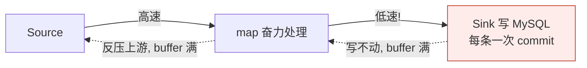
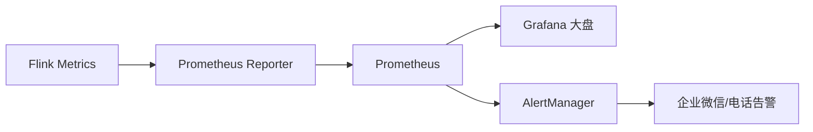

# 第14章 · 生产调优与运维

 

> **本章目标**：掌握生产环境的"望闻问切"——看懂背压与 Web UI 指标、TM 内存模型、RocksDB 与 Checkpoint 调优、故障排查 SOP。学完你能独立值守一个 Flink 作业集群。

---

## 14.1 运维第一现场：Web UI 指标解读

打开 <http://localhost:8081> 点进任意 Running 作业，每个算子框上的三个数字：

```
┌─────────────────────────────┐
│  Sink: Unnamed              │
│  12 / 8 / 0    ← 输出/入/出队列水位  │
│  backpressured (busy: 60%)  │
└─────────────────────────────┘
```

| 指标 | 含义 | 健康值 |
|:---|:---|:---|
| **Backpressured** | 被下游拖累的时间占比 | < 50%（红区要处理） |
| **Busy** | 本算子计算满载占比 | 高说明是热点 |
| **Idle** | 无数据空转占比 | 多输入流不均衡时出现 |

**三个指标互斥**（同一时刻只算一种状态），背压定位口诀：**沿着数据流方向，找到第一个 Backpressured 低但下游高的算子——瓶颈就在两者之间**。

## 14.2 背压（Backpressure）全解析



### 排查四步法

| 步骤 | 动作 | 指向 |
|:---|:---|:---|
| ① Web UI 定位瓶颈算子 | backpressured 指标 | 哪个算子慢 |
| ② 火焰图（1.13+ 自带） | Job → Flame Graph | 慢在哪个方法 |
| ③ 外部依赖检查 | DB/Redis/Kafka 延迟 | 多数瓶颈在**外部 IO** |
| ④ 资源检查 | slot/内存/CPU | 是否资源不足 |

### 常见病因与处方

| 病因 | 处方 |
|:---|:---|
| Sink 单条写外部系统 | 攒批（第10章 JDBC batch） |
| 数据倾斜（个别 key 巨热） | 见 14.3 |
| 窗口/状态过大 | 缩窗、预聚合、RocksDB |
| 高频 GC（日志看 GC pause） | 调内存模型（14.4） |
| 算子逻辑本身慢 | 火焰图优化热点方法 |

## 14.3 数据倾斜专题

**症状**：个别子任务 busy 100%，其余空闲；或个别 Subtask 状态远大于兄弟。

**诊断**：Web UI → 算子 → SubTasks 视图看各 subtask 的 Records Received 分布。

**处方**（按优先级）：

```
① 两阶段聚合（打散 → 局部聚合 → 全局聚合）
   keyBy 时拼随机后缀：hot_key_0~N → 先局部 sum → 再按原 key 二次聚合
   适用：大 key 上的 count/sum 类聚合

② LocalGlobal 优化（SQL 自动）
   SQL: table.exec.mini-batch + local-global 开启后框架自动两阶段
   DataStream 用 ① 手工实现

③ 广播小表替代大 key join
④ 范围分桶替代离散 key（如按 uid 哈希桶聚合后再关联）
```

```java
// ① 两阶段聚合骨架
stream.keyBy(e -> e.getKey() + "_" + rnd.nextInt(10))   // 打散
      .reduce(...)                                        // 局部聚合
      .keyBy(e -> e.getKey())                             // 还原
      .reduce(...);                                       // 全局聚合
```

## 14.4 内存模型（TM 进程内存）

```mermaid
flowchart TB
    TM[TaskManager 进程总内存<br/>total-process-memory] --> F1[Framework Heap<br/>框架自身]
    TM --> F2[Task Heap<br/>用户代码+状态(HashMap后端)]
    TM --> OFF["堆外 Off-Heap"]
    F1 --> M1[框架堆外]
    F2 --> M2[Managed Memory<br/>RocksDB/排序/缓存<br/>框架管理,不受GC]
    F2 --> M3[Network<br/>网络缓冲区<br/>shuffle 数据传输]
    F2 --> M4[Task 堆外<br/>用户直接内存]
```

| 参数 | 默认 | 何时调 |
|:---|:---|:---|
| `taskmanager.memory.task.heap.size` | 按 total 比例 | OOM 时减并发或增 heap；GC 高频时排查而非盲目加 |
| `taskmanager.memory.managed.size` | 0.4×total | **RocksDB 状态大就加大**（RocksDB 用 managed memory） |
| `taskmanager.memory.network.min/max` | 0.1×total | 报 `network buffer 用尽` 时调大 |
| `taskmanager.memory.process.size` | 1728m | **容器化部署必配**，且 < 容器限额（防被 K8s OOMKill） |

!> **容器内存铁律**：`process-memory` = JVM 总内存（含堆外），**必须小于容器 limit** 留出余量，否则 K8s/Yarn 直接 kill -9，日志只有"容器被杀"没有任何 Java 堆栈。

## 14.5 Checkpoint 与状态调优

```yaml
# flink-conf.yaml 生产参考（结合第7章代码级配置）
state.backend: rocksdb
state.checkpoints.dir: hdfs:///flink/ckpt
state.backend.incremental: true            # RocksDB 增量 CP：大状态救星

execution.checkpointing.interval: 60s
execution.checkpointing.min-pause: 30s
execution.checkpointing.timeout: 10min
execution.checkpointing.externalized-checkpoint-retention: RETAIN_ON_CANCELLATION

# RocksDB 调优（大状态）
state.backend.rocksdb.memory.managed: true
state.backend.rocksdb.block.cache-size: 64mb
state.backend.rocksdb.writebuffer.count: 4
state.backend.rocksdb.compaction.level-target-file-size: 64mb
```

| 症状 | 调优 |
|:---|:---|
| CP 持续超时 | ① unaligned CP ② interval 拉大 ③ 增量 CP ④ 查是否大状态全量上传 |
| CP 期间吞吐骤降 | min-pause 拉大；异步快照已默认，看是不是 barrier 对齐卡顿 |
| 状态远超预期 | 窗口 TTL？去重结构膨胀？`state` 指标逐算子看 |
| 恢复极慢 | 大状态全量下载 → 增量 CP；考虑状态迁移而非重建 |

## 14.6 监控告警体系



**必配告警项**（SRE 视角）：

| 告警 | 指标 | 阈值参考 |
|:---|:---|:---|
| 作业挂了 | job status | != RUNNING 持续 1min |
| Checkpoint 失败 | CP success rate | 连续 2 次失败 |
| 消费积压 | Kafka lag（每分区） | > 10 万持续 5min |
| 背压 | backPressuredTimeMsPerSecond | > 60% 持续 10min |
| 状态暴涨 | state size 环比 | 日环比 > 50% |

## 14.7 故障排查 SOP（拿走即用）

```text
凌晨 3 点被叫醒，大屏不更新了：
1. Web UI 作业还在吗？
   ├─ 挂了 → 看最后异常栈（最常见：外部连接拒绝/OOM）
   │         → 修复外部依赖 → 从最近 CP/SP 恢复
   └─ 在跑 → 2
2. 数据流断了吗？看 Source 的 numRecordsIn 增长
   ├─ 不涨 → 上游 Kafka 没数据/producer 挂了 → 找上游
   └─ 涨   → 3
3. 窗口不触发？看 Watermark 指标
   ├─ Watermark 停滞 → 乱序配置/idle 分区（第4章 withIdleness）
   └─ 正常推进 → 4
4. Sink 写出失败？看 Sink 异常与 DB 状态
   └─ DB 满/锁/网络 → 找 DBA，同时作业内做失败重试
```

## 14.8 上线前 Checklist

- [ ] 所有算子设置显式 `.uid()`（Savepoint 兼容的命根）
- [ ] Checkpoint 配置完整（interval/timeout/minPause/retention + 远端存储）
- [ ] 状态后端选型确认（HashMap vs RocksDB），大状态开增量
- [ ] Sink 幂等或事务（第7章三段一致性）
- [ ] 重启策略设置（failure-rate，不用默认无限重启）
- [ ] Kafka 消费组独立命名，`auto.offset.reset` 明确
- [ ] 关键日志级别与采样（避免日志风暴）
- [ ] 监控四件套接入：作业状态/CP/Kafka lag/背压
- [ ] 压测：预期峰值 ×2 流量跑 1 小时
- [ ] 回滚预案：上一版本 jar + Savepoint 路径

## ✍️ 动手练习

1. 在第11章数仓作业上人为制造背压：把 `DwsGmvJob` 的 JdbcSink `batchSize` 改成 1、`batchIntervalMs` 改成 5000，观察 Web UI 背压指标传播；
2. 制造数据倾斜：改 Mock producer，让 80% 订单 city=深圳，观察 keyed 窗口各 subtask 分布，再用两阶段聚合修复；
3. **思考题**：RocksDB 状态后端下，`taskmanager.memory.managed.size` 调大为什么能提升状态读写性能？这份数据存的是 JVM 堆内还是堆外？

---

## 本章小结

- 三大健康指标：**Backpressured / Busy / Idle**，背压排查=定位瓶颈算子+火焰图+查外部 IO；
- 数据倾斜四处方：**两阶段聚合**为纲，SQL 自动 LocalGlobal；
- TM 内存：堆（Task Heap）+ 托管（RocksDB 用）+ 网络（shuffle 用）；容器部署 **process-size < 容器 limit**；
- 大状态三件套：**RocksDB + 增量 CP + min-pause**；
- 上线 Checklist 的每一条都来自真实事故。

---

<div class="chapter-nav">

[⬅️ 第13章 · IoT 设备监控](ch13.md)
[➡️ 第15章 · 源码与面试](ch15.md)

</div>
