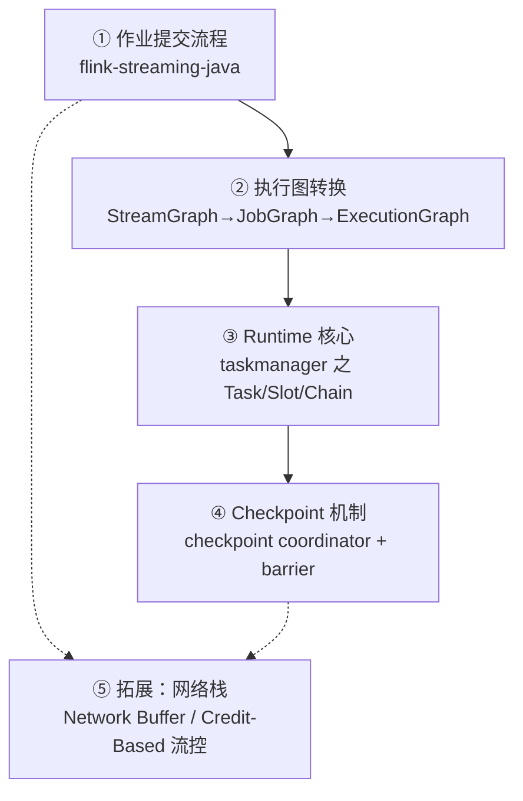

# 第15章 · 进阶：源码剖析路线与高频面试题

 

> **本章目标**：给出一条**可执行的源码阅读路线**（不是吓退你的那种），并整理 30 道 Flink 高频面试题的参考答案要点。面试前 3 天刷这章，效率最高。

---

## 15.1 源码阅读路线（四条主线）

**前置**：clone 源码 `git clone https://github.com/apache/flink`（分支 release-1.20），IDEA 导入，只读不跑（跑起来是另一个工程量级的事）。

### 主线①：一个作业从 main 到集群（1~2 周）

| 顺序 | 类 | 看什么 |
|:-:|:---|:---|
| 1 | `StreamExecutionEnvironment#execute` | 程序入口，LocalStreamEnvironment vs RemoteStreamEnvironment |
| 2 | `StreamGraphGenerator#generate` | 算子 → StreamGraph（节点/边怎么建） |
| 3 | `StreamingJobGraphGenerator#createJobGraph` | **算子链怎么合成**（isChainableInput，第3章的答案在这） |
| 4 | `ExecutionEnvironment#executeAsync` | JobGraph 提交给 JobManager（REST 或 Actor） |

### 主线②：执行图与调度（1 周）

| 类 | 看什么 |
|:---|:---|
| `JobGraph / JobVertex / IntermediateResult` | 作业逻辑结构 |
| `ExecutionGraphBuilder` | 并行化：JobVertex → ExecutionVertex |
| `DefaultScheduler` | 故障重启策略如何触发（第7章） |

### 主线③：Task 执行（1 周）

| 类 | 看什么 |
|:---|:---|
| `Task`（flink-runtime） | TM 收到部署指令后的生命周期 |
| `StreamTask#processInput` | 算子链的"线程体"：一个 while 循环拉数据跑算子 |
| `OperatorChain` | 链上算子如何 one-to-one 传递 |

### 主线④：Checkpoint（1~2 周，面试密度最高）

| 类 | 看什么 |
|:---|:---|
| `CheckpointCoordinator#triggerCheckpoint` | 定时触发，向 Source 触发 barrier |
| `AbstractStreamOperator#snapshotState` | 算子收到 barrier 后的状态快照 |
| `CheckpointBarrierHandler`（对齐/非对齐） | 第7章"对齐"的源码现场 |
| `SubtaskCheckpointCoordinatorImpl` | ACK 汇聚与完成广播 |

> **读源码心法**：带着问题读（"算子链的判断条件是什么？"），用 IDEA 的 Find Usages 顺藤摸瓜，**只读主干忽略分支**。通读 3 千万行是陷阱，带着 4 个问题读完 4 条主线是真功夫。

## 15.2 三十道高频面试题（按主题分组）

### 时间与窗口（7 题）

**Q1. 事件时间 vs 处理时间？**
事件时间取数据自带字段，可重放、结果确定；处理时间取机器时钟，延迟低但不可重放。生产默认事件时间（第4章场景题：跨天订单归属）。

**Q2. Watermark 是什么？怎么生成的？**
声明"≤W 的数据已到齐"的单调时间戳；`W = maxTs − delay`，由 WatermarkStrategy 在 Source/算子处周期性（默认 200ms）生成；多输入取 min（第4章）。

**Q3. Watermark 设置过小/过大分别什么后果？**
过小：迟到数据被丢（除非 allowedLateness/侧输出兜底）；过大：窗口触发延迟、状态存活时间变长。按数据延迟分布 P99 取值。

**Q4. 滚动/滑动/会话/累积窗口的适用？分别举业务例。**
GMV 分钟榜→滚动；近5分钟趋势→滑动；用户行为会话→会话；全天累计大屏→累积（第5/8章）。

**Q5. 窗口什么时候触发？迟到数据三级防线？**
事件时间窗口：`W ≥ 窗口end`。防线：Watermark→allowedLateness（窗口重算，注意下游幂等）→sideOutputLateData（旁路）（第4/13章）。

**Q6. countWindow 和时间窗口的区别？会互相影响吗？**
按条数触发，与时间无关；两者可叠加（窗口内再限条数）但语义独立。

**Q7. 多分区 Kafka Source，一个分区没数据，窗口不触发怎么办？**
Watermark 多输入取 min 被空闲分区卡住；`withIdleness()` 标记空闲源（第4章）。

### 状态（6 题）

**Q8. Keyed State 和 Operator State 区别？**
Key：按逻辑 key 隔离，keyBy 后可用；Operator：按并行子任务隔离，Source/Sink 用（第6章）。

**Q9. 五种 Keyed State？**
Value/List/Map/Reducing/Aggregating；前三种覆盖 95% 场景。

**Q10. 状态后端怎么选？**
小状态（<1GB）HashMap；大状态/长窗口 RocksDB（TB 级、增量 CP、代价是序列化+磁盘延迟）（第6章）。

**Q11. 状态 TTL 的坑？**
惰性清理（读时判断+后台过期），`ReturnExpiredIfNotCleanedUp` 可能读到"过期未清理"数据；RocksDB 物理空间靠 compaction 释放。

**Q12. 算子链（chain）的条件？为什么要 chain？**
同并行度、forward 连接、无重分区、未禁链；省线程切换与网络序列化。读 `StreamingJobGraphGenerator#isChainableInput`（主线①源码）。

**Q13. Broadcast State 为什么主流侧只读？**
广播状态要求各并行实例**完全一致**，若主流可写则各实例各写各的，恢复后不一致（第10章）。

### 容错（5 题）

**Q14. Checkpoint 原理（必考）**
Chandy-Lamport 分布式快照：barrier 随数据流注入，算子收到即快照状态，多输入等齐（对齐）；全 ACK 后 CP 完成、持久化远端（第7章）。

**Q15. 对齐 vs 非对齐 CP？**
对齐等 barrier 期间缓存后到通道数据，背压时 barrier 走不动→超时；非对齐 barrier 直通，in-flight 数据并入快照，代价是快照变大。

**Q16. Checkpoint vs Savepoint？**
自动/手动、轻量/标准格式、恢复用/发版迁移用；**算子 uid 是恢复兼容的钥匙**。

**Q17. 端到端 Exactly-Once 条件？**
① Source 可重放（offset 进 CP）② 内部快照 ③ Sink 事务（Kafka 2PC 或幂等 upsert）。JDBC 常走 AT_LEAST_ONCE+幂等（第7章）。

**Q18. CP 都成功但结果有重复，可能哪里错？**
Sink 非事务/非幂等；或消费端没 read_committed；或两作业消费同一结果 topic 各自处理。

### 数据倾斜与背压（4 题）

**Q19. 背压怎么定位？**
三指标互斥（backpressured/busy/idle），从 Source 向下游找第一个"下游高压上游低压"的算子即瓶颈；火焰图定位方法（第14章）。

**Q20. 数据倾斜处方？**
两阶段聚合（打散-局部-全局）、SQL LocalGlobal、广播小表、分桶（第14章）。

**Q21. UV 去重方案演进？**
窗口 HashSet（课程版）→ Bitmap/RoaringBitmap → HLL（近似，常数内存）→ 位移窗口聚合（第5/11章）。

**Q22. 大 key 的状态调优？**
RocksDB + 增量 CP + TTL；评估 key 拆分；监控单 subtask 状态量。

### SQL 与生态（4 题）

**Q23. 动态表和 Changelog？**
流=持续变化的表；查询产出 +I/-U/+U/-D 变更流；聚合输出更新流→Sink 必须支持 upsert（第8章）。

**Q24. CUMULATE 窗口干嘛的？**
从窗口起点开始按步长输出累积值，大屏"当天截至当前 GMV"标配（第8章）。

**Q25. Flink CDC 原理？和 Canal 区别？**
Debezium 引擎读 binlog，Flink CDC 增量快照算法实现**无锁全量+增量一体化**，单作业 Exactly-Once，省掉 Canal+Kafka 中间链路（第9章）。

**Q26. 维表 Join 两种方案？**
Lookup（现查+缓存，大表）vs Broadcast（内存广播，小表，主流只读）（第10章）。

### 综合与场景（4 题）

**Q27. 设计：实时大屏 GMV，允许多少延迟、怎么保证不多算？**
分层（ODS→DWD→DWS）、事件时间 CUMULATE、幂等 upsert 落 OLAP、Watermark 按延迟 P99。完整答案=第11章架构图。

**Q28. 设计：双11 零点瞬间流量 100 倍，作业怎么扛？**
扩容预案（Kafka 分区数≥最大并行度）、两阶段聚合抗倾斜、Sink 攒批+限流、降级旁路（只算 GMV 砍维度）、提前压测 ×2。

**Q29. Flink 为什么快？**
逐条真流式（无微批）、本地状态（免网络 RTT）、chain 内线程内传数据、异步快照不阻塞计算（由 Q14 展开可拿源码分）。

**Q30. Flink 2.x 的主要变化？**
DataSet API 移除（流批一体彻底化）、Source/Sink V2 API 普及、Per-job 模式限制、WindowingStrategy 等清理。存量 1.x 作业迁移成本低，API 主干不变。

## 15.3 学习资源（精选不贪多）

| 资源 | 用途 |
|:---|:---|
| [Flink 官方文档 1.20](https://nightlies.apache.org/flink/flink-docs-release-1.20/) | 权威查询，概念性问题先查它 |
| 官方仓库 `flink-examples` | 各连接器标准用法 |
| Flink Forward / FFA 大会议题 | 大厂生产案例（公众号搜往届回顾） |
| 本课程源码 | 全部示例可运行、可改造、可写进简历 |

> **三周后回看**：如果你能不看答案讲清 Q14/Q17/Q20/Q27，且第11-13章的项目是自己敲出来的——恭喜，你已经超过大多数"看过教程"的候选人。去投简历吧。

---

## 本章小结

- 源码四主线：**提交流程 → 执行图 → Task 执行 → Checkpoint**，带着问题读、只读主干；
- 面试四大必考簇：**Watermark/窗口、状态、Checkpoint 一致性、背压/倾斜**；
- 场景题（大屏/大促）按"分层架构 + 一致性保障 + 峰值预案"三段式作答。

---

[⬅️ 第14章 · 生产调优](ch14.md)
[🏠 返回课程主页](/)

