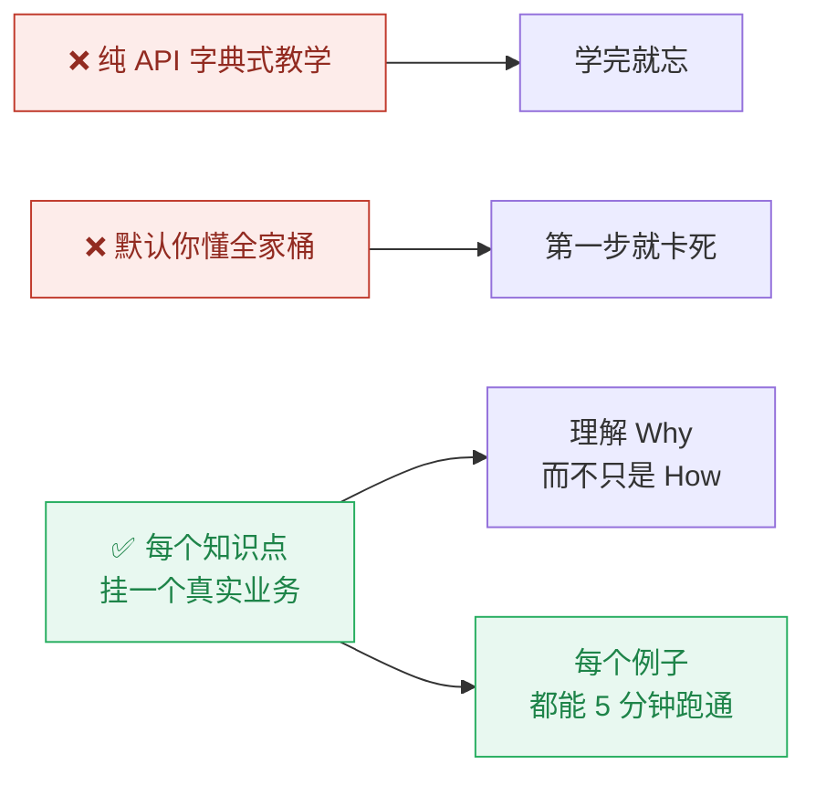
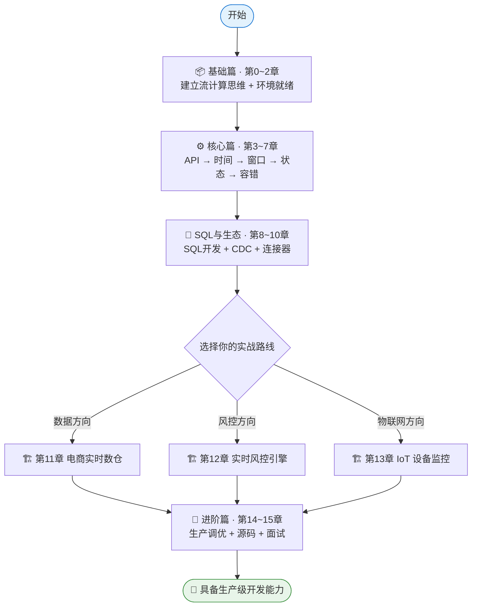

# 欢迎来到《Flink 实战：从 0 到 1》

> 一套**零基础起步、真实业务场景驱动、直通生产实践**的 Apache Flink 系统课程。

   

---

## 🎯 这门课能带你到哪里？

学完本课程，你将能够：

1. **独立完成**流处理核心开发：时间窗口、状态管理、乱序处理、 Exactly-Once 语义；
2. **独立搭建**三大简历级项目：**电商实时数仓（双11 大屏）**、**实时反欺诈引擎**、**IoT 设备监控告警**；
3. **独立应对**生产问题：背压排查、Checkpoint 失败、状态膨胀、大作业调优；
4. **从容通过**大厂 Flink 相关面试（附 30 道高频面试题详解）。

## 💡 课程设计哲学



**每个章节都遵循统一结构：**

| 环节 | 内容 |
|:---|:---|
| 🎯 学习目标 | 学完你能做到什么 |
| 🧠 核心概念 | 图解原理，拒绝八股文 |
| 💻 代码实战 | 业务场景 + 可运行完整代码 |
| ✅ 运行验证 | 预期输出 + 如何自测 |
| ⚠️ 常见坑 | 踩过的人才懂的细节 |
| ✍️ 动手练习 | 举一反三的作业 |

## 🗺️ 学习路线图



> ⏱️ **建议节奏**：基础篇 1 天，核心篇 5~7 天，SQL 与生态 3 天，实战篇 5~7 天，进阶篇 3 天。全程约 **3 周**。

## 🏙️ 覆盖的主流业务场景

| 场景 | 章节 | 行业映射 |
|:---|:---|:---|
| 实时 GMV 大屏（滚动窗口聚合） | 第5、11章 | 电商大促 |
| 实时 UV 统计（滑动窗口 + 去重） | 第5、11章 | 流量分析 |
| 用户行为会话切分（会话窗口） | 第5章 | 埋点分析 |
| 乱序/迟到数据处理（Watermark） | 第4、13章 | 网络抖动、埋点延迟 |
| 转账反欺诈（状态机 + CEP） | 第12章 | 金融风控 |
| IoT 温度告警（侧输出流） | 第13章 | 工业物联网 |
| 数据库实时入仓（CDC） | 第9章 | 数仓同步 |
| 实时数仓分层（ODS→DWD→DWS→ADS） | 第11章 | 数据平台 |

## 🖥️ 环境要求

| 项 | 最低要求 | 推荐配置 |
|:---|:---|:---|
| 操作系统 | macOS / Linux / Windows(WSL2) | macOS / Linux |
| JDK | 8 | **11**（课程默认） |
| Maven | 3.6+ | 3.8+ |
| Docker | 20+ | 24+（Docker Desktop / OrbStack） |
| IDE | 任意 | IntelliJ IDEA（Community 即可） |
| 内存 | 8 GB | 16 GB（需同时跑 Flink+Kafka+MySQL） |

> 所有外部依赖（Flink 集群、Kafka、MySQL、Redis）均通过 `docker compose up -d` 一键拉起，**不要求你预先安装任何大数据组件**。

## ❓ 常见问题

**Q：我没有大数据基础，真的能学吗？**

可以。课程从"什么是有界流/无界流"讲起，需要的只是 Java 基础（集合、Lambda、泛型）和一点点 SQL。第0章附有前置知识自查清单。

**Q：为什么要学 Flink 而不是 Spark Streaming？**

实时计算领域（实时数仓、风控、监控）Flink 是事实标准：事件时间语义、状态管理、Exactly-Once 都是原生设计。国内字节、阿里、腾讯、快手等大厂的实时链路均以 Flink 为核心。

**Q：课程用 Flink 1.20，Flink 2.x 都发布了还适用吗？**

适用。Flink 2.x 的 API 变化集中在移除 DataSet API 等遗留接口，本课程教授的 DataStream/Table API/SQL 均向前兼容，第15章附 2.x 迁移指南。

**Q：代码怎么跑？**

```bash
# 1. 拉起环境（一次性）
docker compose up -d

# 2. 编译课程代码
cd code && mvn compile

# 3. 运行任意章节示例，例如第2章词频统计
nc -lk 9999   # 终端1：模拟数据源
mvn exec:exec -Dexec.mainClass="com.flinkcourse.ch02.StreamWordCount"  # 终端2
```

---

## 📚 现在就开始

<div class="chapter-nav">

[➡️ 第0章 · 课程导读](ch00.md)

</div>
